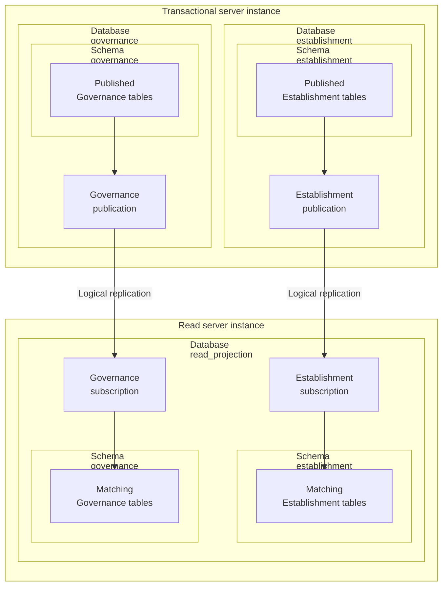

# EPR logical replication configuration specification

This specification defines the native PostgreSQL logical replication configuration supporting [BAU to EPR data platform design](epr-data-platform-topology-and-replication.md). The topology document remains authoritative for infrastructure, repository ownership, security zones and data flow.

Each environment must have two server instances. The transactional instance hosts the `establishment` and `governance` databases. The read instance hosts `read_projection`. Each source database must have a separate publication and replication credential; both subscriptions must be created in `read_projection`.

## Instance, database and schema boundaries

The diagram uses compact labels; the tables below give the full instance and replication-object names.



| Diagram boundary | Server instance name |
| --- | --- |
| Transactional server instance | `<subscription-identifier><env-identifier>-pg-epr-transactional` |
| Read server instance | `<subscription-identifier><env-identifier>-pg-epr-read` |

Arrows show data movement. The subscriber must initiate both connections from the read instance to the transactional private endpoint. Each connection must select its own source database using `dbname`. Publications are database-scoped; destination matching uses schema-qualified table names. [Subscription behaviour](https://www.postgresql.org/docs/18/logical-replication-subscription.html)

| Source database | Source publication | Destination database | Destination schema | Destination subscription | Source slot |
| --- | --- | --- | --- | --- | --- |
| `establishment` | `establishment_publication` | `read_projection` | `establishment` | `establishment_subscription` | `epr_establishment_slot` |
| `governance` | `governance_publication` | `read_projection` | `governance` | `governance_subscription` | `epr_governance_slot` |

## Replication scope

Each publication must explicitly list **all tables required from its domain for the Read Projection**. The complete table lists must be maintained in the domain-owned replication configuration and kept consistent with destination migrations and replication-role grants.

**The SQL table lists in this document are abbreviated. They must be completed with every table in the agreed domain replication scope before deployment. A publication containing only the single table shown below does not satisfy the full configuration.** Additional tables must be listed in the same `FOR TABLE` clause, separated by commas.

The implementation must publish permitted Establishment data and exclude Governance PII from both initial copy and ongoing replication, as required by the topology document. Unrelated schemas, including migration evidence, must not enter the publications. Use explicit table lists so newly created unrelated tables are not included automatically.

For tables published without a column list, all ordinary columns are included, including ordinary columns added later. PostgreSQL 18 excludes generated columns by default. Source column additions therefore require compatible destination migrations and scope review before deployment. If a table contains fields outside the permitted read scope, define an approved column selection or sanitised publication source instead of publishing the table unchanged. [Publication scope](https://www.postgresql.org/docs/18/sql-createpublication.html)

Replication credentials must be separate from application reader credentials. Publication filters are not an isolation boundary against a compromised replication client. Where that isolation is required, the publication source must provide it independently. [Replication security](https://www.postgresql.org/docs/18/logical-replication-security.html)

## Prerequisites and deployment order

1. DevOps must provision both instances, their databases, private endpoint connectivity and server parameters through the environment's infrastructure process. The topology document's outstanding network-design dependencies still apply.
2. Domain migrations must create the source schemas and tables. Published tables must have suitable replica identity for UPDATE and DELETE; primary keys are the standard configuration.
3. Read Projection migrations must create compatible, empty target tables for every published table, preserving source schema and table names.
4. Domain configuration must create replication credentials, grants and publications in each source database.
5. Read Projection configuration must create both subscriptions and verify table readiness and reconciliation before dependent read models are made available.

The following are initial configuration baselines for **two subscriptions on PostgreSQL 18**, with up to two concurrent initial-copy workers per subscription and no parallel transaction apply. They are project starting values, not vendor-prescribed production sizing. Retain existing higher values where other workloads require them.

| Instance | Parameter | Baseline values | Purpose |
| --- | --- | --- | --- |
| Transactional publisher | `wal_level` | `logical` | Enable logical decoding for both source databases. |
| Transactional publisher | `max_replication_slots` | `10` | Two persistent subscription slots, synchronization slots and spare capacity. |
| Transactional publisher | `max_wal_senders` | `10` | Capacity for subscription streams and initial-copy connections. Add capacity for physical replication consumers. |
| Transactional publisher | `max_worker_processes` | `16` | Baseline worker capacity consistent with Azure logical-replication guidance; account for extensions and other workers. |
| Read subscriber | `max_logical_replication_workers` | `8` | Two apply workers, up to four table-copy workers and two spare logical workers. |
| Read subscriber | `max_sync_workers_per_subscription` | `2` | Limit initial-copy concurrency to two tables per subscription. |
| Read subscriber | `max_parallel_apply_workers_per_subscription` | `0` | Keep parallel transaction apply outside the baseline worker budget. |
| Read subscriber | `max_worker_processes` | `16` | Accommodate logical workers, their launcher and other server workers. |
| Read subscriber | `max_active_replication_origins` | `10` | PostgreSQL 18 capacity for two subscriptions, table synchronization and reserve. |

These settings apply to the **server instance**, not individually to each database. The subscriber does not need `wal_level = logical` solely to receive changes; retain its existing setting unless another use requires logical decoding.

The baseline permits six concurrent logical workers during initial copy: two subscription apply workers plus four synchronization workers. Increasing the number of published tables extends the copy workload but does not require one worker or permanent slot per table. Increasing copy concurrency, adding subscriptions or enabling parallel apply requires recalculating worker, sender, slot and origin budgets.

Physical replicas and Azure HA can require additional source sender/slot capacity. The source `max_wal_senders` budget must cover the logical-slot capacity plus connected physical replicas. Retained WAL limits, outage tolerance, storage alerts and throughput must be sized separately against the actual daily load; these baseline counts do not establish that capacity.

Apply the baseline through Azure server parameters and the environment's infrastructure configuration, with a restart for startup settings. Load and recovery testing must confirm the values against the full table lists and other workloads. Settings, role provisioning and failover configuration must match the deployed Azure PostgreSQL major version; `max_active_replication_origins` is a PostgreSQL 18 setting. [PostgreSQL configuration](https://www.postgresql.org/docs/18/logical-replication-config.html), [Azure configuration](https://learn.microsoft.com/en-us/azure/postgresql/configure-maintain/concepts-logical)

The read instance must resolve and reach the transactional private endpoint on port `5432`. Both replication connections must use validated TLS.

## 1. Configure source roles and publications

Run source configuration as an authorised provisioning/table-owner role with the privileges required to create replication accounts and publications. Source data must already exist; replication configuration must not rebuild or reseed source tables.

### Establishment database

Connect to the transactional instance, database `establishment`:

```sql
CREATE ROLE epr_establishment_repl LOGIN REPLICATION
    PASSWORD 'REPLACE_WITH_ESTABLISHMENT_REPLICATION_SECRET';
GRANT CONNECT ON DATABASE establishment TO epr_establishment_repl;
GRANT USAGE ON SCHEMA establishment TO epr_establishment_repl;

-- Extend this grant to every table in the Establishment publication list.
GRANT SELECT ON TABLE establishment.establishment TO epr_establishment_repl;

CREATE PUBLICATION establishment_publication
    FOR TABLE establishment.establishment
        -- REQUIRED: append all remaining approved Establishment tables here.
    WITH (publish = 'insert, update, delete');
```

### Governance database

Connect to the same transactional instance, database `governance`:

```sql
CREATE ROLE epr_governance_repl LOGIN REPLICATION
    PASSWORD 'REPLACE_WITH_GOVERNANCE_REPLICATION_SECRET';
GRANT CONNECT ON DATABASE governance TO epr_governance_repl;
GRANT USAGE ON SCHEMA governance TO epr_governance_repl;

-- Extend this grant to every table in the Governance publication list.
GRANT SELECT ON TABLE governance.governance_appointment TO epr_governance_repl;

CREATE PUBLICATION governance_publication
    FOR TABLE governance.governance_appointment
        -- REQUIRED: append all remaining approved Governance tables here.
    WITH (publish = 'insert, update, delete');
```

Each replication role must have SELECT access to every table it copies, but must not receive source write permissions. Role provisioning must use Azure's supported administration model. Adding a table to a publication does not grant its replication role SELECT automatically. [Replication security](https://www.postgresql.org/docs/18/logical-replication-security.html)

Roles and slot names are shared across a server instance, so Establishment and Governance must use distinct names. Publications are created in their own databases.

## 2. Configure destination schemas, tables and reader permissions

Connect to the read instance, database `read_projection`. Read Projection migrations must create both schemas and every target table before subscriptions start:

```sql
CREATE SCHEMA establishment;
CREATE SCHEMA governance;
```

Target table definitions must be maintained as migrations against the [Establishment model](../models/schema/establishment/establishment-schema.sql) and [Governance model](../models/schema/governance/governance-schema.sql). Native logical replication does not create target tables or propagate DDL. The target must contain all published columns with compatible types and usable keys; it must not contain mandatory extra columns that cannot be populated.

Target constraints and triggers must support independent initial table copies. Cross-domain constraints must not assume atomic delivery from separate subscriptions. Source constraints continue validating source writes. Application teams own the additional read indexes and read models.

Configure the application reader separately from subscription ownership and migration privileges:

```sql
CREATE ROLE epr_read_app LOGIN PASSWORD 'REPLACE_WITH_READER_SECRET';
GRANT CONNECT ON DATABASE read_projection TO epr_read_app;
GRANT USAGE ON SCHEMA establishment, governance TO epr_read_app;
GRANT SELECT ON ALL TABLES IN SCHEMA establishment, governance TO epr_read_app;

-- Apply for the actual target table-creation role if it differs from postgres.
ALTER DEFAULT PRIVILEGES FOR ROLE postgres IN SCHEMA establishment
    GRANT SELECT ON TABLES TO epr_read_app;
ALTER DEFAULT PRIVILEGES FOR ROLE postgres IN SCHEMA governance
    GRANT SELECT ON TABLES TO epr_read_app;
```

Only tables permitted for the Read Projection may exist in its domain schemas. The application reader must not own these objects or inherit source-write, target-write or subscription-administration permissions. Read-only application access is enforced by privileges; a logical subscriber is not inherently read-only.

## 3. Configure both subscriptions

Run both statements on the read instance, database `read_projection`, using the approved subscription-owner role. Execute **each statement separately**, with Auto-commit enabled, outside `BEGIN`/`COMMIT`.

Replace endpoint, certificate and secret placeholders through the environment's configuration and secret mechanisms. `CA_CERT_PATH` must be accessible to the subscriber server process. Certificate trust must use a mechanism supported by the deployed Azure service. Real connection secrets must not be committed to source control, exposed to application readers or included in deployment logs.

```sql
CREATE SUBSCRIPTION establishment_subscription
    CONNECTION 'host=TRANSACTIONAL_FQDN port=5432 dbname=establishment user=epr_establishment_repl password=REPLACE_WITH_ESTABLISHMENT_REPLICATION_SECRET sslmode=verify-full sslrootcert=CA_CERT_PATH'
    PUBLICATION establishment_publication
    WITH (
        copy_data = true,
        slot_name = 'epr_establishment_slot'
    );
```

```sql
CREATE SUBSCRIPTION governance_subscription
    CONNECTION 'host=TRANSACTIONAL_FQDN port=5432 dbname=governance user=epr_governance_repl password=REPLACE_WITH_GOVERNANCE_REPLICATION_SECRET sslmode=verify-full sslrootcert=CA_CERT_PATH'
    PUBLICATION governance_publication
    WITH (
        copy_data = true,
        slot_name = 'epr_governance_slot'
    );
```

Each subscription must connect to the source database named in `dbname`. It creates a logical slot there, copies existing published rows and then applies subsequent committed changes. Initial copy must start against empty target tables. A successful CREATE SUBSCRIPTION is not sufficient evidence that initial synchronization has completed. [CREATE SUBSCRIPTION](https://www.postgresql.org/docs/18/sql-createsubscription.html)

## 4. Acceptance checks and monitoring

On `read_projection`:

```sql
SELECT s.subname, r.srrelid::regclass AS target_table, r.srsubstate
FROM pg_subscription_rel r
JOIN pg_subscription s ON s.oid = r.srsubid
ORDER BY s.subname, target_table;

SELECT subname, pid, received_lsn, latest_end_lsn, last_msg_receipt_time
FROM pg_stat_subscription;
```

Acceptance requires:

- Both subscriptions exist in `read_projection` and use the correct source database, publication and distinct slot.
- Every table in each agreed publication list appears in the subscription relation inventory and reaches state `r` (ready).
- Every target table's row count and representative column values reconcile with its source under a controlled comparison snapshot.
- Committed INSERT, UPDATE and DELETE operations on dedicated test records appear on the subscriber.
- Application reader credentials can SELECT the permitted data and cannot write or obtain replication credentials.

On each source database, inspect the publication and compare its full table/column membership with the version-controlled scope:

```sql
SELECT pubname, schemaname, tablename, attnames
FROM pg_publication_tables
ORDER BY pubname, schemaname, tablename;
```

On the transactional instance, inspect both slots:

```sql
SELECT slot_name, database, plugin, active, restart_lsn, confirmed_flush_lsn
FROM pg_replication_slots
WHERE slot_name IN ('epr_establishment_slot', 'epr_governance_slot');
```

Both slots must use `pgoutput` and identify their intended source databases. Each stream must be monitored independently for stopped workers, apply errors, stale progress, retained WAL and invalid slots. Unused subscriptions and slots must be retired; a disconnected subscriber can retain source WAL and exhaust storage.

## Changing the replication scope

The full table lists are deployment configuration, even though they are not enumerated in this document. For each approved table addition:

1. Create compatible empty target tables and required types/indexes through Read Projection migrations.
2. Grant the domain replication role SELECT on the new source tables and add them to that database's publication with `ALTER PUBLICATION ... ADD TABLE ...`.
3. Refresh the affected subscription in `read_projection`, outside a transaction block:

```sql
ALTER SUBSCRIPTION establishment_subscription
    REFRESH PUBLICATION WITH (copy_data = true);
```

```sql
ALTER SUBSCRIPTION governance_subscription
    REFRESH PUBLICATION WITH (copy_data = true);
```

Refresh must follow target migration and publication updates. It copies newly subscribed tables; it does not create target structures or backfill newly published columns on rows already copied. Column changes require destination-first migrations and an explicit backfill plan where necessary. Removing a table from a publication does not remove the corresponding target table or copied data. [ALTER PUBLICATION](https://www.postgresql.org/docs/18/sql-alterpublication.html), [replication restrictions](https://www.postgresql.org/docs/18/logical-replication-restrictions.html)

## Daily loads and recovery

BAU remains the write authority and ADF loads the transactional models. Published table identities and keys must remain stable. These publications exclude TRUNCATE: truncate-and-reload can leave stale target rows, and schema rebuilds/table swaps require a separate replication-aware design. DDL, sequence state and application read models are not replicated automatically.

The two subscriptions are eventually consistent. A completed ADF run does not establish that both have applied a load. Domain completion markers, catch-up checks and reconciliation must gate dependent read-model refreshes or publication cutovers. The implementation must define empty-target resynchronization and test logical-slot behaviour under the deployed Azure version's HA/failover configuration.

Domain teams own source publications and migrations. The Read Projection team owns target migrations, subscriptions and application reader grants. DevOps owns server configuration and networking, following the responsibilities in the topology document.
