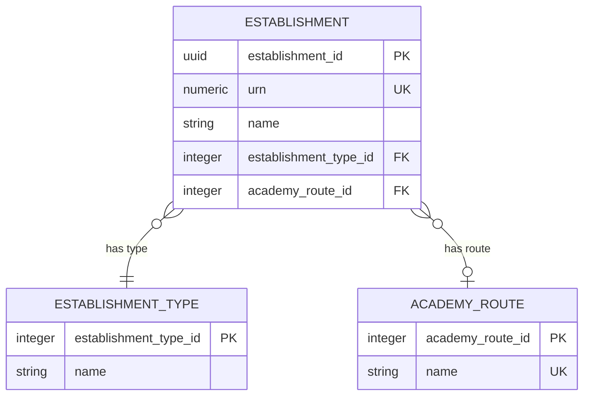
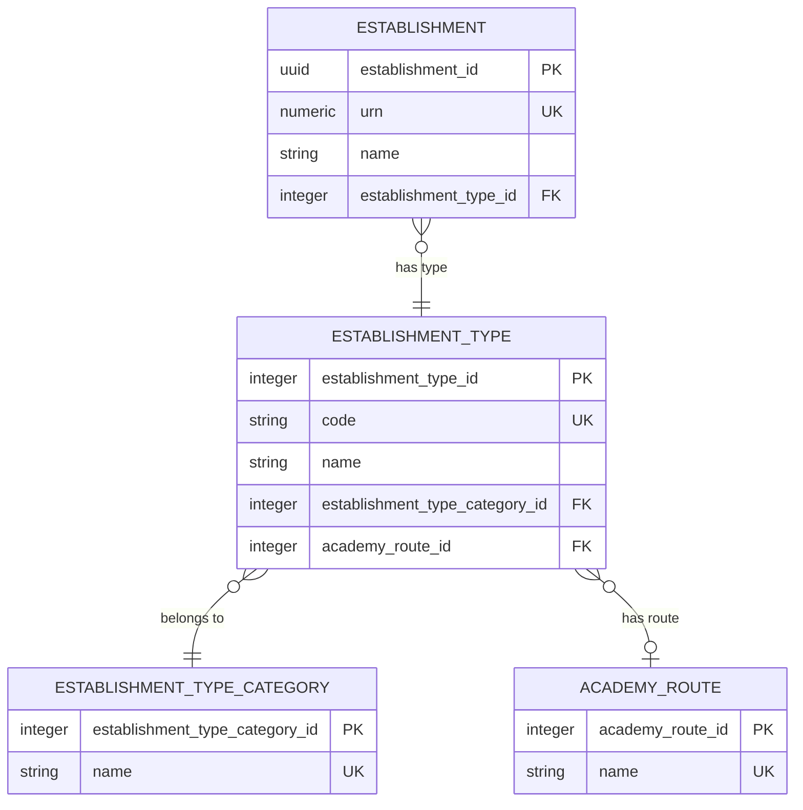

# Academy establishment types: logical model as-is and to-be

This covers establishment type only, for the change agreed in [academy establishment types and academy route: options](academy-establishment-types-and-route-options.md) (Option 3). Other columns on `establishment` are left out. The full model is in [identity-and-classification.md](../../../../education-provider-registry-docs/models/logical/establishment/identity-and-classification.md).

## 1. As-is

Academy rows in `establishment_type` today:

| `establishment_type_id` | `name` |
| --- | --- |
| 4 | Mainstream academy |
| 5 | Academy special school |
| 6 | Academy alternative provision |
| 7 | Academy 16 to 19 |
| 8 | Academy secure 16 to 19 |

Rows in `academy_route`:

| `name` | Canonical identifier |
| --- | --- |
| Converter | `est:ConverterRoute` |
| Sponsor led | `est:SponsorLedRoute` |

- Route sits on the establishment, following the conceptual model's `esto:hasAcademyRoute`. It's required for four of the five academy types and empty for Academy secure 16 to 19.
- Type and route are stored separately, so they can contradict each other unless a rule stops it.
- There's no BAU type code.
- `academy_route` and `establishment.academy_route_id` aren't yet in [identity-and-classification.md](../../../../education-provider-registry-docs/models/logical/establishment/identity-and-classification.md) or the schema. The BAU transform throws route away, so converter and sponsor-led academies can't be told apart once loaded.

## 2. To-be

### Rules

- `establishment.establishment_type_id` always points at a detailed type, the one the administrative team records.
- Category and route are reached through the type. They're never stored on `establishment`, so they can't contradict the type.
- Route moves from `establishment` to `establishment_type`. `establishment.academy_route_id` goes.
- `establishment_type.code` is the published DfE establishment type code. It's required and unique.
- Every type belongs to exactly one category. A non-academy type has a category of its own, with the same name.
- `academy_route_id` is required for the eight converter and sponsor-led types, and empty for every other type, including Academy secure 16 to 19.

### Academy categories

Each category stands for a conceptual establishment type.

| `name` | Canonical identifier |
| --- | --- |
| Mainstream academy | `est:MainstreamAcademy` |
| Academy special school | `est:AcademySpecial` |
| Academy alternative provision | `est:AcademyAlternativeProvision` |
| Academy 16 to 19 | `est:Academy1619` |
| Academy secure 16 to 19 | `est:AcademySecure16To19` |

### Academy routes

| `name` | Canonical identifier |
| --- | --- |
| Converter | `est:ConverterRoute` |
| Sponsor led | `est:SponsorLedRoute` |

### Academy types

| `code` | `name` | Category | Route |
| --- | --- | --- | --- |
| 34 | Academy converter | Mainstream academy | Converter |
| 28 | Academy sponsor led | Mainstream academy | Sponsor led |
| 44 | Academy special converter | Academy special school | Converter |
| 33 | Academy special sponsor led | Academy special school | Sponsor led |
| 42 | Academy alternative provision converter | Academy alternative provision | Converter |
| 43 | Academy alternative provision sponsor led | Academy alternative provision | Sponsor led |
| 45 | Academy 16-19 converter | Academy 16 to 19 | Converter |
| 46 | Academy 16 to 19 sponsor led | Academy 16 to 19 | Sponsor led |
| 57 | Academy secure 16 to 19 | Academy secure 16 to 19 | None |
