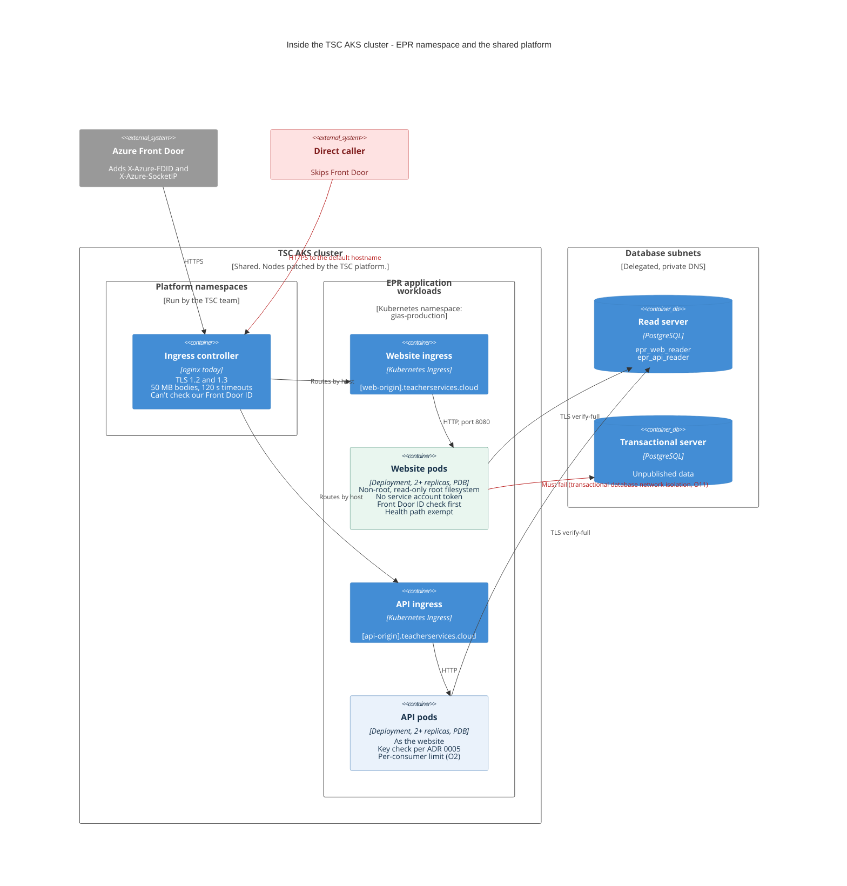

# Inside the AKS cluster

This view supplements the [deployment overview](deployment-diagram.md). See its [environment information](deployment-diagram.md#environment-information) for namespace selection.

What runs in our namespace, what the platform runs for us, and where the boundaries are. The red arrow is a route that must not exist.

A direct caller can reach the ingress controller, because the default `teacherservices.cloud` hostnames are public. The ingress passes the request on. Our pods then refuse it with a 403, because it has no Front Door ID (Front Door origin validation). This is risk IR-01. See [Shared ingress risks](deployment-diagram.md#shared-ingress-risks).

