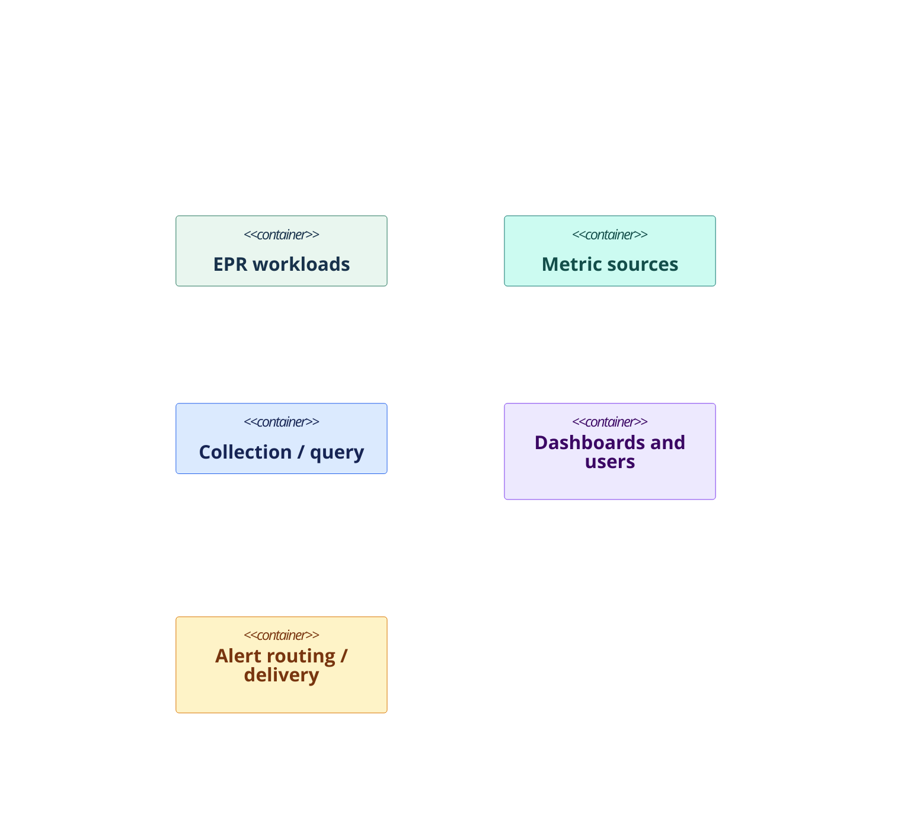

# Education Provider Registry: application metrics and alerting

This is the **target EPR configuration**, not confirmation of deployed integrations.  Metrics monitoring and alerting are separate from Security Information and Event Management (SIEM).

## Deployment diagram
### Key

```mermaid
%%{init: {"wrap": true, "c4": {"width": 260}}}%%
C4Deployment
    title EPR - application metrics and alerting (target)
    Person(engineer, "EPR / platform engineer", "Uses shared dashboards and responds to alerts")
    System_Ext(teams, "Microsoft Teams", "EPR service alert receiver")

    Boundary(sub, "EPR environment subscription", "S189; production names shown") {
        Deployment_Node(vnet, "S189 environment VNet", "Azure virtual network") {
            Deployment_Node(aks, "Teacher Services Cloud AKS cluster", "Shared platform") {

                Deployment_Node(platform, "Shared monitoring", "Kubernetes namespace: monitoring") {
                    Container(grafana, "Grafana", "Shared dashboards", "Thanos data source<br/>EPR workload and API views")
                    
                    Container(alertmanager, "Alertmanager", "Shared notification routing", "Groups firing/resolved alerts<br/>Routes to EPR Teams receiver")

                    Container(thanos, "Thanos", "Query and retained metrics", "Sidecar plus shared query/storage services")

                    Container(prom, "Prometheus", "Metrics and shared alert rules", "Scrapes annotated workloads<br/>Evaluates existing deployment rules")
                }
                Deployment_Node(apps, "EPR workloads", "Kubernetes namespace: gias-production") {
                    Container(web, "Website", "ASP.NET Core", "Target: /metrics exporter<br/>Request and runtime measurements")
                    Container(api, "Public API", "ASP.NET Core", "Target: /metrics exporter<br/>API request measurements")
                }

                Deployment_Node(sources, "Platform metric sources", "Existing shared collectors") {
                    Container(kstate, "kube-state-metrics", "Kubernetes state", "Pod/deployment state via Kubernetes API")
                    Container(kubelet, "Kubelet / cAdvisor", "Container usage", "CPU and memory for EPR containers")
                    Container(nodeexp, "Node exporter", "Host metrics", "AKS node resource usage")
                    Container(ingress, "Ingress controller", "Ingress metrics", "Configured shared controller endpoint")
                }
            }
        }
    }

    Rel(engineer, grafana, "Views EPR<br/>dashboards", "Platform access")
    Rel(grafana, thanos, "Queries metrics", "Thanos exposed Prometheus<br> API / HTTP")
    Rel(thanos, prom, "Queries through<br/>Thanos sidecar", "Thanos Store API")
    Rel(prom, web, "Scrapes /metrics<br/>(target)", "HTTP; internal")
    Rel(prom, api, "Scrapes /metrics<br/>(target)", "HTTP; internal")
    Rel(prom, kstate, "Scrapes state", "HTTP")
    Rel(prom, kubelet, "Scrapes resource usage<br/>via API proxy", "HTTPS")
    Rel(prom, nodeexp, "Scrapes host metrics", "HTTP")
    Rel(prom, ingress, "Scrapes ingress metrics", "Configured endpoint")
    Rel(prom, alertmanager, "Firing / resolved<br/>deployment alerts", "HTTP :9093")
    Rel(alertmanager, teams, "Grouped notifications", "Teams webhook")

    %% Keep external access and notification labels above the subscription boundary.
    UpdateRelStyle(engineer, grafana, $offsetX="-30", $offsetY="-160")
    UpdateRelStyle(alertmanager, teams, $offsetX="-50", $offsetY="-210")

    %% Place query and alert labels in the gaps between monitoring components.
    UpdateRelStyle(grafana, thanos, $offsetX="10", $offsetY="-30")
    UpdateRelStyle(thanos, prom, $offsetX="-45", $offsetY="40")
    UpdateRelStyle(prom, alertmanager, $offsetX="-100", $offsetY="10")

    %% Separate the website and API scrape labels.
    UpdateRelStyle(prom, web, $offsetX="50", $offsetY="-20")
    UpdateRelStyle(prom, api, $offsetX="-70", $offsetY="20")

    %% Stagger collector labels into the spaces between source containers.
    UpdateRelStyle(prom, kstate, $offsetX="-180", $offsetY="90")
    UpdateRelStyle(prom, kubelet, $offsetX="-240", $offsetY="180")
    UpdateRelStyle(prom, nodeexp, $offsetX="10", $offsetY="180")
    UpdateRelStyle(prom, ingress, $offsetX="-120", $offsetY="270")

    UpdateElementStyle(web, $bgColor="#e9f6ef", $fontColor="#18324b", $borderColor="#26775e")
    UpdateElementStyle(api, $bgColor="#e9f6ef", $fontColor="#18324b", $borderColor="#26775e")
    UpdateElementStyle(kstate, $bgColor="#ccfbf1", $fontColor="#134e4a", $borderColor="#0f766e")
    UpdateElementStyle(kubelet, $bgColor="#ccfbf1", $fontColor="#134e4a", $borderColor="#0f766e")
    UpdateElementStyle(nodeexp, $bgColor="#ccfbf1", $fontColor="#134e4a", $borderColor="#0f766e")
    UpdateElementStyle(ingress, $bgColor="#ccfbf1", $fontColor="#134e4a", $borderColor="#0f766e")
    UpdateElementStyle(prom, $bgColor="#dbeafe", $fontColor="#172554", $borderColor="#2563eb")
    UpdateElementStyle(thanos, $bgColor="#dbeafe", $fontColor="#172554", $borderColor="#2563eb")
    UpdateElementStyle(grafana, $bgColor="#ede9fe", $fontColor="#3b0764", $borderColor="#7c3aed")
    UpdateElementStyle(engineer, $bgColor="#ede9fe", $fontColor="#3b0764", $borderColor="#7c3aed")
    UpdateElementStyle(alertmanager, $bgColor="#fef3c7", $fontColor="#78350f", $borderColor="#d97706")
    UpdateElementStyle(teams, $bgColor="#fef3c7", $fontColor="#78350f", $borderColor="#d97706")

    UpdateLayoutConfig($c4ShapeInRow="2", $c4BoundaryInRow="2")
```

## What each component does

| Component | EPR target configuration | Ownership |
| --- | --- | --- |
| Website and public API | Expose Prometheus-format metrics at `/metrics`; expose lightweight `/ping` and dependency-aware `/healthcheck`. Implement these in the .NET applications. | EPR |
| kube-state-metrics | Exposes Kubernetes resource state, including desired/running replicas, pod status and container restarts. Prometheus scrapes its endpoint. | Teacher Services Cloud |
| Kubelet / cAdvisor | Exposes container CPU, memory and other resource-usage metrics, including those for EPR containers. Prometheus collects them through the Kubernetes API proxy. | Teacher Services Cloud |
| Node exporter | Exposes AKS node metrics, including host CPU, memory, disk and network activity. Prometheus scrapes its endpoint. | Teacher Services Cloud |
| Shared ingress controller metrics | Exposes ingress traffic and controller metrics through the configured controller endpoint. Available measurements depend on the deployed controller configuration. | Teacher Services Cloud |
| Prometheus | Scrape the EPR application endpoints using shared module annotations; evaluate existing deployment-alert rules. | Teacher Services Cloud manages collection; EPR implements and maintains the application's `/metrics` endpoint |
| Thanos | Existing current/retained metrics query and storage layer. | Teacher Services Cloud |
| Grafana | Use shared namespace/pod dashboards filtered to EPR | Teacher Services Cloud hosts; EPR owns service panels |
| Alertmanager and Teams receiver | Register each EPR deployment under `alertable_apps` and route to an EPR service receiver | Teacher Services Cloud configuration; EPR response ownership |

## EPR configuration for Prometheus monitoring

EPR must configure each application whose request metrics are to be collected. Teacher Services Cloud supplies the shared collectors and monitoring services; the EPR team implements the application endpoint and enables its discovery.

| EPR responsibility | Where to configure it | Required configuration |
| --- | --- | --- |
| Expose application metrics | Website and public API .NET applications | Add a Prometheus-compatible exporter and serve its output at `/metrics`.  |
| Instrument requests | Application code and exporter configuration | Record the request counts, durations, failures and response sizes defined under [Application metrics](#application-metrics). Use stable operation/route labels, with consistent names, units and meanings. |
| Enable discovery | Each application's Terraform variables, environment values and shared application module call | Pass `enable_prometheus_monitoring = true`. |
| Select the correct Prometheus scrape port | The application's Terraform settings: `is_web`, `web_port` and `worker_port`. | Ensure `/metrics` is served on the annotated port.  |
| Keep metrics internal | Ingress and platform configuration | Retain the platform's metrics-path blocking configuration so Prometheus can scrape the workload internally while the public website/API does not expose `/metrics`. |

The existing kube-state-metrics, kubelet/cAdvisor and node-exporter collectors already supply infrastructure measurements such as pod state, CPU and memory. EPR does not implement those collectors or need an application exporter to obtain those infrastructure metrics.

Application metric configuration is complete when `/metrics` responds internally on the configured port, Prometheus reports the application target as healthy, and its measurements can be queried through the shared Grafana/Thanos service. Deployment-alert registration and Teams routing are separate configuration, described below; enabling application scraping does not enable those alerts automatically.

## EPR integration

### Shared platform configuration

| Area | EPR configuration to implement | Detail |
| --- | --- | --- |
| Production monitoring | Set `enable_monitoring = true` for the applicable EPR production HTTP workloads. | Keep this distinct from Prometheus application scraping and platform alert registration. |
| Prometheus discovery | Pass `enable_prometheus_monitoring = true` to each HTTP workload's shared application module. | The module adds `prometheus.io/scrape = true`, `prometheus.io/path = /metrics` and the configured workload port. Use the actual serving port; the data repository currently declares its application `is_web = false`, so identify the real API workload/port before wiring this in. |
| Application metrics endpoint | Implement a .NET Prometheus-compatible exporter at `/metrics`. | Keep the metrics path excluded from public ingress, following the platform's metrics-blocking pattern. |
| Deployment alerts | Add one `gias-production/<actual-deployment-name>` entry per EPR deployment to the platform's production `alertable_apps` map, using an agreed EPR receiver. | Deployment names and the EPR receiver identifier must come from the deployed configuration; placeholders are not ready-to-apply values. |
| Shared dashboards | Use the shared Grafana/Thanos services and create EPR-filtered request panels. | Retain the platform metrics store, access mechanism and metrics-retention configuration. |

### Application metrics

EPR's .NET applications expose the following request measurements:

| Measurement | EPR target |
| --- | --- |
| Request count | Counter by HTTP method and stable API operation/route. |
| Request duration | Histogram in seconds; use latency boundaries `0.1`, `0.5`, `1`, `5`, `10` where compatible with the selected exporter. |
| Unsuccessful requests | Counter distinguishing operation and bounded failure/status classification. |
| Response size | Histogram in bytes; use boundaries `100`, `1000`, `10000`, `100000`, `1000000` where compatible with the selected exporter. |

The website uses the same request/latency/failure/size approach for its HTTP routes. Document the .NET metric names, units and stable operation/route labels with the exporter. Raw URLs, personal data and unbounded error-message labels are not required for these measurements. Exporting these metrics supplies dashboards; it does not automatically add latency/error alert rules to the shared platform baseline.

### Shared alerts and response

Retain the existing platform rule expressions and defaults when registering EPR: container-restart increase, high CPU and high memory. In the inspected template, CPU uses threshold `0.8` in the CPU-rate expression, memory uses ratio `0.8`, and the restart expression is an increase greater than zero over 30 minutes with a one-minute `for` period. Its restart annotation mentions another crash-count value; the expression is authoritative for this design.

Use the existing Alertmanager service-receiver route: 30-second grouping wait, five-minute group interval, six-hour repeat interval and resolved notifications. Configure EPR's receiver identifier, secret reference, Teams destination and response owner through the shared platform process. 

