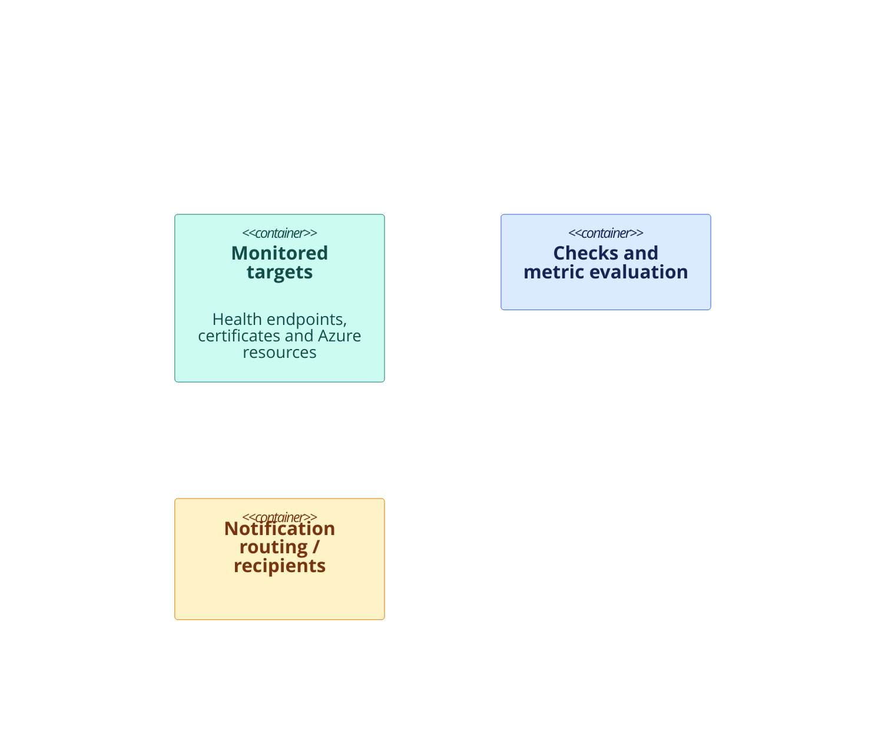
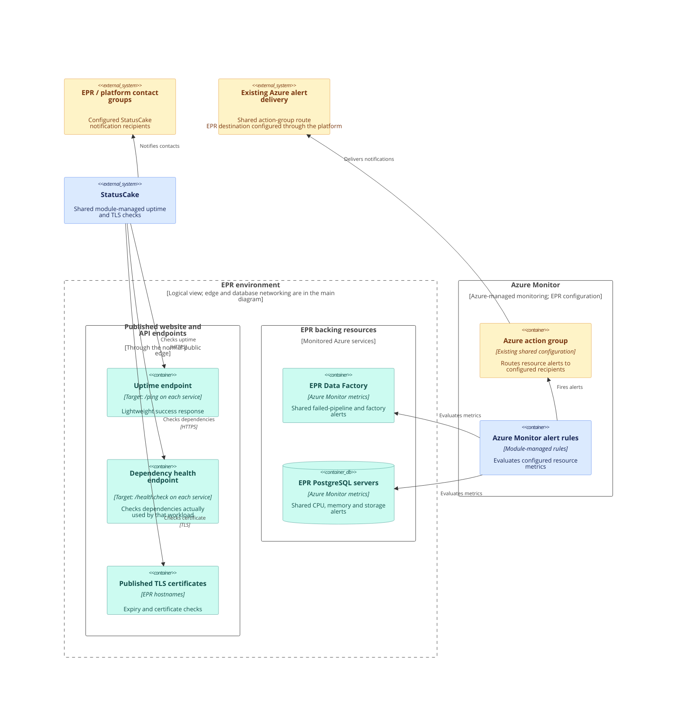

# Aavailabavavailability checks and Azure resource alerting

This is the **target EPR configuration**, not confirmation of deployed integrations. See also the [logging view](https://github.com/DFE-Digital/education-provider-registry-docs/blob/main/documentation/service/logging-deployment-diagram.md) and [main deployment diagram](https://github.com/DFE-Digital/education-provider-registry-docs/blob/main/documentation/service/deployment-diagram.md).

## Deployment diagram

### Key

### Availability and Azure monitoring

The checks target the normal published website/API hosts. `/metrics` remains an internal scrape endpoint. StatusCake contact groups and Azure action-group delivery are separate from the Prometheus-to-Alertmanager Teams route; they are not assumed to use the same receiver automatically.

PostgreSQL monitoring follows Register's shared-module calls. ADF is an EPR-specific extension using the existing shared ADF module, rather than a component copied from Register. Its metric alerts are separate from the ADF diagnostic-log export in the logging view. Front Door's metrics remain available through Azure; adding custom Front Door latency/5xx alert rules is not part of the copied Register baseline, whose inspected custom Front Door alert flag is off.

## What each component does

| Component | EPR target configuration | Ownership | **Baseline security support** | **OWASP support** |
| --- | --- | --- | --- | --- |
| Website/API health endpoints | Expose lightweight `/ping` and dependency-aware `/healthcheck` for separate external checks. | EPR | 3.8: health-check data flows | A09: operational monitoring input only |
| StatusCake | Use the shared module for separate uptime, dependency and certificate checks, with EPR URLs and agreed service/platform contact groups. | EPR configuration; existing monitoring service | 3.8: external check and notification flows; 3.10: certificate-health contribution only | A09: availability notifications only; A04: certificate validity/expiry monitoring |
| PostgreSQL metric alerts | Enable monitoring on the shared PostgreSQL module and use its existing rules/action-group integration. | EPR configuration; Teacher Services Cloud shared module | 3.8: resource metric and alert flows | A09: CPU, memory and storage alerts; no security-event detection established |
| Data Factory metric alerts | Set `azure_enable_monitoring = true` on the shared ADF module and use its existing action group. | EPR configuration; Teacher Services Cloud shared module | 3.8: factory metric and alert flows | A09 / A10: failed-run alerts support investigation; exception handling and security detection not established |
| Azure Monitor alert rules | Evaluate resource metric conditions configured by the shared modules. | EPR configuration; Azure-managed monitoring | 3.8: metric evaluation and alert flows | A09: operational alert evaluation; security use cases not established |
| Azure action group and contact groups | Use existing platform delivery routes and EPR recipients. StatusCake groups and Azure action groups are configured independently. | EPR and Teacher Services Cloud | 3.8: notification flows; 13.1: routing contribution only; security escalation not established | A09: notification routing; security response playbooks not established |

### Availability and certificate checks

StatusCake checks TLS certificate validity and expiry, alerting configured recipients to problems that could disrupt HTTPS access.

Configure the website and public API separately, using their real published hostnames:

| Check | Target | Reference behaviour | **Baseline security support** | **OWASP support** |
| --- | --- | --- | --- | --- |
| Uptime | `/ping` | Lightweight application response; Register uses `trigger_rate = 0`. | 3.8: external uptime-check flow | A09: availability monitoring only; no attack-detection rule established |
| Dependencies | `/healthcheck` | Checks the dependencies used by that workload; Register uses `trigger_rate = 1`. | 3.8: dependency-check flow | A09: dependency-failure monitoring; cause and security significance require investigation |
| TLS certificate | Published TLS hostnames | Certificate validity and expiry; Register uses `trigger_rate = 0`. | 3.8: certificate-check flow; 3.10: certificate-health contribution only | A04: certificate validity/expiry monitoring; protocol and cipher strength not established |

Reuse the shared StatusCake module and replace Register's URLs and contact-group IDs with EPR's. Keep `/metrics` internal. Do not introduce Rails-only Redis or queue checks into a workload that does not use those dependencies.

