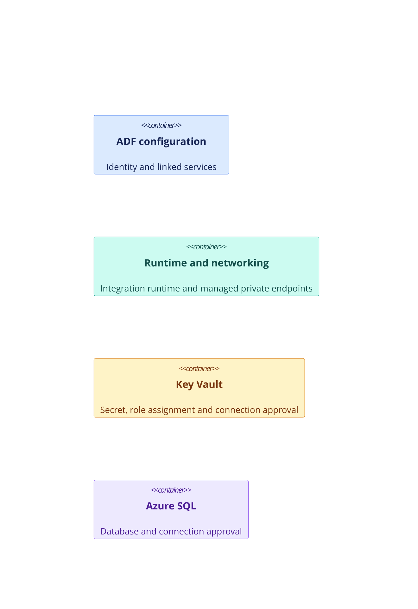
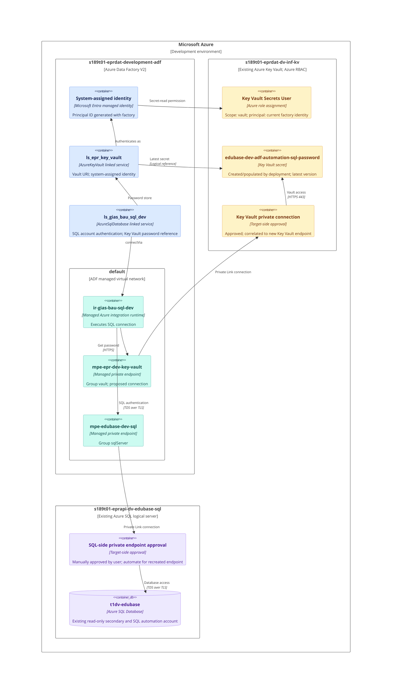

# C4 deployment diagram: development ADF connection

This specification describes the development environment only, centred on Data Factory `s189t01-eprdat-development-adf`. The resource names and configuration shown apply to development; test and production environments are outside this specification. Linked services and identity are configuration attached to the factory; the integration runtime and private endpoints belong to its managed network. Secret and linked-service instances are shown to expose configuration relationships.

## Component key

## Development ADF connection - target deployment

## Components

| Component | Azure resource type | Description and deployment requirement |
| --- | --- | --- |
| `s189t01-eprdat-development-adf` | Data Factory | Hosts the linked services, system-assigned identity and managed network. Recreate through the subscription Terraform deployment. |
| System-assigned identity | System-assigned managed identity | Generated with the factory. Use its current principal ID for secret-read permission after every recreation. |
| `ls_gias_bau_sql_dev` | Linked service | SQL authentication to `t1dv-edubase`; uses `ir-gias-bau-sql-dev` and references the password through `ls_epr_key_vault`. |
| `ls_epr_key_vault` | Linked service | References the existing vault URI and authenticates using the factory's system-assigned identity. |
| `default` | Managed virtual network | Contains the integration runtime and managed private endpoints; managed by ADF. |
| `ir-gias-bau-sql-dev` | Integration runtime | Executes the database connection inside the ADF managed network. |
| `mpe-epr-dev-key-vault` | Managed private endpoint | Private connection to the existing vault, group ID `vault`. Proposed target configuration. Requires matching vault-side approval. |
| `mpe-edubase-dev-sql` | Managed private endpoint | Private connection to the SQL logical server, group ID `sqlServer`. Creates the SQL-side request described below. |
| `s189t01-eprdat-dv-inf-kv` | Key Vault | Stores the SQL password secret and uses Azure RBAC. Vault creation remains outside this specification. |
| `edubase-dev-adf-automation-sql-password` | Key Vault secret | Create/populate through the deployment with a protected password input matching the SQL account. ADF references the latest version; omit `secretVersion`. |
| Key Vault Secrets User | Role assignment | Grants the current factory identity secret-read permission at vault scope. Recreate the assignment for the new principal ID. |
| Key Vault private connection | Private endpoint connection | Automatically requested by the vault managed private endpoint. Deployment must identify and approve the matching request using an authorised identity. |
| `s189t01-eprapi-dv-edubase-sql` | SQL server | Hosts the source database and the SQL-side private endpoint connection. Server creation remains outside this specification. |
| `t1dv-edubase` | SQL database | Read-only secondary accessed using the existing SQL automation account. Database and account creation remain outside this specification. |
| SQL-side private endpoint approval | Private endpoint connection | Creating `mpe-edubase-dev-sql` in ADF automatically creates a private endpoint connection request on the SQL server. This is the SQL side of the same private connection, not a separately created endpoint. You manually approved the original request. After recreation, the deployment must identify and approve the new matching request using an identity with approval permissions on the SQL server. The connection must be Approved before ADF can use it. |

