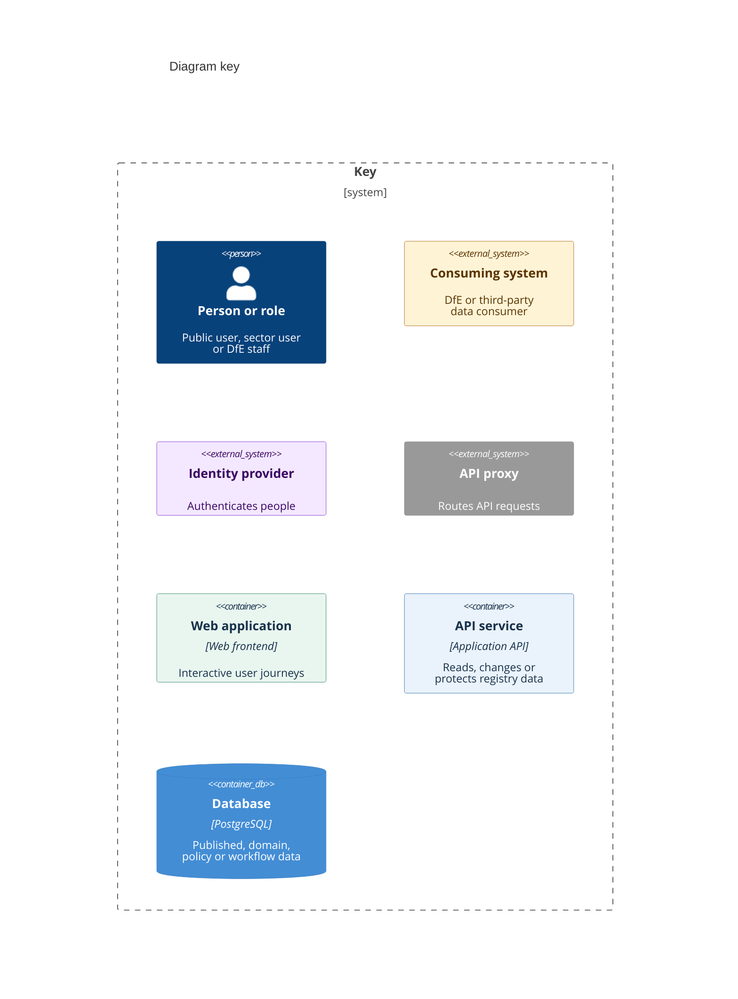

# Education Provider Registry - C4 container diagram

This diagram describes the provisional target architecture for the Education Provider Registry (EPR). It shows how people and consuming systems find data, propose changes and interact with the services that own establishment, group and governance records.

This is a **C4 Level 2 container view**. A container represents an application, API service or data store. The view explains responsibilities and interactions; deployment packaging, hosting and network controls require separate design detail.

## Diagram key

This standalone C4 container diagram shows the notation and colours used in the architecture view.

## Container diagram

```mermaid
C4Container
    UpdateLayoutConfig($c4ShapeInRow="20", $c4BoundaryInRow="1")
    title Education Provider Registry - Provisional Target Architecture
    Boundary(publicInternet, "Public Internet") {
        System_Ext(thirdParty, "Third-party system", "Consumes published data")
        Person(publicUser, "Public user", "Anonymous Find and Share")
        Person(sectorUser, "Education sector user", "Reads privileged data and<br/>proposes updates")
    }

    Enterprise_Boundary(dfeEnterprise, "DfE System") {
        Boundary(identityAndApiAccess, "Identity and API access") {
            System_Ext(publicProxy, "FaUAPI", "Proxies API<br/>requests")
            System_Ext(signIn, "DfE Sign-in", "Education sector identity")
            System_Ext(entra, "Microsoft Entra ID", "Staff identity")
        }

        Boundary(internalConsumers, "Internal Consumers") {
            System_Ext(dfeSystem, "DfE system", "Internal data consumer")
            Person(admin, "System administrator", "Configures access policies")
            Person(dataOwner, "DfE data owner", "Reviews and approves<br/>proposed changes")
        }

        System_Boundary(epr, "Education Provider Registry") {
            Boundary(publicZone, "Public zone") {
                Container(publicApi, "Read API Public", "API service", "Published representations<br/>for third-party systems")
                Container(web, "Web Frontend", "Web application", "Anonymous Find and Share;<br/>reads the published<br/>projection")
                Container(changeFrontend, "Change Request Frontend", "Web application", "Reads privileged data from<br/>domain APIs; submits<br/>change messages to Data<br/>Stewardship")
            }

            Boundary(internalZone, "Internal trusted zone") {
                Container(internalApi, "Read API Internal", "API service", "Establishment and governance<br/>data for DfE systems")
                Container(access, "Access Control", "API service", "Central permission<br/>decisions and policy<br/>configuration")
                Container(stewardship, "Data Stewardship", "API service", "Reviews, approves and<br/>coordinates domain changes")

                Boundary(transactionalZone2, "") {
                    Container(establishment, "Establishment and Groups", "API service", "Authoritative<br/>establishments, groups and<br/>memberships")
                    Container(governance, "Governance", "API service", "Authoritative<br/>appointments, roles and<br/>people")
                }
            }
            

            

            Boundary(publishedReadStore, "Published read store") {
                ContainerDb(projectionDb, "Read Projection DB", "PostgreSQL", "Published, joined view;<br/>asynchronously maintained")
            }

            Boundary(serviceDataStores, "Internal service data stores") {
                ContainerDb(establishmentDb, "Establishment DB", "PostgreSQL", "Authoritative<br/>establishment and group<br/>data")
                ContainerDb(governanceDb, "Governance DB", "PostgreSQL", "Authoritative governance<br/>data")
                ContainerDb(accessDb, "Access Control DB", "PostgreSQL", "Policies, assignments and<br/>decision audit")
                ContainerDb(stewardshipDb, "Data Stewardship DB", "PostgreSQL", "Change requests, decisions<br/>and workflow history")
            }
        }
    }


    Rel(publicUser, web, "Uses website")
    Rel(thirdParty, publicProxy, "Requests published data</br>from Read API Public<br/>via FaUAPI")
    Rel(dfeSystem, publicProxy, "Reads from Read API<br>Internal via FaUAPI")
    Rel(publicProxy, publicApi, "Proxies API request to<br>Read API Public")
    Rel(publicProxy, internalApi, "Proxies API request to<br>Read API Internal")
    Rel(sectorUser, signIn, "Authenticates via")
    Rel(sectorUser, changeFrontend, "Uses Change Request Frontend")
    Rel(dataOwner, entra, "Authenticates via")
    Rel(admin, entra, "Authenticates via")
    Rel(dataOwner, stewardship, "Reviews and approves changes<br>via Data Stewardship")
    Rel(admin, access, "Configures access policies")
    Rel(web, projectionDb, "Reads from<br>Read Projection DB")
    Rel(publicApi, projectionDb, "Reads from<br>Read Projection DB")
    Rel(internalApi, establishment, "Reads establishment<br>data")
    Rel(internalApi, governance, "Reads governance<br> data")
    Rel(changeFrontend, establishment, "Reads privileged<br>establishment data")
    Rel(changeFrontend, governance, "Reads privileged<br>governance data")
    Rel(changeFrontend, stewardship, "Sends/reads proposed<br>changes to/from <br>Data Stewardship")
    Rel(stewardship, access, "Checks<br>permissions")
    Rel(stewardship, establishment, "Applies approved<br>changes")
    Rel(stewardship, governance, "Applies approved<br>changes")

    Rel(stewardship, stewardshipDb, "Reads and writes workflow<br/>records")

    Rel(establishment, access, "Checks<br>permissions")
    Rel(governance, access, "Checks<br>permissions")

    Rel(access, accessDb, "Reads and writes<br>access policies")
    Rel(establishment, establishmentDb, "Reads and writes<br>authoritative data")
    Rel(governance, governanceDb, "Reads and writes<br>authoritative data")
    Rel(establishmentDb, projectionDb, "Publishes asynchronously", "Logical replication")
    Rel(governanceDb, projectionDb, "Publishes asynchronously", "Logical replication")

    UpdateRelStyle(thirdParty,       publicProxy,      $offsetX="-160", $offsetY="-170")
    UpdateRelStyle(publicUser,       web,              $offsetX="-120", $offsetY="-549")
    UpdateRelStyle(dfeSystem,        publicProxy,      $offsetX="-136", $offsetY="100")
    UpdateRelStyle(publicProxy,      publicApi,        $offsetX="0", $offsetY="-350")
    UpdateRelStyle(publicProxy,      internalApi,      $offsetX="-159", $offsetY="-540")
    UpdateRelStyle(sectorUser,       signIn,           $offsetX="-13", $offsetY="-138")
    UpdateRelStyle(sectorUser,       changeFrontend,   $offsetX="-39", $offsetY="-557")
    UpdateRelStyle(dataOwner,        entra,            $offsetX="-92", $offsetY="113")
    UpdateRelStyle(admin,            entra,            $offsetX="-91", $offsetY="115")
    UpdateRelStyle(dataOwner,        stewardship,      $offsetX="-208", $offsetY="-325")
    UpdateRelStyle(admin,            access,           $offsetX="-171", $offsetY="-314")
    UpdateRelStyle(web,              projectionDb,     $offsetX="20", $offsetY="-470")
    UpdateRelStyle(publicApi,        projectionDb,     $offsetX="10", $offsetY="-457")
    UpdateRelStyle(internalApi,      establishment,    $offsetX="-69", $offsetY="-80")
    UpdateRelStyle(internalApi,      governance,       $offsetX="-127", $offsetY="-54")
    UpdateRelStyle(changeFrontend,   establishment,    $offsetX="125", $offsetY="-210")
    UpdateRelStyle(changeFrontend,   governance,       $offsetX="20", $offsetY="-150")
    UpdateRelStyle(changeFrontend,   stewardship,      $offsetX="10", $offsetY="-18")
    UpdateRelStyle(stewardship,      establishment,    $offsetX="140", $offsetY="-81")
    UpdateRelStyle(stewardship,      governance,       $offsetX="10", $offsetY="-20")
    UpdateRelStyle(stewardship,      access,           $offsetX="-30", $offsetY="-27")
    UpdateRelStyle(establishment,    access,           $offsetX="-118", $offsetY="60")
    UpdateRelStyle(governance,       access,           $offsetX="-50", $offsetY="70")
    UpdateRelStyle(stewardship,      stewardshipDb,    $offsetX="-165", $offsetY="-400")
    UpdateRelStyle(access,           accessDb,         $offsetX="-130", $offsetY="-482")
    UpdateRelStyle(establishment,    establishmentDb,  $offsetX="-20", $offsetY="-324")
    UpdateRelStyle(governance,       governanceDb,     $offsetX="-50", $offsetY="-324")
    UpdateRelStyle(establishmentDb,  projectionDb,     $offsetX="-142", $offsetY="98")
    UpdateRelStyle(governanceDb,     projectionDb,     $offsetX="107", $offsetY="86")





    UpdateElementStyle(signIn, $bgColor="#f3e8ff", $fontColor="#3b0764", $borderColor="#7e22ce")
    UpdateElementStyle(entra, $bgColor="#f3e8ff", $fontColor="#3b0764", $borderColor="#7e22ce")
    UpdateElementStyle(thirdParty, $bgColor="#fff3d6", $fontColor="#5b3500", $borderColor="#a85d00")
    UpdateElementStyle(dfeSystem, $bgColor="#fff3d6", $fontColor="#5b3500", $borderColor="#a85d00")

    UpdateElementStyle(web, $bgColor="#e9f6ef", $fontColor="#18324b", $borderColor="#26775e")
    UpdateElementStyle(changeFrontend, $bgColor="#e9f6ef", $fontColor="#18324b", $borderColor="#26775e")
    UpdateElementStyle(publicApi, $bgColor="#eaf2fb", $fontColor="#18324b", $borderColor="#2165a5")
    UpdateElementStyle(internalApi, $bgColor="#eaf2fb", $fontColor="#18324b", $borderColor="#2165a5")
    UpdateElementStyle(stewardship, $bgColor="#eaf2fb", $fontColor="#18324b", $borderColor="#2165a5")
    UpdateElementStyle(access, $bgColor="#eaf2fb", $fontColor="#18324b", $borderColor="#2165a5")
    UpdateElementStyle(establishment, $bgColor="#eaf2fb", $fontColor="#18324b", $borderColor="#2165a5")
    UpdateElementStyle(governance, $bgColor="#eaf2fb", $fontColor="#18324b", $borderColor="#2165a5")

```

## Applications and responsibilities

| Application or API | Responsibility |
| --- | --- |
| **Web Frontend** | Provides anonymous Find and Share journeys using the published Read Projection DB. |
| **Read API Public** | Serves published representations to third-party systems through FaUAPI. Reads the projection rather than the authoritative domain services. |
| **Change Request Frontend** | Provides authenticated update journeys. Reads privileged establishment and governance data from the domain APIs, and submits or retrieves proposed changes through Data Stewardship. |
| **Read API Internal** | Serves DfE systems through FaUAPI. Reads establishment and governance data through the two domain APIs. |
| **Establishment and Groups** | Owns authoritative establishment, group and membership records. Handles domain reads and applies approved changes. |
| **Governance** | Owns authoritative governance appointments, roles and people. Handles domain reads and applies approved changes. |
| **Data Stewardship** | Owns change requests, review decisions and workflow history. Coordinates approved changes through the domain APIs, which retain ownership of the resulting records. |
| **Access Control** | Makes permission decisions for Data Stewardship and the domain services. Owns access policies and decision audit data. |

## Main journeys

1. **Public discovery:** a public user accesses the Web Frontend, which reads the published projection. A third-party system uses FaUAPI to reach Read API Public, which reads the same projection.
2. **Internal consumption:** a DfE system uses FaUAPI to reach Read API Internal. That API reads through Establishment and Groups and Governance. It does not read the projection or transactional databases directly.
3. **Proposed changes:** an education sector user authenticates with DfE Sign-in and uses the Change Request Frontend. The frontend reads current domain data and exchanges proposed changes with Data Stewardship.
4. **Review and application:** a DfE data owner authenticates with Microsoft Entra ID and reviews changes through Data Stewardship. Approved changes are applied by the relevant domain API. Data Stewardship and the domain APIs check permissions with Access Control.
5. **Policy administration:** a system administrator authenticates with Entra ID and configures policies through Access Control. Authentication establishes identity; the permission checks determine which actions that identity may perform.

FaUAPI is the API proxy for both public and internal consumption. DfE Sign-in and Entra ID provide identity services. They are grouped under **Identity and API access** because that boundary includes both proxy and identity capabilities.

## Data ownership and publication

| Store | Owner or purpose |
| --- | --- |
| **Read Projection DB** | Shared published read model used by the Web Frontend and Read API Public. Contains a joined representation of establishment, group and governance data. |
| **Establishment DB** | Authoritative establishment and group data, owned by Establishment and Groups. |
| **Governance DB** | Authoritative governance data, owned by Governance. |
| **Access Control DB** | Policies, assignments and decision audit data, owned by Access Control. |
| **Data Stewardship DB** | Proposed changes, review decisions and workflow history, owned by Data Stewardship. |

The diagram shows **logical replication** as the mechanism for asynchronous publication from the two authoritative domain databases into the read projection. Approved changes may therefore take time to appear in public results. The detailed composition of the joined published view remains a separate design concern.

## Boundary clarifications

- **Public zone** groups applications reached by public or sector users and third-party consumers. The Change Request Frontend still requires authentication
- **Internal trusted zone** groups the internal read API, permission service, workflow service and authoritative domain APIs.
- **Published read store** describes the projection's purpose. External users and systems reach published data through the frontend or API, not by connecting to the database.
- **Internal service data stores** groups the four databases owned by individual services. Separate ownership does not prescribe separate database servers.
- The **DfE enterprise boundary** includes shared DfE dependencies and internal consumers. The nested **EPR system boundary** identifies the registry applications and stores.

