# Education Provider Registry - C4 deployment diagram

This is the target deployment of the public Find and Share service for one environment. We will host the website and public read API on our Azure Kubernetes Service (AKS) cluster. Azure Front Door provides the website entry route; the shared FaUAPI proxy provides public internet access to the API.

API hosting on our AKS is an agreed design decision. The detailed connection from FaUAPI to AKS remains to be agreed. We show FaUAPI as an external dependency and do not assign it to subscription S189: its hosting subscription is unconfirmed. The logical grouping of public entry services below does not imply that Front Door and FaUAPI share infrastructure or a subscription.

## Read database terminology

The target **Read Projection DB** runs on an independent Azure Database for PostgreSQL Flexible Server and receives permitted data through **logical replication**. It is not an Azure physical read replica. The target topology has two database server instances per environment: one transactional server hosting `establishment` and `governance`, and one read server hosting `read_projection`. This split and the replication are not established by the current website Terraform.

## Deployment diagram

The diagram reads from top to bottom: public entry point, application hosting, published read database, then the transactional sources. Request arrows point towards the service being called. Replication arrows point upwards from the source databases to the read projection and describe data flow; the subscriber initiates the replication connection.

```mermaid
%%{init: {"wrap": true, "c4": {"width": 260}}}%%
C4Deployment
    title EPR public read deployment - proposed target for one environment

    Boundary(publicAccess, "Public access services", "Logical grouping; hosting is separate") {
        Container(frontDoor, "Azure Front Door", "Global edge service", "Website entry route;<br/>origin configuration to confirm")
        System_Ext(fauapi, "FaUAPI proxy", "Public API entry route;<br/>hosting subscription unconfirmed")
    }

    Deployment_Node(vnet, "S189 environment VNet", "Azure virtual network") {
        Deployment_Node(aks, "Shared AKS cluster", "Azure Kubernetes Service (AKS)") {
            Deployment_Node(appNamespace, "Application namespace", "Kubernetes namespace", "Selected by environment configuration") {
                Container(web, "Website / Web Frontend", "ASP.NET Core container", "Website Deployment and Service;<br/>port 8080; target: published reads")
                Container(publicApi, "Read API Public", "API service container")
            }
        }

        Deployment_Node(readServer, "Read database server - target", "Azure Database for PostgreSQL Flexible Server", "Outside AKS; proposed read subnet and network controls") {
            ContainerDb(readProjection, "Read Projection DB", "PostgreSQL: read_projection", "Schemas: establishment<br/>and governance;<br/>published data only")
        }

        Deployment_Node(transactionalServer, "Transactional database server - target", "Azure Database for PostgreSQL Flexible Server", "Outside AKS; proposed transactional isolation") {
            ContainerDb(establishmentDb, "Establishment DB", "PostgreSQL: establishment", "Permitted establishment<br/>and group data")
            ContainerDb(governanceDb, "Governance DB", "PostgreSQL: governance", "Publishes governance data<br/>with PII excluded")
        }
    }

    Rel(frontDoor, web, "Via ingress and<br/>website Service", "Proposed HTTPS origin route")
    Rel(fauapi, publicApi, "Proxies public API requests", "Connectivity to confirm")
    Rel(web, readProjection, "Reads published data", "PostgreSQL / TLS")
    Rel(publicApi, readProjection, "Reads published data", "PostgreSQL / TLS")
    Rel(establishmentDb, readProjection, "Permitted establishment data", "Logical replication")
    Rel(governanceDb, readProjection, "Non-PII governance data", "Logical replication")

    UpdateElementStyle(frontDoor, $bgColor="#f3f4f6", $fontColor="#1f2937", $borderColor="#6b7280")
    UpdateElementStyle(fauapi, $bgColor="#f3f4f6", $fontColor="#1f2937", $borderColor="#6b7280")
    UpdateElementStyle(web, $bgColor="#e9f6ef", $fontColor="#18324b", $borderColor="#26775e")
    UpdateElementStyle(publicApi, $bgColor="#eaf2fb", $fontColor="#18324b", $borderColor="#2165a5")
    UpdateElementStyle(readProjection, $bgColor="#DCFCE7", $fontColor="#14532D", $borderColor="#16A34A")
    UpdateElementStyle(establishmentDb, $bgColor="#DBEAFE", $fontColor="#172554", $borderColor="#2563EB")
    UpdateElementStyle(governanceDb, $bgColor="#EDE9FE", $fontColor="#3B0764", $borderColor="#7C3AED")
    UpdateRelStyle(frontDoor, web, $offsetX="-50", $offsetY="-180")
    UpdateRelStyle(fauapi, publicApi, $offsetX="-5", $offsetY="-180")
    UpdateRelStyle(establishmentDb, readProjection, $textColor="#1D4ED8", $lineColor="#2563EB")
    UpdateRelStyle(governanceDb, readProjection, $textColor="#6D28D9", $lineColor="#7C3AED")
    UpdateLayoutConfig($c4ShapeInRow="20", $c4BoundaryInRow="1")
```

## Request paths and responsibilities

| Path or component | Behaviour |
| --- | --- |
| **Website request** | Target path: Browser -> Front Door -> AKS ingress -> website Service -> website pods -> Read Projection DB. The website reads the projection directly, as shown in the container view. |
| **Public API request** | Agreed route: Third-party system -> FaUAPI -> public API hosted on our AKS -> Read Projection DB. The ingress endpoint, Service routing, authentication and network connection between FaUAPI and AKS remain to be agreed. |
| **Azure Front Door** | Provides the website entry route and forwards requests to the website origin. Front Door is outside the VNet; it does not carry database traffic. We do not assume a Front Door hop in the API route. |
| **FaUAPI** | Shared DfE proxy providing public internet access to the API. Its hosting subscription and connection into our AKS environment need confirmation. Its placement outside the S189 VNet is a dependency view, not confirmation of its Azure subscription. |
| **AKS ingress and workloads** | Both applications will run on our AKS cluster, with separate Deployments and Services in the target design. A Service directs traffic to its application's pods. The website uses ingress and port 8080; detailed API ingress and TLS arrangements remain to be agreed. |
| **Read Projection DB** | Target: serves both applications using read-only database roles. Private DNS and network rules restrict access to approved workloads and operational clients. These controls and the website's connection to the named projection require implementation or verification. |
| **Transactional databases** | Publish permitted base-table data asynchronously into the projection. BAU remains the write authority during private beta, with daily ETL into these domain databases. Applications construct their own read models. |

The server instances use the names `[subscription-identifier][env-identifier]-pg-epr-read` and `[subscription-identifier][env-identifier]-pg-epr-transactional`. Their full naming and proposed subnet layout are in the data platform design. Deployment nodes show hosting; the applications and databases inside them are container instances. Both database servers are in the environment subscription; Front Door is shown at the global edge rather than inside the VNet.

