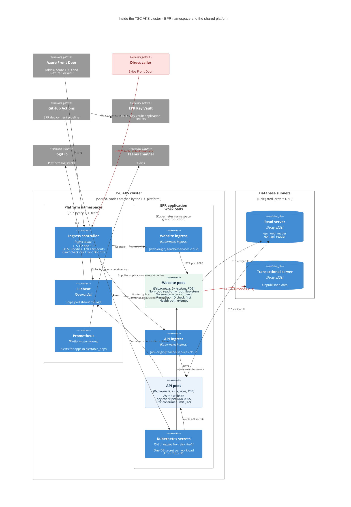

# Education Provider Registry: public beta deployment


## Diagram 1: production overview

One environment is shown at a time. The subscription and VNet labels follow the [service deployment diagram](../../../../../education-provider-registry-docs/documentation/service/deployment-diagram.md); see [Environment information](#environment-information) for each environment's subscription, cluster and namespace. The security and sizing settings shown are the production target. Arrows point at the service being called.

```mermaid
%%{init: {"wrap": true, "c4": {"width": 260}}}%%
C4Deployment
    title EPR public beta - production, security overview

     UpdateLayoutConfig($c4ShapeInRow="3", $c4BoundaryInRow="3")

    System_Ext(fauapi, "FaUAPI", "DfE API catalogue")

    System_Ext(gh, "GitHub Actions", "Build and deploy. OIDC, no stored secrets.")
    System_Ext(logit, "logit.io", "Shared TSC log stacks")
    System_Ext(browser, "Public user", "Browser. Anonymous, read-only.")
    System_Ext(consumer, "API consumer", "Third-party system. Key per ADR 0005.")

    

    Boundary(sub, "EPR environment subscription", "S189 test or production; see environment table") {
        Deployment_Node(afd, "Azure Front Door", "Global edge. Premium proposed (O7).") {
            Container(webEp, "Website endpoint", "[service-domain]", "WAF prevention mode<br/>Managed and custom rules<br/>300 req per IP per 5 min to start<br/>TLS 1.2+, managed cert<br/>Caches static files only")
            Container(apiEp, "API endpoint", "api.[service-domain]", "Own WAF policy<br/>Own rate limit<br/>TLS 1.2+, managed cert<br/>No caching")
        }
        Deployment_Node(vnet, "S189 environment VNet", "Azure virtual network") {
            Deployment_Node(aks, "Teacher Services Cloud AKS cluster", "Shared with other TSC services") {

                Deployment_Node(platform, "Shared TSC platform services", "Platform-managed components") {
                Container(ingress, "Shared ingress controller", "TSC platform. nginx, moving to Traefik.", "Public load balancer<br/>Port 80 off<br/>Trusts forwarded headers from anyone")
                Container(filebeat, "Platform Filebeat", "TSC-managed DaemonSet", "Collects opted-in pod logs<br/>Sends logs to logit.io over TLS")
                }

                Deployment_Node(ns, "EPR application workloads", "Kubernetes namespace: gias-production") {
                    Container(web, "Website", "ASP.NET Core, 2+ pods", "Refuses requests without our Front Door ID<br/>GET and HEAD only<br/>Read-only DB role")
                    Container(api, "Public API", "ASP.NET Core, 2+ pods", "Refuses requests without our Front Door ID<br/>GET and HEAD only<br/>Own read-only DB role")
                    Container(secrets, "Kubernetes secrets", "Set at deploy", "EPR application secrets<br/>Database credentials per workload")
                }
            }
            Deployment_Node(readSrv, "Read server", "PostgreSQL Flexible Server", "Private subnet, no public access<br/>Zone-redundant HA") {
                ContainerDb(projection, "Read Projection DB", "read_projection", "Published data only")
            }
            Deployment_Node(txSrv, "Transactional server", "PostgreSQL Flexible Server", "Private subnet, no public access<br/>No route from public pods") {
                ContainerDb(estDb, "Establishment DB", "establishment", "Unpublished data")
                ContainerDb(govDb, "Governance DB", "governance", "Unpublished personal data")
            }
        }
        Container(kv, "Key Vault", "Azure Key Vault", "DB passwords<br/>Front Door ID")
       
        Deployment_Node(bauSrv, "BAU database server", "Microsoft SQL Server", "Network path to Data Factory open (O8)") {
            ContainerDb(bau, "BAU GIAS DB", "MSSQL", "Source of truth in beta")
            Container(adf, "Data Factory", "Managed VNet", "BAU feed (O8)")
        }
        Container(law, "Log Analytics", "Azure Monitor workspaces", "Front Door access and WAF diagnostics<br/>PostgreSQL diagnostics when enabled<br/>Logical grouping; may use separate workspaces")
    }


    Rel(browser, webEp, "HTTPS")
    Rel(consumer, apiEp, "HTTPS")
    Rel(webEp, ingress, "HTTPS, origin name checked")
    Rel(apiEp, ingress, "HTTPS, origin name checked")
    Rel(ingress, web, "HTTP in cluster")
    Rel(ingress, api, "HTTP in cluster")
    Rel(web, projection, "SQL, TLS verify-full")
    Rel(api, projection, "SQL, TLS verify-full")
    Rel(estDb, projection, "Logical replication, TLS")
    Rel(govDb, projection, "Published columns only, TLS")
    Rel(adf, bau, "Reads")
    Rel(adf, estDb, "Writes")
    Rel(adf, govDb, "Writes")
    Rel(gh, kv, "Reads secrets at deploy")
    Rel(gh, secrets, "Supplies application secrets at deploy")
    Rel(secrets, web, "Injects website secrets")
    Rel(secrets, api, "Injects API secrets")
    Rel(gh, fauapi, "Publishes OpenAPI spec (O18)")
    Rel(webEp, law, "Front Door profile diagnostics: access and WAF logs")
    Rel(apiEp, law, "Same profile diagnostics: API access and WAF logs")
    Rel(readSrv, law, "Server diagnostics, when monitoring enabled")
    Rel(txSrv, law, "Server diagnostics, when monitoring enabled")
    Rel(ingress, filebeat, "Collects ingress container logs")
    Rel(web, filebeat, "Container stdout/stderr collected")
    Rel(api, filebeat, "Container stdout/stderr collected")
    Rel(filebeat, logit, "TLS")

    UpdateElementStyle(webEp, $bgColor="#fef3c7", $fontColor="#78350f", $borderColor="#d97706")
    UpdateElementStyle(apiEp, $bgColor="#fef3c7", $fontColor="#78350f", $borderColor="#d97706")
    UpdateElementStyle(web, $bgColor="#e9f6ef", $fontColor="#18324b", $borderColor="#26775e")
    UpdateElementStyle(api, $bgColor="#eaf2fb", $fontColor="#18324b", $borderColor="#2165a5")
    UpdateElementStyle(projection, $bgColor="#DCFCE7", $fontColor="#14532D", $borderColor="#16A34A")
    UpdateElementStyle(estDb, $bgColor="#DBEAFE", $fontColor="#172554", $borderColor="#2563EB")
    UpdateElementStyle(govDb, $bgColor="#EDE9FE", $fontColor="#3B0764", $borderColor="#7C3AED")

```

The BAU MSSQL database is in S189, so the BAU feed stays inside our subscriptions. We still need to confirm which S189 subscription holds it in each environment, and whether Data Factory reaches it over a private network path (O8).

Front Door is shown inside the subscription boundary to represent ownership of its Azure profile. Traffic is processed at Azure's global edge, outside the VNet. The owning S189 subscription for the shared Front Door profile across environments still needs confirmation.

### Diagram 1 configuration inventory

We will build this comparison one row at a time as we review each aspect against existing TSC services.

| Component or connection | Technology / location shown | Configuration or behaviour stated in the diagram |
| --- | --- | --- |
| Read replica db | PostgreSQL Flexible Server in the S189 environment VNet | Private subnet; no public access; zone-redundant HA |
| Inherited ingress logging | Shared TSC Filebeat → logit.io | Platform collects annotated ingress pod logs and sends them to the shared Logit stack over TLS. |
| Inherited Front Door diagnostic logging | Azure Monitor diagnostic settings → Log Analytics | Shared domains module supports access and WAF logs from the Front Door profile when monitoring is enabled, covering both endpoints. Enablement and retention require confirmation (O17, O20). |
| Inherited PostgreSQL diagnostic logging | Shared PostgreSQL module → Log Analytics | Server diagnostic categories go to a module-created workspace when monitoring is enabled. PostgreSQL audit configuration and enabled categories require confirmation (O17). |

### Security Information and Event Management (SIEM)

The website and public API use the shared TSC logging path:

1. Our website/API writes logs to **stdout/stderr**.
2. The container runtime stores that output as log files on the AKS node.
3. Shared **Filebeat**, running on the nodes, discovers pods with the `logit.io/send: "true"` annotation and reads their logs.
4. Filebeat sends them over TLS to the cluster's configured **logit.io** destination.

The shared application Terraform module adds the annotation when `enable_logit = true`. TSC manages Filebeat and its destination configuration. Our applications write to the console and do not need a direct connection to Filebeat or logit.io. EPR owns the events and fields emitted, log levels and filtering of sensitive information; those details remain to be agreed.

### Inherited logging and service-owned decisions

The diagram shows logging mechanisms available through the existing TSC platform and shared Terraform modules. Diagnostic settings must be enabled in our environment before the Azure-resource paths shown are active. Log Analytics represents the relevant workspaces collectively; the Front Door and PostgreSQL modules can create separate workspaces. No forwarding connection from Log Analytics to logit.io is established by the inspected configuration.

| Component | Inherited mechanism | Responsibility |
| --- | --- | --- |
| Shared ingress | Platform pod annotations opt its container logs into Filebeat collection and logit.io delivery. | TSC manages the collector and ingress configuration. Confirm the configuration deployed in our cluster, including the Traefik transition. |
| Filebeat and logit.io | Shared collector, TLS delivery and environment log stack. | TSC manages the shipping infrastructure. Confirm retention, access and operational ownership. |
| Front Door / WAF | Shared domains module provides diagnostic settings targeting Log Analytics. | EPR enables the module setting and confirms access/WAF categories, retention and costs (O17, O20). |
| PostgreSQL servers | Shared PostgreSQL module provides server diagnostic settings targeting Log Analytics. | EPR confirms monitoring enablement, required categories and any audit settings (O17). Database contents are not automatically copied into logs. |
| Website and public API | Shared application module offers Filebeat/Logit opt-in. | EPR selects stdout/stderr collection through platform Filebeat to logit.io, as shown. Verify collection enablement in each environment; event content, formatting, filtering and alerts remain to be reviewed. |
| Data Factory | **Design decision:** enable `azure_enable_monitoring` and send pipeline, activity and trigger logs to Log Analytics over TLS. | Create or reuse an environment workspace and verify diagnostic settings; implementation pending. See [logging view](logging/logging-deployment-diagram.md). |
| Key Vault and BAU MSSQL | No Logit route established in this review. | Review these components' diagnostic configuration and required destinations separately. |


## Secrets

**Key Vault → deployment pipeline → Kubernetes secrets → Website / Public API**

1. EPR's Azure Key Vault holds application secrets.
2. During deployment, the pipeline reads the required values from Key Vault through Terraform and the shared application configuration module.
3. The deployment creates or updates Kubernetes secrets in the EPR application namespace.
4. Kubernetes injects the appropriate secret values into the website and public API containers when their pods start.

The applications consume the injected configuration; they do not read Key Vault directly at runtime. Each workload should receive only the secrets it needs. Updating Key Vault alone does not automatically refresh values already injected into running containers; the deployment must update the Kubernetes secrets and restart or roll out the affected pods.

The flow above describes the direction in which secret values are supplied. In the C4 diagrams, the pipeline-to-Key Vault arrow points towards Key Vault because it represents the pipeline calling Key Vault to read them.

## Environment information


| Environment | Azure subscription | AKS cluster selection | Kubernetes namespace | Resource prefix | Environment configuration |
| --- | --- | --- | --- | --- | --- |
| Dev | `s189-teacher-services-cloud-test` | `test` | `gias-development` | `s189t01` | [development.sh](https://github.com/DFE-Digital/education-provider-registry-data/blob/main/global_config/development.sh) |
| Test | `s189-teacher-services-cloud-test` | `test` | `gias-test` | `s189t01` | [test.sh](https://github.com/DFE-Digital/education-provider-registry-data/blob/main/global_config/test.sh) |
| Pre-prod | `s189-teacher-services-cloud-production` | `production` | `gias-production` | `s189p01` | [preproduction.sh](https://github.com/DFE-Digital/education-provider-registry-data/blob/main/global_config/preproduction.sh) |
| Prod | `s189-teacher-services-cloud-production` | `production` | `gias-production` | `s189p01` | [production.sh](https://github.com/DFE-Digital/education-provider-registry-data/blob/main/global_config/production.sh) |

The diagrams show the production namespace, `gias-production`. Use the table's namespace for other environments. Pre-prod and prod currently share that namespace; separating them remains open (O9). The environment mapping does not confirm the BAU MSSQL server's subscription or Data Factory's network path (O8).


## Diagram 2: inside the AKS cluster

What runs in our namespace, what the platform runs for us, and where the boundaries are. The red arrow is a route that must not exist.



A direct caller can reach the ingress controller, because the default `teacherservices.cloud` hostnames are public. The ingress passes the request on. Our pods then refuse it with a 403, because it has no Front Door ID (APP-05). This is risk IR-01. See [Shared ingress risks](#shared-ingress-risks).

## Hostnames and endpoints

| Hostname | Serves | Front Door | Origin | Status |
| --- | --- | --- | --- | --- |
| `[service-domain]` | Website and downloads | Own endpoint, WAF policy and rate limit | `[web-origin].teacherservices.cloud` on the shared ingress | **Proposed** (O4) |
| `api.[service-domain]` | Public API | Own endpoint, WAF policy and rate limit | `[api-origin].teacherservices.cloud` on the shared ingress | **Proposed** (O4) |
| `*.teacherservices.cloud` origin names | Nothing public | None. Requests without our Front Door ID get a 403. | Shared ingress | **Proposed** (APP-05, EDGE-03) |

Why a separate API hostname:

- **Different limits.** People and machines behave differently. Register early career teachers serves its API under its main domain and had to raise its single limit to 2,000 requests for everyone.
- **Different WAF tuning.** We can tune the API's rules for JSON calls without loosening the website's.
- **Clear logs.** Each hostname gets its own WAF and access logs.
- **It fits the module.** The domains module takes one origin for each call, so we call it once per hostname.

## Request paths

| Path | Hops | Security at each hop |
| --- | --- | --- |
| Website | Browser → Front Door → shared ingress → website pod → Read Projection DB | WAF and rate limit at the edge. Origin lock and host check in the pod. Read-only role on the database. |
| Public API | Consumer → Front Door → shared ingress → API pod → Read Projection DB | As the website, plus the key check and per-consumer limit if ADR 0005 chooses keys (O1, O2) |
| Downloads | Browser → Front Door → shared ingress → website pod → download files | Files hold published data only. Cached at the edge with a set lifetime and purgeable (DATA-14, O30). |
| Replication | Read server → transactional server | Started by the read server. Publications list their columns. TLS. |
| BAU feed | Data Factory → BAU MSSQL database, then → transactional databases | Both ends are in S189. Managed identity. Network path still open (O8). |
| Deploy | GitHub Actions → Azure and AKS | OIDC, one credential for each environment. Production needs a second reviewer. |
| Catalogue | GitHub Actions → FaUAPI | Publishes the OpenAPI spec when it changes (O18) |
| Engineer access | Engineer → Entra sign-in with MFA → Azure and AKS → `konduit.sh` tunnel → database | Named accounts, PIM elevation, no standing admin |
| Direct origin call | Anyone → shared ingress → pod | Refused with a 403 by the pod. Alerts on spikes. |

## Security tables

### Edge: Front Door and WAF

| ID | Control | Where | Status | Baseline | OWASP |
| --- | --- | --- | --- | --- | --- |
| EDGE-01 | Every public request enters through our Front Door | Diagram 1 | **Decided** | 4.4, 12.2 | A01 |
| EDGE-04 | WAF in prevention mode on both endpoints, with the Microsoft default rule set and bot manager. Managed rules need Premium and either a domains module change or our own WAF policy. | Website and API endpoints | **Proposed** (O7, O19) | 4.4 | A02, A05 |
| EDGE-05 | Rate limit by client IP, set separately for each hostname. Website starts at 300 per IP in 5 minutes. | Both endpoints | **Proposed** (O10) | 4.4 | A01, A10 |
| EDGE-06 | HTTPS only. HTTP redirects to HTTPS. TLS 1.2 minimum, managed certificates. | Both endpoints | **Decided** | 3.10 | A04 |
| EDGE-07 | Front Door caches named static paths and versioned download files only. Never API responses. | Website endpoint | **Proposed** | 3.4 | A04 |
| EDGE-10 | SPF `-all`, DMARC `p=reject` and CAA on the service domain | DNS | **Proposed** | 4.2 | A02 |
| EDGE-11 | A forged `X-Forwarded-For` can't dodge the rate limit, IP block or geo-block. Tested on a deployed Front Door. | Both endpoints | **Open** (O29) | 4.4 | A01 |
| N1 | The `block_ip` rule is created ready to fill during an incident, and `allow_aks` stays off, so other tenants' cluster traffic isn't exempt from our rate limit | Both endpoints | **Proposed** | 4.4 | A01 |
| N2 | A second secret header for each environment, added by a Front Door rule set, so development doesn't hold production's origin secret and we can rotate it | Both endpoints | **Proposed** (O25) | 16.8 | A01, A02 |

### Ingress and origin lock

| ID | Control | Where | Status | Baseline | OWASP |
| --- | --- | --- | --- | --- | --- |
| EDGE-02, APP-05 | Middleware, first in the pipeline, refuses any request without our Front Door ID in `X-Azure-FDID`. 403 with no body. Health path exempt. | Website and API pods | **Proposed** (O5, O6) | 1.2, 4.4 | A01 |
| EDGE-03 | Requests to the default ingress hostnames get a 403 and no content | Shared ingress, enforced by pods | **Proposed** | 1.2 | A01 |
| APP-03 | `AllowedHosts` set to the real hostnames | Pods | **Proposed** | 16.7 | A02 |
| APP-04 | Client IP read from `X-Azure-SocketIP` once the Front Door ID check has passed. Never by counting `X-Forwarded-For` hops. | Pods | **Proposed** (O29) | 8.5 | A01, A09 |
| APP-11 | Page size, query length, body size and timeouts set in the app, because the shared ingress allows 50 MB bodies and 120-second timeouts | Pods | **Proposed** (O14) | 16.7 | A10 |
| N3 | Retest origin refusal, client IP and host handling when the platform moves the ingress to Traefik | Shared ingress | **Proposed** | 12.1 | A02 |

### Workloads in AKS

| ID | Control | Where | Status | Baseline | OWASP |
| --- | --- | --- | --- | --- | --- |
| APP-01, API-06 | GET and HEAD only. Other methods get a 405. | Pods | **Proposed** | 4.1 | A01 |
| APP-15 | Non-root, read-only root filesystem, no service account token. The image is non-root today, but the deployment doesn't enforce it. | Pods | **Proposed** | 16.7 | A02 |
| N4 | Drop all Linux capabilities and set `allowPrivilegeEscalation: false` and a `RuntimeDefault` seccomp profile, if the application module can set them | Pods | **Proposed**. Needs a module check. | 16.7 | A02 |
| APP-06 to APP-09 | HSTS for one year, CSP, `nosniff`, referrer and permissions policies. No CORS unless agreed. | Pods | **Proposed** (O13) | 16.7 | A02 |
| APP-10, APP-16 | Safe errors with a correlation ID. Health endpoints say only up or down. | Pods | **Proposed** | 4.1 | A10 |
| APP-12, APP-13 | Parameterised queries, allowlisted sort fields, encoded output, CSV formula cells neutralised | Pods | **Proposed** | 16.1 | A05 |
| EDGE-09 | Public pods can't reach the transactional server | Namespace network policy, or subnet rules | **Proposed** (O11) | 3.12, 12.2 | A06 |
| N5 | Default-deny network policy in our namespace, allowing only ingress from the controller, egress to the read server, DNS, and anything the key check needs | Namespace | **Open** (O11). Depends on whether the cluster enforces network policy. | 12.2 | A02, A06 |
| ENV-03 | 2 or more replicas with a pod disruption budget, resources set from the load test | Deployments | **Proposed** (O10) | 12.2 | A10 |

### Data

| ID | Control | Where | Status | Baseline | OWASP |
| --- | --- | --- | --- | --- | --- |
| EDGE-08 | Databases have no public endpoint | Both servers | **Proposed**. The Postgres module already turns public access off. | 4.1 | A02 |
| DATA-01, DATA-02 | Publications name their columns. A build test fails if the projection holds a personal data column the DPIA doesn't publish. | Transactional server, pipeline | **Proposed** (O31) | 3.12 | A01, A08 |
| DATA-03 | Clients connect with `verify-full`. Servers require TLS 1.2 or higher. Today the setting is `require`. | Both servers | **Proposed** | 3.10 | A04 |
| DATA-04 | Encryption at rest with Azure-managed keys on servers, backups and storage | Both servers, storage | **Proposed** | 3.11 | A04 |
| DATA-05 | Zone-redundant HA on both servers in production. Today production gets none. | Both servers | **Proposed** | 11.1, 12.2 | A10 |
| DATA-06, DATA-07 | Geo-redundant backup on the transactional server. Point-in-time restore for 7 days, plus a nightly dump to storage. | Transactional server | **Open** (O15) | 11.2, 11.4 | A10 |
| DATA-11, DATA-13 | Replication slots survive failover. Alert when a slot holds back too much WAL. | Both servers | **Proposed** (O26) | 11.1 | A10 |
| ENV-06 | Delete locks on the production databases and the DNS zone | Both servers, DNS | **Proposed** | 11.3 | A02 |

### Identity and secrets

| ID | Control | Where | Status | Baseline | OWASP |
| --- | --- | --- | --- | --- | --- |
| IAM-01, IAM-02 | Separate read-only database role and secret for the website and the API, on the read server only | Read server | **Proposed** | 3.3, 6.8 | A01 |
| IAM-03, IAM-05 | No app uses the server admin. Break-glass use raises an alert. | Both servers | **Proposed** | 4.7 | A07 |
| IAM-04 | Engineers use named Entra accounts with MFA, and PIM for time-limited elevation | Azure, AKS | **Proposed** | 5.4, 6.5 | A07 |
| IAM-06, PIPE-03 | Pipeline uses OIDC, one credential for each environment, no client secrets in GitHub | GitHub Actions | **Proposed** | 6.8 | A08 |
| IAM-07 | All secrets live in Key Vault. Only the pipeline can read secrets in the namespace. | Key Vault, namespace | **Proposed** | 3.3 | A04 |
| N6 | Key Vault public network access off, or limited to the pipeline and cluster, with soft delete and purge protection on | Key Vault | **Open**. Not checked yet. | 4.1, 3.11 | A02 |
| IAM-08 | Database passwords for now. Entra workload identity is the target. | Pods | Accepted risk | 5.2 | A07 |

### Pipeline and supply chain

| ID | Control | Where | Status | Baseline | OWASP |
| --- | --- | --- | --- | --- | --- |
| PIPE-01, PIPE-02 | Branch protection with one independent approval. Production deploy needs a reviewer who isn't the author. | GitHub | **Proposed** | 16.1 | A08 |
| PIPE-04, PIPE-09 | Actions pinned to a commit SHA. Base images pinned by digest and rebuilt at least monthly. | GitHub, images | **Proposed** | 7.3 | A03 |
| PIPE-05 to PIPE-08 | CodeQL, Dependabot, Snyk, secret scanning with push protection | GitHub | **Proposed** (O21) | 16.2 | A03 |
| PIPE-10, PIPE-12 | SBOM stored with each release. Images scanned. | Pipeline | **Proposed** | 2.1 | A03 |
| PIPE-13 | Smoke test checks the refusals: direct origin call, write methods, and a missing key if keys are chosen | Pipeline | **Proposed** | 1.2 | A01 |

### Logging and monitoring

| ID | Control | Where | Status | Baseline | OWASP |
| --- | --- | --- | --- | --- | --- |
| LOG-01 | Inherited ingress logs use Filebeat → logit.io. EPR website/API logging content and collection configuration remain to be reviewed. | Platform collector and application pods | Ingress mechanism inherited; application decisions pending | 8.1, 8.5 | A09 |
| LOG-02 | Front Door and PostgreSQL shared modules support diagnostic logs to Log Analytics when enabled. Confirm categories, PostgreSQL audit settings and enablement. Other Azure-resource logging and any further forwarding remain open. | Azure Monitor diagnostic settings | **Open** (O17, O20) | 8.2, 8.9 | A09 |
| LOG-03 | Retention agreed with the SOC. The baseline asks for 90 days hot and a year cold. | All log stores | **Open** (O17) | 8.3 | A09 |
| LOG-04 | Alerts for WAF block spikes, origin-lock refusals, 401 and 429 spikes, replication lag, failed BAU runs. Someone owns them out of hours. | Log Analytics, Prometheus | **Proposed** (O23) | 13.1 | A09 |
| LOG-05, LOG-06 | Monitoring and StatusCake on in production. Both apps listed in `alertable_apps`. | TSC repo, our config | **Proposed**. Off today. | 8.2 | A09 |

## Encryption in transit, hop by hop

This is the connection matrix that baseline safeguard 3.10 and OWASP A04 ask for.

| Hop | Protocol | Certificate checked by | Status |
| --- | --- | --- | --- |
| Browser or consumer → Front Door | HTTPS, TLS 1.2 minimum, 1.3 offered | Client, against the managed certificate | **Decided** |
| Front Door → shared ingress | HTTPS | Front Door, against the origin hostname | **Decided** |
| Shared ingress → pod | Plain HTTP on the cluster network | Nobody | Accepted risk |
| Pod → read server | PostgreSQL over TLS | Pod, with `verify-full` | **Proposed** (DATA-03). `require` today. |
| Read server → transactional server, replication | PostgreSQL over TLS | Read server. Subscription connection uses `verify-full`. | **Proposed** (O26) |
| Data Factory → BAU and transactional | TLS | Data Factory | **Open** (O8) |
| Pod → FaUAPI, if ADR 0005 chooses a key check | HTTPS | Pod | **Open** (O1) |
| Filebeat → Logit | TLS | Platform | Platform assurance needed |
| Engineer → database | AKS API over TLS, then `konduit.sh` tunnel to TLS on the database | Engineer's tools | **Proposed** |
| Pipeline → Azure and AKS | HTTPS with OIDC tokens | GitHub runner | **Proposed** |

## Who can reach what

The reachability matrix behind baseline safeguards 3.12 and 12.2. Each row needs a test that proves it.

| From | To | Allowed? | Enforced by | Status |
| --- | --- | --- | --- | --- |
| Internet | Front Door endpoints | Yes | WAF and rate limits | **Proposed** |
| Internet | Shared ingress, default hostnames | Reaches the ingress, then refused | App origin lock, 403 | **Proposed**. Accepted risk IR-01. |
| Internet | Databases, Key Vault | No | Public access off | **Proposed** (N6) |
| Website and API pods | Read server | Yes, port 5432 only | DB roles, TLS, network policy | **Proposed** |
| Website and API pods | Transactional server | No | Network policy or subnet rules | **Open** (O11) |
| Other tenants' pods | Our databases | Network allows it today | DB roles and TLS only | Accepted risk, unless O11 is fixed |
| Read server | Transactional server | Replication only | Subnet rules, because we can't edit `pg_hba.conf` | **Proposed** (O32) |
| Pre-prod | Production | No | Separate namespaces, servers and credentials | **Open** (O9). Both use `gias-production` today. |
| Our pods | Internet | Only what we need | Egress network policy | **Open** (O11) |

## Shared ingress risks

We use the shared TSC ingress controller, as all six live TSC services do. We don't plan to run our own. Running our own would mean patching, upgrading, monitoring and supporting it ourselves, out of hours too. No live TSC service does it, and the application module hardcodes the `nginx` ingress class, so it would also need the TSC team's agreement.

The WAF isn't one of the reasons. It sits on Front Door, which we own, so custom WAF rules go in our own Front Door WAF policy whichever ingress we use.

### The risks we take on

These come from the [source material](../source-material/security-controls.md#risks-from-the-shared-ingress). Each needs an owner and a review date before public beta.

| ID | Risk | How we mitigate it | What's left | What our own controller would change |
| --- | --- | --- | --- | --- |
| IR-01 | The default `*.teacherservices.cloud` hostnames are public, and the ingress can't check our Front Door ID. A direct call skips the WAF and the Front Door rate limit. | The apps refuse it with a 403 (APP-05, EDGE-03). We alert on refusals. The IT Health Check tests it. We ask the TSC team about a check at the ingress (O5). | Refused requests still reach our pods, so a flood costs us some capacity | It could refuse them before the pods. With Front Door Premium and Private Link, the origin would have no public address at all. |
| IR-02 | The origin lock depends on the Front Door ID staying private. Every environment shares one profile, so development holds production's value (O25). | Held in Key Vault and never logged. A second, rotatable secret header for each environment (N2). | Without N2, a leak needs a new Front Door profile | Nothing. This is a Front Door matter. |
| IR-03 | The ingress trusts `X-Forwarded-For` and `X-Forwarded-Host` from any caller | The origin check runs first. The apps read the client IP from `X-Azure-SocketIP` (APP-03, APP-04). | IP addresses on refused requests can't be trusted, so we don't act on them | It could trust forwarded headers from Front Door only |
| IR-04 | One controller serves every TSC service, about 50 monitored deployments in production. Another service's traffic, or a platform incident, could take us down. | StatusCake and the status page tell us. We agree the load test with the TSC team (O10). | Accepted. It's the price of the shared platform. | Capacity of our own |
| IR-05 | The platform can change the ingress without us. The move to Traefik is under way, and its test config also trusts forwarded headers from anyone. | The origin lock is in the app, so it doesn't depend on the controller. We retest origin refusal, client IP and host handling after the move (N3). | We rely on hearing about changes from the TSC team | Changes would be ours to make |
| IR-06 | The ingress settings aren't ours: 50 MB bodies, 120-second timeouts, and whatever TLS the platform sets | The apps set tighter limits (APP-11). We check TLS versions on the deployed service. | Slow connections on the direct route still tie up the shared ingress | Body size, timeouts and TLS would be ours to set |
| IR-07 | Ingress logs go to the platform's Logit stacks. Paths and query strings are visible to the platform team and held on its terms. | Keys never go in URLs (API-02). The DPIA covers search terms (O31). Retention agreed with the SOC (O17). | Low | Little. Logs would still go through the platform. |
| | Plain HTTP between the ingress and our pods | Traffic stays on the cluster network | Accepted. No service mesh. | We could choose TLS to the pods |

### Why we might need our own

We'd revisit running our own controller if any of these happen:

- **The direct route is judged unacceptable.** The IT Health Check or the threat model finds IR-01 too much, even with the apps refusing direct calls.
- **Security requires a private origin.** Only our own controller, with Front Door Premium and Private Link, gives the origin no public address.
- **We need refusal before the pods.** The TSC team can't add a Front Door check at the ingress (O5), and refused traffic starts to cost us real capacity.
- **Capacity.** The load test shows the shared ingress can't handle our traffic, or another tenant's traffic affects us.
- **Platform change.** The move to Traefik, or another change, breaks something our controls rely on and can't be fixed in the app.

If one happens, we raise it with the TSC team and record the decision in an ADR (O24).

## Baseline safeguards this design helps close

From the [baseline security risk assessment output coverage](../../../security/security-by-design/baseline-security-risk-assessment/epr-baseline-security-risk-assessment-completion-plan.md). These are the rows where the deployment design is part of the answer. Each still needs evidence from the deployed service.

| Safeguard | What this design gives | Controls | Still needed |
| --- | --- | --- | --- |
| 1.1 Asset inventory | Every deployed component, by environment, in diagrams 1 and 2 | ENV-04 | Resource IDs from Azure and Kubernetes exports, tags, a six-monthly review |
| 1.2 Unauthorised routes | Direct origin calls are refused and alerted on | APP-05, EDGE-03, PIPE-13, LOG-04 | A drift check for new public endpoints |
| 3.3 Data access lists | Database roles listed for each workload | IAM-01, IAM-02 | Exported grants and tests that writes fail |
| 3.8 Data flows | Request paths, replication and BAU feed set out | DATA-01 | Owner review, BAU feed path (O8) |
| 3.10 Encryption in transit | [Hop-by-hop matrix](#encryption-in-transit-hop-by-hop) | EDGE-06, DATA-03 | Tests rejecting wrong-name and expired certificates |
| 3.11 Encryption at rest | Azure-managed keys on servers, backups and storage | DATA-04 | Configuration evidence, platform assurance for logs |
| 3.12 Segmentation by sensitivity | Public apps read only the projection. Unpublished data stays on the transactional server. | IAM-02, EDGE-09, DATA-01 | Network enforcement (O11) and negative tests |
| 3.14 Logging access to sensitive data | PostgreSQL audit configuration to confirm on the transactional server | LOG-02 | Agree required events and verify collection (O17) |
| 4.1 No public management interfaces | Databases and Key Vault have no public access | EDGE-08, N6 | External test |
| 4.2 Network configuration ownership | Front Door and WAF are ours. Ingress and cluster network are the TSC team's. | | A written ownership split agreed with the TSC team |
| 4.4 WAF in blocking mode | Prevention mode on both hostnames | EDGE-04, EDGE-05 | Blocked test requests, tier decision (O7) |
| 4.6 Secure management | IaC through the pipeline, `konduit.sh` for database access | PIPE-02, IAM-04 | Ask the TSC team how the AKS API server is exposed (N7) |
| 5.4, 6.5 Admin rights and MFA | Named accounts, MFA, PIM | IAM-04, IAM-05 | PIM configuration evidence |
| 7.3 Operating system patching | Nodes patched by the TSC platform. Images rebuilt monthly by us. | PIPE-09 | Platform patch schedule, image rebuild records |
| 8.2, 8.9 Log coverage and **Security Information and Event Management** (SIEM) | Inherited ingress logging to logit.io; shared Front Door/PostgreSQL diagnostics to Log Analytics when enabled. Application and other resource coverage pending. | LOG-01, LOG-02 | Trace test events to each configured destination; confirm coverage (O17, O20). |
| 11.2, 11.4 Backups, held apart | Point-in-time restore, geo-redundant backup, nightly dump | DATA-06, DATA-07 | Decide geo-redundancy before creating the server (O15) |
| 12.2 Secure network design | [Reachability matrix](#who-can-reach-what) | EDGE-09, N5 | Tests for each row |
| 12.3 Network managed by IaC | Front Door and WAF through the domains module in the website repo | | Change records for a sample network change |
| 13.1 Central alerting, 24/7 | Alerts listed with routes | LOG-04 | Out-of-hours owner (O23) |
| 15.1 Service providers | TSC platform, FaUAPI, Logit, GitHub, Microsoft | | Provider register in the service operations manual |
| 16.7 Hardening baseline | Pod security settings, headers, `AllowedHosts` | APP-15, N4, APP-06 to APP-08 | Comparison with the DfE Azure baseline |
| 16.8 Production apart from non-production | Separate servers, Key Vault and credentials. Separate origin secret. | ENV-01, N2 | Separate namespaces for pre-prod and prod (O9) |
| 16.10 Secure by Design principles | Defence in depth: WAF, origin lock, app limits, read-only roles, published-only data | All of the above | A principle-by-principle mapping |

## OWASP Top 10 2025: where the deployment helps

From the [OWASP controls and actions](../../../security/security-by-design/epr-owasp-2025-controls-actions.md).

| Category | Deployment controls | Still needed |
| --- | --- | --- |
| A01 Broken access control | Origin lock, GET and HEAD only, separate read-only roles, rate limits at the edge and per consumer | Access-control regression tests, forged-header tests (O29) |
| A02 Security misconfiguration | Pod hardening, safe headers, environment separation, databases with no public access | Rendered-manifest checks, split pre-prod and prod (O9) |
| A03 Supply chain | Pinned actions and images, SBOM, scanning | Digest-based promotion between environments |
| A04 Cryptographic failures | TLS on every hop except ingress to pod, `verify-full`, managed keys | Certificate negative tests |
| A05 Injection | WAF managed rules, parameterised queries, CSV neutralising | DAST through both hostnames |
| A06 Insecure design | Tier separation, published-only projection, threat model on these diagrams | Network enforcement (O11) |
| A07 Authentication failures | MFA and PIM for engineers, no app accounts | Key decision for the API (ADR 0005) |
| A08 Integrity failures | Independent review, production approval, publication column test | Signed or attested images |
| A09 Logging and alerting | Inherited Filebeat/logit.io and Azure Monitor/Log Analytics mechanisms | Application logging, diagnostic enablement and retention (O17, O20), out-of-hours owner (O23) |
| A10 Exceptional conditions | App limits, HA, pod disruption budgets, safe errors | Load test (O10), failure drills |

## Risks we accept

From the source material. Each needs an owner and a review date before public beta. The risks from the shared ingress are in [Shared ingress risks](#shared-ingress-risks).

| Risk | Why we accept it | What would remove it |
| --- | --- | --- |
| No network policies on the shared cluster, if O11 can't be fixed | Database roles and TLS still limit access | Network policies, or our own subnet |
| Database passwords, not workload identity (IAM-08) | The shared module's pattern. Each role is scoped. | Entra workload identity |
| Azure-managed encryption keys | Standard for OFFICIAL | Customer-managed keys |

## New open items

The rest are in the [source material README](../source-material/README.md#open-items).

| ID | Item | Who to ask |
| --- | --- | --- |
| N4 | Whether the application module can set capabilities, privilege escalation and seccomp on our pods | TSC team |
| N5 | Whether the cluster enforces Kubernetes network policies, so a default-deny policy in our namespace would work | TSC team |
| N6 | Key Vault network access, soft delete and purge protection | Our infrastructure |
| N7 | How the AKS API server is exposed, and whether it's limited to approved networks | TSC team |
| N8 | Confirm the `api.` hostname under the service domain with the domain owner | Service owner |

## Environments

Values come from the [data repo's global config](https://github.com/DFE-Digital/education-provider-registry-data/tree/main/global_config), as on the current deployment page.

| Environment | Azure subscription | AKS cluster | Namespace | Front Door |
| --- | --- | --- | --- | --- |
| Development | `s189-teacher-services-cloud-test` | `test` | `gias-development` | **Open** |
| Test | `s189-teacher-services-cloud-test` | `test` | `gias-test` | **Open** |
| Pre-production | `s189-teacher-services-cloud-production` | `production` | `gias-production` | Own endpoints and WAF policies on the shared profile (O25) |
| Production | `s189-teacher-services-cloud-production` | `production` | `gias-production` | Own endpoints and WAF policies on the shared profile (O25) |

Pre-production and production share a namespace today (O9). Baseline safeguard 16.8 says production can't talk to non-production, so we propose a separate namespace for pre-production.
