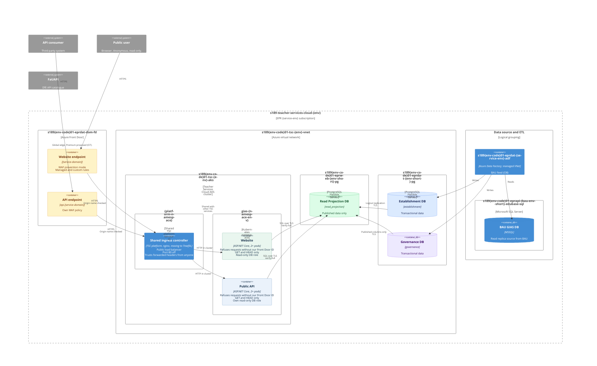

# Education Provider Registry: public beta deployment

This document covers request handling, data flows, deployment, secrets and network security.

- [Secrets deployment view](secrets-deployment-diagram.md): Key Vault dependencies and secret delivery.
- [Logging deployment view](logging-deployment-diagram.md): log collection, destinations and configuration.
- [Application metrics and alerting view](application-metrics-and-alerting-deployment-diagram.md): metric collection, dashboards and deployment-alert integration.

## Deployment overview

See [Environment information](#environment-information) for the current environment mapping. 

## Environment information

| Environment | Azure subscription | AKS cluster selection | Kubernetes namespace | Resource prefix | Environment configuration | Baseline security support | OWASP support |
| --- | --- | --- | --- | --- | --- | --- | --- |
| Dev | `s189-teacher-services-cloud-test` | `test` | `gias-development` | `s189t01` | [development.sh](https://github.com/DFE-Digital/education-provider-registry-data/blob/main/global_config/development.sh) | 1.1: environment inventory; IDs, tags and review still needed; 16.8: isolation not proved by names | A02: environment mapping; separation tests needed |
| Test | `s189-teacher-services-cloud-test` | `test` | `gias-test` | `s189t01` | [test.sh](https://github.com/DFE-Digital/education-provider-registry-data/blob/main/global_config/test.sh) | 1.1: environment inventory; IDs, tags and review still needed; 16.8: isolation not proved by names | A02: environment mapping; separation tests needed |
| Pre-prod | `s189-teacher-services-cloud-production` | `production` | `gias-production` | `s189p01` | [preproduction.sh](https://github.com/DFE-Digital/education-provider-registry-data/blob/main/global_config/preproduction.sh) | 1.1: environment inventory; IDs, tags and review still needed; 16.8: isolation not proved by names | A02: environment mapping; separation tests needed |
| Prod | `s189-teacher-services-cloud-production` | `production` | `gias-production` | `s189p01` | [production.sh](https://github.com/DFE-Digital/education-provider-registry-data/blob/main/global_config/production.sh) | 1.1: environment inventory; IDs, tags and review still needed; 16.8: isolation not proved by names | A02: environment mapping; separation tests needed |

### Configuration inventory

This inventory describes the deployment overview's target configuration, not verified deployed settings. Names follow the supplied `Azureresources.csv` and shared-platform naming evidence; assigning existing servers to the target database roles still requires confirmation.

| Component or connection | Technology / location shown | Configuration or behaviour stated in the diagram | Baseline security support | OWASP support |
| --- | --- | --- | --- | --- |
| Public user | External browser | Anonymous, read-only website access over HTTPS. | 3.8: public request flow | A01: anonymous read-only access; A04: HTTPS |
| API consumer | External third-party system | Calls the API endpoint over HTTPS; API access controls are defined in the security tables. | 3.8: API request flow | A01: API access-control context; A04: HTTPS |
| FaUAPI | External DfE API catalogue | Catalogue component only in this view; no request-proxy or deployment connection is drawn. | 15.1: provider identified; provider register still needed |  |
| `s189-teacher-services-cloud-{env}` | Azure subscription boundary | Owns the EPR environment resources shown. Resolve each shared resource's owning subscription separately. | 1.1: component inventory; resource IDs/tags and six-monthly review needed |  |
| `s189{env-code}01-eprdat-dom-fd` | Azure Front Door, outside the VNet | Global public edge; Premium remains proposed (O7). Shared profile ownership across environments must be confirmed. | 1.1: component inventory; resource IDs/tags and six-monthly review needed |  |
| Website endpoint | Front Door; `[service-domain]` | WAF prevention mode with managed and custom rules; target configuration. | 4.4: target WAF protection; tier decision and blocked-request tests needed | A02 / A05: target managed WAF rules |
| API endpoint | Front Door; `api.[service-domain]` | Separate API hostname and its own WAF policy. | 4.4: separate API WAF policy; applied rules need evidence | A01 / A02: separate API edge controls |
| `s189{env-code}01-tsc-{env}-vnet` | Shared Azure virtual network | Contains the AKS cluster and PostgreSQL server groupings shown. | 1.1: component inventory; resource IDs/tags and six-monthly review needed |  |
| `s189{env-code}01-tsc-{env}-aks` | Shared Teacher Services Cloud AKS cluster | Shared with other TSC services; platform components and EPR workloads have separate logical groupings. | 1.1: component inventory; resource IDs/tags and six-monthly review needed |  |
| `{platform-namespace}` | Shared platform namespace or logical grouping | Platform-managed services; exact namespace scope requires confirmation. | 1.1: namespace placement; 16.8: pre-prod/prod separation unresolved | A02: isolation configuration gap |
| Shared ingress controller | Platform AKS workload | nginx moving to Traefik; public load balancer; port 80 off; forwarded headers currently trusted from any caller. | 4.2: platform ownership identified; written ownership split needed; 7.3: platform patch schedule evidence needed | A02: shared ingress configuration; forwarded-header trust remains a risk |
| `gias-{namespace-env}` | EPR Kubernetes namespace | Contains Website and Public API workloads. Use the environment table; pre-production and production currently share `gias-production`. | 1.1: namespace placement; 16.8: pre-prod/prod separation unresolved | A02: isolation configuration gap |
| Website | ASP.NET Core workload in EPR namespace | Target 2+ pods; refuses requests without the expected Front Door ID; GET/HEAD only; read-only database role. | 3.3: read-only role; exported grants and write-refusal tests needed; 3.8: request flow | A01: origin validation and read-only access; A04: target TLS |
| Public API | ASP.NET Core workload in EPR namespace | Target 2+ pods; expected Front Door ID required; GET/HEAD only; its own read-only database role. | 3.3: separate read-only role; exported grants and tests needed; 3.8: API flow | A01: origin and API access controls; API key decision remains open |
| `s189{env-code}01-eprweb-{env-short}-pg` | Read PostgreSQL Flexible Server in the VNet | Private subnet; no public access; zone-redundant HA shown as target. Existing eprweb server names do not prove target Read Projection use. | 1.1: server inventory; 4.1: private access; 11.1: HA target; evidence needed | A02: database exposure; A10: resilience target |
| `read_projection` | Read Projection database on read server | Published data only; queried by the Website and Public API. This is logical replication, not the inventory's physical reporting replica. | 3.12: published-only projection; boundary tests needed | A01 / A08: publication restrictions |
| `s189{env-code}01-eprdat-{env-short}-pg` | Transactional PostgreSQL Flexible Server in the VNet | Private subnet; no public access; no route from public workloads is the target. Inventory confirms development/test names, not complete target provisioning. | 1.1: inventory; 3.12, 12.2: target isolation; enforcement tests needed | A06: data-tier separation target |
| `establishment` | Establishment database on transactional server | Holds transactional Establishment data; receives ADF loads and publishes data to the Read Projection. | 3.8: domain flows; 3.12: publication boundary; tests needed | A01 / A08: permitted data replication |
| `governance` | Governance database on transactional server | Holds transactional Governance data; receives ADF loads; only the permitted published subset is replicated. | 3.8: domain flows; 3.12: publication boundary; tests needed | A01 / A08: permitted data replication |
| Data source and ETL | Logical grouping within the subscription view | Groups source SQL and ADF; does not mean ADF runs inside the SQL server or its network. | 3.8: source and transformation boundary; BAU path review needed |  |
| `s189{env-code}01-eprapi-{bau-env-short}-edubase-sql` | BAU Microsoft SQL Server | Hosts the BAU source. Confirmed development name: `s189t01-eprapi-dv-edubase-sql`; select BAU environment independently of application environment. | 1.1: component inventory; resource IDs/tags and six-monthly review needed |  |
| BAU GIAS DB | MSSQL database on BAU SQL server | Read-replica source from BAU; ADF reads it. Database name and environment-specific replica state are not established by this overview. | 3.8: source identified; replica state and access require verification |  |
| `s189{env-code}01-eprdat-{service-env}-adf` | Azure Data Factory with managed VNet | BAU feed reads SQL and writes both transactional databases. Network path and detailed deployment remain open (O8); development linked-service configuration has its own specification. | 1.1: resource identified; 3.8: BAU flow; routing evidence needed | A09: see separate run-log and metric-alert views |
| Public user to website endpoint | HTTPS | Website request entry through Front Door. | 3.8: request flow; 3.10: HTTPS; certificate negative tests needed | A04: encrypted public traffic |
| API consumer to API endpoint | HTTPS | API request entry through Front Door. | 3.8: request flow; 3.10: HTTPS; certificate negative tests needed | A04: encrypted public traffic |
| Website/API endpoints to shared ingress | HTTPS | Backend origin name checked. | 3.10: origin TLS validation; wrong-name/expired-certificate tests needed | A04: authenticated TLS connection |
| Shared ingress to Website/Public API | HTTP inside cluster | Ingress forwards requests to the appropriate workload; this hop is not shown as TLS. | 3.8: internal request flow; 3.10: no encryption on this hop | A04: residual risk, plain HTTP |
| Website/Public API to `read_projection` | PostgreSQL over TLS | `verify-full` certificate/hostname validation; separate read-only workload roles. | 3.3: workload grants; 3.10: verify-full; grant and certificate tests needed | A01: read-only roles; A04: database TLS |
| `establishment` to `read_projection` | PostgreSQL logical replication over TLS | Copies the permitted Establishment dataset; publication scope and configuration are covered by the replication specification. | 3.8: replication flow; 3.10: TLS; 3.12: permitted dataset; scope tests needed | A01 / A08: publication boundary; A04: TLS |
| `governance` to `read_projection` | PostgreSQL logical replication over TLS | Published columns only; unpublished Governance PII must not enter the projection, including the initial copy. | 3.8: replication flow; 3.12: PII exclusion; initial/subsequent-copy tests needed | A01 / A08: published-only projection; A04: TLS |
| ADF to BAU GIAS DB | Read connection | Extracts source data; connection protocol, authentication and private routing are detailed in the ADF specification and require environment-specific verification. | 3.8: extract flow; network/authentication evidence needed | A04: transport verification required |
| ADF to `establishment` and `governance` | Write connections | Loads transformed BAU data into both transactional databases; detailed target connection configuration is not shown. | 3.8: load flows; target connection details still needed | A01 / A04: grants and TLS require verification |

`{env}` is the platform environment (`test` or `production` for the current application mapping); `{env-code}` is the owning subscription code (`d`, `t` or `p`); `{service-env}` is the application environment; `{env-short}` and `{bau-env-short}` are short environment codes (`dv`, `ts`, `pp`, `pd`). `{namespace-env}` follows the actual namespace mapping. Resolve placeholders per resource rather than assuming all resources share the same environment values.

### Security Information and Event Management (SIEM)

See the [logging deployment view](logging-deployment-diagram.md#logging-configuration) for collection destinations and the limits of the current central-SIEM integration.

Logging requirements for Key Vault and BAU MSSQL remain to be reviewed separately; neither is covered by that view.

## Hostnames and endpoints

| Hostname | Serves | Front Door | Origin | Baseline security support | OWASP support |
| --- | --- | --- | --- | --- | --- |
| `[service-domain]` | Website and downloads | Own endpoint, WAF policy and rate limit | `[web-origin].teacherservices.cloud` on the shared ingress | 1.2, 4.4: controlled entry routes; refusal/drift tests needed | A01: origin restriction; A02: edge configuration |
| `api.[service-domain]` | Public API | Own endpoint, WAF policy and rate limit | `[api-origin].teacherservices.cloud` on the shared ingress | 1.2, 4.4: controlled entry routes; refusal/drift tests needed | A01: origin restriction; A02: edge configuration |
| `*.teacherservices.cloud` origin names | Nothing public | None. Requests without our Front Door ID get a 403. | Shared ingress | 1.2, 4.4: controlled entry routes; refusal/drift tests needed | A01: origin restriction; A02: edge configuration |

Why a separate API hostname:

- **Different limits.** People and machines behave differently. Register early career teachers serves its API under its main domain and had to raise its single limit to 2,000 requests for everyone.
- **Different WAF tuning.** We can tune the API's rules for JSON calls without loosening the website's.
- **Clear logs.** Each hostname gets its own WAF and access logs.
- **It fits the module.** The domains module takes one origin for each call, so we call it once per hostname.

## Request paths

| Path | Hops | Security at each hop | Baseline security support | OWASP support |
| --- | --- | --- | --- | --- |
| Website | Browser -> Front Door -> shared ingress -> website pod -> Read Projection DB | WAF and rate limit at the edge. Origin lock and host check in the pod. Read-only role on the database. | 3.3: read-only role; exported grants and write-refusal tests needed; 3.8: request flow | A01: origin validation and read-only access; A04: target TLS |
| Public API | Consumer -> Front Door -> shared ingress -> API pod -> Read Projection DB | As the website, plus the key check and per-consumer limit if ADR 0005 chooses keys (O1, O2) | 3.3: separate read-only role; exported grants and tests needed; 3.8: API flow | A01: origin and API access controls; API key decision remains open |
| Downloads | Browser -> Front Door -> shared ingress -> website pod -> download files | Files hold published data only. Cached at the edge with a set lifetime and purgeable (published download caching and expiry, O30). | 3.4: cache expiry contribution; complete retention process not established | A01: published-only files; A04: restricted caching |
| Replication | Read server -> transactional server | Started by the read server. Publications list their columns. TLS. | 3.8: replication flow; 3.10: TLS; 3.12: column filtering | A01 / A08: published-only data; A04: TLS |
| BAU feed | Data Factory -> BAU MSSQL database, then -> transactional databases | Both ends are in S189. Managed identity. Network path still open (O8). | 3.8: feed path; authentication and routing still need confirmation | A01 / A04: verify actual grants and transport |
| Deploy | GitHub Actions -> Azure and AKS | OIDC, one credential for each environment. Production needs a second reviewer. | 4.6: pipeline-based management; deployment evidence needed; 6.8: environment credentials | A08: OIDC and independent production approval |
| Catalogue | GitHub Actions -> FaUAPI | Publishes the OpenAPI spec when it changes (O18) | 15.1: catalogue dependency; provider register needed |  |
| Engineer access | Engineer -> Entra sign-in with MFA -> Azure and AKS -> `konduit.sh` tunnel -> database | Named accounts, PIM elevation, no standing admin | 4.6, 5.4, 6.5: named elevated access; PIM configuration evidence needed | A07: MFA and time-limited elevation |
| Direct origin call | Anyone -> shared ingress -> pod | Refused with a 403 by the pod. Alerts on spikes. | 1.2: unauthorised route refusal; endpoint drift checks needed | A01: refusal and alerting; regression tests needed |

## Security tables

Control IDs are local to this document and numbered independently within each section. They are separate from Baseline safeguard numbers, OWASP categories and identifiers in earlier source material.

### Edge: Front Door and WAF

| ID | Control | Where | Baseline security support | OWASP support |
| --- | --- | --- | --- | --- |
| EDGE-01 | Every public request enters through our Front Door | Front Door website and API endpoints | 4.4, 12.2: design contribution; deployed evidence required | A01: control contribution; effectiveness requires testing |
| EDGE-02 | WAF in prevention mode on both endpoints, with the Microsoft default rule set and bot manager. Managed rules need Premium and either a domains module change or our own WAF policy. | Website and API endpoints | 4.4: design contribution; deployed evidence required | A02, A05: control contribution; effectiveness requires testing |
| EDGE-03 | Rate limit by client IP, set separately for each hostname. Website starts at 300 per IP in 5 minutes. | Both endpoints | 4.4: design contribution; deployed evidence required | A01, A10: control contribution; effectiveness requires testing |
| EDGE-04 | HTTPS only. HTTP redirects to HTTPS. TLS 1.2 minimum, managed certificates. | Both endpoints | 3.10: design contribution; deployed evidence required | A04: control contribution; effectiveness requires testing |
| EDGE-05 | Front Door caches named static paths and versioned download files only. Never API responses. | Website endpoint | 3.4: design contribution; deployed evidence required | A04: control contribution; effectiveness requires testing |
| EDGE-06 | A forged `X-Forwarded-For` can't dodge the rate limit, IP block or geo-block. Tested on a deployed Front Door. | Both endpoints | 4.4: design contribution; deployed evidence required | A01: control contribution; effectiveness requires testing |
| EDGE-07 | The `block_ip` rule is created ready to fill during an incident, and `allow_aks` stays off, so other tenants' cluster traffic isn't exempt from our rate limit | Both endpoints | 4.4: design contribution; deployed evidence required | A01: control contribution; effectiveness requires testing |

### Ingress and origin lock

| ID | Control | Where | Baseline security support | OWASP support |
| --- | --- | --- | --- | --- |
| ING-01 | Middleware, first in the pipeline, refuses any request without our Front Door ID in `X-Azure-FDID`. 403 with no body. Health path exempt. | Website and API pods | 1.2, 4.4: design contribution; deployed evidence required | A01: control contribution; effectiveness requires testing |
| ING-02 | Requests to the default ingress hostnames get a 403 and no content | Shared ingress, enforced by pods | 1.2: design contribution; deployed evidence required | A01: control contribution; effectiveness requires testing |
| ING-03 | `AllowedHosts` set to the real hostnames | Pods | 16.7: design contribution; deployed evidence required | A02: control contribution; effectiveness requires testing |
| ING-04 | Page size, query length, body size and timeouts set in the app, because the shared ingress allows 50 MB bodies and 120-second timeouts | Pods | 16.7: design contribution; deployed evidence required | A10: control contribution; effectiveness requires testing |

### Workloads in AKS

| ID | Control | Where | Baseline security support | OWASP support |
| --- | --- | --- | --- | --- |
| AKS-01 | GET and HEAD only. Other methods get a 405. | Pods | 4.1: design contribution; deployed evidence required | A01: control contribution; effectiveness requires testing |
| AKS-02 | Non-root, read-only root filesystem, no service account token. The image is non-root today, but the deployment doesn't enforce it. | Pods | 16.7: design contribution; deployed evidence required | A02: control contribution; effectiveness requires testing |
| AKS-03 | Drop all Linux capabilities and set `allowPrivilegeEscalation: false` and a `RuntimeDefault` seccomp profile, if the application module can set them | Pods | 16.7: design contribution; deployed evidence required | A02: control contribution; effectiveness requires testing |
| AKS-04 | HSTS for one year, CSP, `nosniff`, referrer and permissions policies. No CORS unless agreed. | Pods | 16.7: design contribution; deployed evidence required | A02: control contribution; effectiveness requires testing |
| AKS-05 | Safe errors with a correlation ID. Health endpoints say only up or down. | Pods | 4.1: design contribution; deployed evidence required | A10: control contribution; effectiveness requires testing |
| AKS-06 | Parameterised queries, allowlisted sort fields, encoded output, CSV formula cells neutralised | Pods | 16.1: design contribution; deployed evidence required | A05: control contribution; effectiveness requires testing |
| AKS-07 | Public pods can't reach the transactional server | Namespace network policy, or subnet rules | 3.12, 12.2: design contribution; deployed evidence required | A06: control contribution; effectiveness requires testing |
| AKS-08 | Default-deny network policy in our namespace, allowing only ingress from the controller, egress to the read server, DNS, and anything the key check needs | Namespace | 12.2: design contribution; deployed evidence required | A02, A06: control contribution; effectiveness requires testing |

### Data

| ID | Control | Where | Baseline security support | OWASP support |
| --- | --- | --- | --- | --- |
| DATA-01 | Databases have no public endpoint | Both servers | 4.1: design contribution; deployed evidence required | A02: control contribution; effectiveness requires testing |
| DATA-02 | Publications name their columns. A build test fails if the projection holds a personal data column the DPIA doesn't publish. | Transactional server, pipeline | 3.12: published-data boundary; network enforcement and negative tests needed | A01, A08: control contribution; effectiveness requires testing |
| DATA-03 | Clients connect with `verify-full`. Servers require TLS 1.2 or higher. Today the setting is `require`. | Both servers | 3.10: design contribution; deployed evidence required | A04: control contribution; effectiveness requires testing |
| DATA-04 | Encryption at rest with Azure-managed keys on servers, backups and storage | Both servers, storage | 3.11: design contribution; deployed evidence required | A04: control contribution; effectiveness requires testing |
| DATA-05 | Zone-redundant HA on both servers in production. Today production gets none. | Both servers | 11.1, 12.2: design contribution; deployed evidence required | A10: control contribution; effectiveness requires testing |
| DATA-06 | Geo-redundant backup on the transactional server. Point-in-time restore for 7 days, plus a nightly dump to storage. | Transactional server | 11.2, 11.4: backup/restore design; geo-redundancy decision and restore evidence needed | A10: control contribution; effectiveness requires testing |
| DATA-07 | Replication slots survive failover. Alert when a slot holds back too much WAL. | Both servers | 11.1: design contribution; deployed evidence required | A10: control contribution; effectiveness requires testing |

### Identity and secrets

| ID | Control | Where | Baseline security support | OWASP support |
| --- | --- | --- | --- | --- |
| IDENTITY-01 | Separate read-only database role and secret for the website and the API, on the read server only | Read server | 3.3, 6.8: design contribution; deployed evidence required | A01: control contribution; effectiveness requires testing |
| IDENTITY-02 | No app uses the server admin. Break-glass use raises an alert. | Both servers | 4.7: design contribution; deployed evidence required | A07: control contribution; effectiveness requires testing |
| IDENTITY-03 | Engineers use named Entra accounts with MFA, and PIM for time-limited elevation | Azure, AKS | 5.4, 6.5: design contribution; deployed evidence required | A07: control contribution; effectiveness requires testing |
| IDENTITY-04 | Pipeline uses OIDC, one credential for each environment, no client secrets in GitHub | GitHub Actions | 6.8: design contribution; deployed evidence required | A08: control contribution; effectiveness requires testing |
| IDENTITY-05 | All secrets live in Key Vault. Only the pipeline can read secrets in the namespace. | Key Vault, namespace | 3.3: design contribution; deployed evidence required | A04: control contribution; effectiveness requires testing |
| IDENTITY-06 | Key Vault public network access off, or limited to the pipeline and cluster, with soft delete and purge protection on | Key Vault | 4.1, 3.11: design contribution; deployed evidence required | A02: control contribution; effectiveness requires testing |
| IDENTITY-07 | Database passwords for now. Entra workload identity is the target. | Pods | 5.2: design contribution; deployed evidence required | A07: control contribution; effectiveness requires testing |

### Pipeline and supply chain

| ID | Control | Where | Baseline security support | OWASP support |
| --- | --- | --- | --- | --- |
| PIPELINE-01 | Branch protection with one independent approval. Production deploy needs a reviewer who isn't the author. | GitHub | 16.1: design contribution; deployed evidence required | A08: control contribution; effectiveness requires testing |
| PIPELINE-02 | Actions pinned to a commit SHA. Base images pinned by digest and rebuilt at least monthly. | GitHub, images | 7.3: application image rebuilds; platform node patch schedule separate | A03: control contribution; effectiveness requires testing |
| PIPELINE-03 | CodeQL, Dependabot, Snyk, secret scanning with push protection | GitHub | 16.2: design contribution; deployed evidence required | A03: control contribution; effectiveness requires testing |
| PIPELINE-04 | SBOM stored with each release. Images scanned. | Pipeline | 2.1: release SBOM contribution; maintained software register still needed | A03: control contribution; effectiveness requires testing |
| PIPELINE-05 | Smoke test checks the refusals: direct origin call, write methods, and a missing key if keys are chosen | Pipeline | 1.2: design contribution; deployed evidence required | A01: control contribution; effectiveness requires testing |

### Logging and monitoring

Baseline **3.14**, **8.2** and **8.9** support is detailed in the logging view; diagnostic collection alone does not establish sensitive-data audit coverage or central-SIEM delivery. Baseline **13.1** support is limited to documented notification routes until security-event rules and an out-of-hours owner are agreed. See the [logging configuration](logging-deployment-diagram.md#logging-configuration) for the collection scope and limits.

See the [logging configuration](logging-deployment-diagram.md#logging-configuration) for collection, diagnostic settings, destinations, transport and ownership. See [application metrics and alerting](application-metrics-and-alerting-deployment-diagram.md#what-each-component-does) for metric collection, dashboards and deployment-alert integration.

## Encryption in transit, hop by hop

This is the connection matrix that baseline safeguard 3.10 and OWASP A04 ask for.

| Hop | Protocol | Certificate checked by | Baseline security support | OWASP support |
| --- | --- | --- | --- | --- |
| Browser or consumer -> Front Door | HTTPS, TLS 1.2 minimum, 1.3 offered | Client, against the managed certificate | 3.10: target TLS; wrong-name/expired-certificate tests needed | A04: client certificate validation |
| Front Door -> shared ingress | HTTPS | Front Door, against the origin hostname | 3.10: target origin TLS; certificate tests needed | A04: origin hostname validation |
| Shared ingress -> pod | Plain HTTP on the cluster network | Nobody | 3.10: uncovered hop; plain HTTP accepted risk | A04: no transport encryption on this hop |
| Pod -> read server | PostgreSQL over TLS | Pod, with `verify-full` | 3.10: verify-full; deployed configuration and negative tests needed | A04: database certificate validation |
| Read server -> transactional server, replication | PostgreSQL over TLS | Read server. Subscription connection uses `verify-full`. | 3.10: replication TLS; trust and failover tests needed | A04: subscriber certificate validation |
| Data Factory -> BAU and transactional | TLS | Data Factory | 3.10: TLS target; per-connection evidence needed | A04: database transport verification needed |
| Pod -> FaUAPI, if ADR 0005 chooses a key check | HTTPS | Pod | 3.10: conditional HTTPS path | A01: API key decision open; A04: TLS |
| Engineer -> database | AKS API over TLS, then `konduit.sh` tunnel to TLS on the database | Engineer's tools | 4.6: controlled management route; 3.10: TLS | A07: engineer access; A04: transport |
| Pipeline -> Azure and AKS | HTTPS with OIDC tokens | GitHub runner | 4.6: automated management; 6.8: OIDC | A08: deployment identity; A04: HTTPS |

## Who can reach what

The reachability matrix behind baseline safeguards 3.12 and 12.2. Each row needs a test that proves it.

| From | To | Allowed? | Enforced by | Baseline security support | OWASP support |
| --- | --- | --- | --- | --- | --- |
| Internet | Front Door endpoints | Yes | WAF and rate limits | 3.12, 12.2: intended reachability; test this path to prove enforcement | A01 / A06: access boundaries; evidence needed |
| Internet | Shared ingress, default hostnames | Reaches the ingress, then refused | App origin lock, 403 | 3.12, 12.2: intended reachability; test this path to prove enforcement | A01 / A06: access boundaries; evidence needed |
| Internet | Databases, Key Vault | No | Public access off | 3.12, 12.2: intended reachability; test this path to prove enforcement | A01 / A06: access boundaries; evidence needed |
| Website and API pods | Read server | Yes, port 5432 only | DB roles, TLS, network policy | 3.12, 12.2: intended reachability; test this path to prove enforcement | A01 / A06: access boundaries; evidence needed |
| Website and API pods | Transactional server | No | Network policy or subnet rules | 3.12, 12.2: intended reachability; test this path to prove enforcement | A01 / A06: access boundaries; evidence needed |
| Other tenants' pods | Our databases | Network allows it today | DB roles and TLS only | 3.12, 12.2: network isolation gap; DB grants and TLS only | A06: residual cross-tenant reachability |
| Read server | Transactional server | Replication only | Subnet rules, because we can't edit `pg_hba.conf` | 3.12, 12.2: intended reachability; test this path to prove enforcement | A01 / A06: access boundaries; evidence needed |
| Pre-prod | Production | No | Separate namespaces, servers and credentials | 16.8: separation target; separate namespaces and tests needed | A02: environment isolation |
| Our pods | Internet | Only what we need | Egress network policy | 3.12, 12.2: intended reachability; test this path to prove enforcement | A01 / A06: access boundaries; evidence needed |

