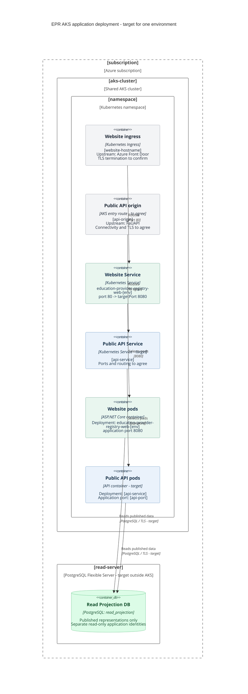
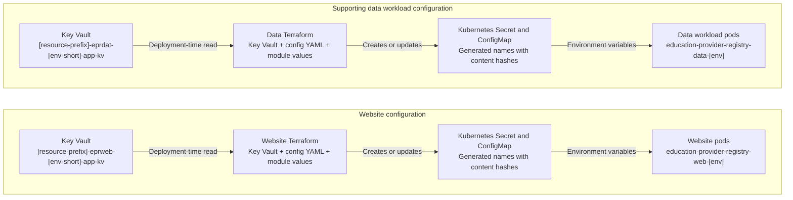

# AKS application deployment — target

This is the environment-neutral AKS detail beneath our [target deployment overview](deployment-diagram.md). The diagrams use placeholders; the tables give configured names for dev, test, pre-prod and prod. Live resources remain unverified.

## Naming placeholders

| Placeholder | Meaning |
| --- | --- |
| `[env]` | `development`, `test`, `preproduction` or `production`. |
| `[env-short]` | `dv`, `ts`, `pp` or `pd`. |
| `[resource-prefix]` | `s189t01` or `s189p01`. |
| `[subscription]`, `[aks-cluster]`, `[namespace]` | Values in the environment table. Namespace names must be read from configuration rather than inferred from `[env]`. |
| `[website-hostname]` | Environment-specific website ingress hostname. |
| `[api-service]`, `[api-origin]`, `[api-port]` | API naming, routing and port decisions still to be agreed. |
| `[read-server]` | Target logical read-projection server; per-environment names are not established by the reviewed deployment configuration. |

## Target application layout

The two columns represent the website and public API paths. Read downwards from their AKS entry routes through Services and pods to the Read Projection DB. Front Door and FaUAPI appear in the overview; this view starts at their AKS-facing endpoints.

The website port mapping follows current configuration. The API origin box represents the endpoint to agree with FaUAPI; it does not select an ingress controller or public exposure. We do not use a service mesh. TLS termination and backend certificate validation remain actions under [PA-03](../../../docs/transformation/low-level/public-access/owasp/pa-03-transport-security-controls.md).

Each pod box represents instances managed by its Deployment. Services select pods; Deployments manage their lifecycle. Changing pod names, image digests and configuration hashes belong in the inventory or release evidence.

## Environment names

These are configured values and names resolved from naming rules, rather than confirmation that the target is deployed in every environment.

| Setting | Dev | Test | Pre-prod | Prod |
| --- | --- | --- | --- | --- |
| `[env]` | `development` | `test` | `preproduction` | `production` |
| `[env-short]` | `dv` | `ts` | `pp` | `pd` |
| `[resource-prefix]` | `s189t01` | `s189t01` | `s189p01` | `s189p01` |
| `[subscription]` | `s189-teacher-services-cloud-test` | `s189-teacher-services-cloud-test` | `s189-teacher-services-cloud-production` | `s189-teacher-services-cloud-production` |
| AKS resource group | `s189t01-tsc-ts-rg` | `s189t01-tsc-ts-rg` | `s189p01-tsc-pd-rg` | `s189p01-tsc-pd-rg` |
| `[aks-cluster]` | `s189t01-tsc-test-aks` | `s189t01-tsc-test-aks` | `s189p01-tsc-production-aks` | `s189p01-tsc-production-aks` |
| `[namespace]` | `gias-development` | `gias-test` | `gias-production` | `gias-production` |

Pre-prod and prod currently specify the same namespace, **`gias-production`**. We must confirm the intended isolation; substituting `preproduction` into a namespace pattern would misrepresent the configuration.

### Application and configuration names

The platform ingress names below are derived from the shared cluster DNS prefixes. They are not custom public domains or evidence of Front Door routing.

| Resource | Dev | Test | Pre-prod | Prod |
| --- | --- | --- | --- | --- |
| Website Deployment / Service | `education-provider-registry-web-development` | `education-provider-registry-web-test` | `education-provider-registry-web-preproduction` | `education-provider-registry-web-production` |
| `[website-hostname]` / ingress name | `education-provider-registry-web-development.test.teacherservices.cloud` | `education-provider-registry-web-test.test.teacherservices.cloud` | `education-provider-registry-web-preproduction.teacherservices.cloud` | `education-provider-registry-web-production.teacherservices.cloud` |
| Data workload Deployment | `education-provider-registry-data-development` | `education-provider-registry-data-test` | `education-provider-registry-data-preproduction` | `education-provider-registry-data-production` |
| Website resource group | `s189t01-eprweb-dv-rg` | `s189t01-eprweb-ts-rg` | `s189p01-eprweb-pp-rg` | `s189p01-eprweb-pd-rg` |
| Data resource group | `s189t01-eprdat-dv-rg` | `s189t01-eprdat-ts-rg` | `s189p01-eprdat-pp-rg` | `s189p01-eprdat-pd-rg` |
| Website application Key Vault | `s189t01-eprweb-dv-app-kv` | `s189t01-eprweb-ts-app-kv` | `s189p01-eprweb-pp-app-kv` | `s189p01-eprweb-pd-app-kv` |
| Data application Key Vault | `s189t01-eprdat-dv-app-kv` | `s189t01-eprdat-ts-app-kv` | `s189p01-eprdat-pp-app-kv` | `s189p01-eprdat-pd-app-kv` |
| Target API Deployment / Service / origin | To agree | To agree | To agree | To agree |
| Target `[read-server]` | Not established in reviewed configuration | Not established in reviewed configuration | Not established in reviewed configuration | Not established in reviewed configuration |

### Existing database naming context

These names expand the inspected module naming conventions using each environment's inputs. Module refs vary by environment; applied revisions and live resources still need verification. These resources are distinct from the target Read Projection DB.

| Resource | Dev | Test | Pre-prod | Prod |
| --- | --- | --- | --- | --- |
| Data PostgreSQL server | `s189t01-eprdat-dv-pg` | `s189t01-eprdat-ts-pg` | `s189p01-eprdat-pp-pg` | `s189p01-eprdat-pd-pg` |
| Reporting replica naming pattern | `s189t01-eprdat-dv-pg-replica-reporting` | `s189t01-eprdat-ts-pg-replica-reporting` | `s189p01-eprdat-pp-pg-replica-reporting` | `s189p01-eprdat-pd-pg-replica-reporting` |
| Website PostgreSQL server | `s189t01-eprweb-dv-pg` | `s189t01-eprweb-ts-pg` | `s189p01-eprweb-pp-pg` | `s189p01-eprweb-pd-pg` |

The inspected data module sets `source_server_id` for the reporting replica and enables logical-replication server settings. This does not establish the target logical publication/subscription or permitted-field projection. We do not substitute a reporting replica name for `[read-server]`.

The data workload is separate from the public API. Its current `is_web=false` configuration generates no web Service or ingress. Its final relationship to the target publication process remains to be specified.

## Configuration and secrets pattern

This diagram uses placeholders for the website and supporting data workload. It records the deployment-time pattern from the inspected modules; the API's configuration resources and delivery mechanism remain to be specified separately.

Terraform assembles configuration and secrets in Kubernetes objects, which pods consume through `env_from`. This does not establish runtime application access to Key Vault. Exact object names require their content hashes from deployment evidence; secret values are not included here.

The current data Terraform writes `eprweb-eprdat-dotnet-db-connection` into the website application Key Vault using the data server connection. Website Terraform separately supplies `EPRWEB_DOTNET_DB_CONNECTION`, while the reviewed application reads `eprweb_eprdat_dotnet_db_connection`. Resolving the effective connection remains a prerequisite to verifying transition to the target projection.

## Sources and verification

| Detail | Source |
| --- | --- |
| Environment inputs | [Data global configuration](https://github.com/DFE-Digital/education-provider-registry-data/tree/7b2b667251c371fe55beda99b55ffccf591fc3dd/global_config) and [website global configuration](https://github.com/DFE-Digital/education-provider-registry-web/tree/f5b78880f13d27dc083a3e45c262d510c0a2f5d1/global_config). Each contains `development.sh`, `test.sh`, `preproduction.sh` and `production.sh`. |
| Namespace assignments | The corresponding environment's `.tfvars.json` in [data Terraform configuration](https://github.com/DFE-Digital/education-provider-registry-data/tree/7b2b667251c371fe55beda99b55ffccf591fc3dd/terraform/application/config) and [website Terraform configuration](https://github.com/DFE-Digital/education-provider-registry-web/tree/f5b78880f13d27dc083a3e45c262d510c0a2f5d1/terraform/application/config). |
| Resource groups, vaults and AKS names | [Data Makefile](https://github.com/DFE-Digital/education-provider-registry-data/blob/7b2b667251c371fe55beda99b55ffccf591fc3dd/Makefile) and [website Makefile](https://github.com/DFE-Digital/education-provider-registry-web/blob/f5b78880f13d27dc083a3e45c262d510c0a2f5d1/Makefile). |
| Cluster DNS and workload naming | [Shared cluster map](https://github.com/DFE-Digital/terraform-modules/blob/351d9005d9991a879940501f5c335a5109070507/aks/cluster_data/variables.tf) and [website application module](https://github.com/DFE-Digital/terraform-modules/blob/27bc86537d000840b0e5ca28550fb024659f8ef7/aks/application/resources.tf). |
| Website port mapping | [Website application Terraform](https://github.com/DFE-Digital/education-provider-registry-web/blob/f5b78880f13d27dc083a3e45c262d510c0a2f5d1/terraform/application/application.tf) and the shared application module. |
| Data workload and database naming | [Data application Terraform](https://github.com/DFE-Digital/education-provider-registry-data/blob/7b2b667251c371fe55beda99b55ffccf591fc3dd/terraform/application/application.tf), [database inputs](https://github.com/DFE-Digital/education-provider-registry-data/blob/7b2b667251c371fe55beda99b55ffccf591fc3dd/terraform/application/database.tf) and [PostgreSQL module](https://github.com/DFE-Digital/terraform-modules/blob/351d9005d9991a879940501f5c335a5109070507/aks/postgres/resources.tf). |
| Configuration and cross-service connection | [Configuration module](https://github.com/DFE-Digital/terraform-modules/blob/351d9005d9991a879940501f5c335a5109070507/aks/application_configuration/resources.tf) and [shared-secret mapping](https://github.com/DFE-Digital/education-provider-registry-data/blob/7b2b667251c371fe55beda99b55ffccf591fc3dd/terraform/application/shared_secrets.tf). |

The [infrastructure inventory](../../../docs/transformation/low-level/public-access/infra/development-infrastructure.md) records the detailed naming trace and module refs reviewed on 23 October 2026. The tables expand those conventions; they do not assert that all environments used the same module revision.

Before treating this target as implemented, confirm API naming and routing, projection provisioning, effective database connections, applied module revisions, isolation and the TLS evidence required by [PA-03](../../../docs/transformation/low-level/public-access/owasp/pa-03-transport-security-controls.md).
