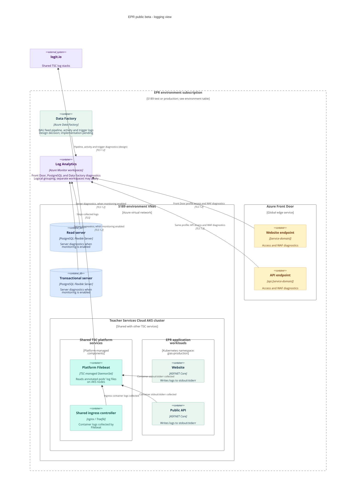

# Education Provider Registry: logging deployment view

This view shows only components involved in log collection and delivery from the [main deployment diagram](../deployment-diagram.md). It omits request handling, data feeds, secrets and replication relationships.

## Logging configuration
The support columns map the logging design to the supplied security documents. They describe contributions to controls, rather than completed assessments or proof of deployed operation. 

| Component | Ownership | Logging / collection | Destination and transport | Configuration and status | Baseline support | OWASP support |
| --- | --- | --- | --- | --- | --- | --- |
| Website | EPR | Writes application logs to stdout/stderr; Filebeat collects the resulting container log files. | Platform Filebeat → logit.io over TLS. | Set `enable_logit = true` on the shared application module to add `logit.io/send: "true"` to pods. EPR must agree event fields, JSON formatting, log levels and sensitive-data filtering. | 3.8, 3.10; 8.1, 8.2 | A09: event collection and format (partial); A04: log transport |
| Public API | EPR | Writes application logs to stdout/stderr; Filebeat collects the resulting container log files. | Platform Filebeat → logit.io over TLS. | Set `enable_logit = true` on the shared application module. EPR must agree API event fields, correlation and consumer identifiers, log levels and sensitive-data filtering. | 3.8, 3.10; 8.1, 8.2 | A09: event collection and format (partial); A04: log transport |
| Shared ingress controller | TSC | Emits ingress container logs collected by Filebeat. | Platform Filebeat → logit.io over TLS. | TSC manages the nginx / Traefik deployment and Logit pod annotation.  | 3.8, 3.10; 8.1, 8.2 | A09: request-log collection (partial); A04: log transport |
| Platform Filebeat | TSC | Runs as a DaemonSet and reads annotated pods' log files on AKS nodes; collection does not call the applications. | Shared TSC logit.io stack over TLS. | TSC manages pod discovery, the `BEATS-URL` destination secret and `ssl.enabled: true`.| 3.8, 3.10; 8.1, 8.2 | A09: off-node collection (partial); A04: log transport |
| Front Door website endpoint | EPR | Front Door profile access and WAF diagnostics covering website traffic. | Log Analytics over TLS 1.2. | Enable `azure_enable_monitoring` on the shared domains infrastructure module. Settings apply to the Front Door profile.  | 3.8, 3.10; 8.1, 8.2 | A09: access/WAF event collection (partial); A04: log transport |
| Front Door API endpoint | EPR | Front Door profile access and WAF diagnostics covering API traffic. | Log Analytics over TLS 1.2. | Covered by the same profile-level diagnostic settings as the website endpoint| 3.8, 3.10; 8.1, 8.2 | A09: access/WAF event collection (partial); A04: log transport |
| Read PostgreSQL server | EPR | Server diagnostic logs; audit events require separate PostgreSQL audit configuration. | Log Analytics over TLS 1.2. | Enable `azure_enable_monitoring` on the PostgreSQL module. Database contents are not automatically copied into logs. | 3.8, 3.10; 8.1, 8.2; 3.14/8.5 conditional on audit configuration | A09: server-log collection (partial); audit trail conditional; A04: log transport |
| Transactional PostgreSQL server | EPR | Server diagnostics for the server hosting establishment and governance databases; audit events require separate configuration. | Log Analytics over TLS 1.2. | Enable `azure_enable_monitoring` on the PostgreSQL module. | 3.8, 3.10; 8.1, 8.2; 3.14/8.5 conditional on audit configuration | A09: server-log collection (partial); audit trail conditional; A04: log transport |
| Data Factory — EPR BAU feed | EPR | Pipeline, activity and trigger run logs: `PipelineRuns`, `ActivityRuns`, `TriggerRuns`. | Environment Log Analytics workspace over TLS 1.2. | `azure_enable_monitoring = true` enables module metric alerts. Configure a separate diagnostic setting to send `PipelineRuns`, `ActivityRuns` and `TriggerRuns` to an environment Log Analytics workspace using resource-specific tables: `ADFPipelineRun`, `ADFActivityRun` and `ADFTriggerRun`. | 3.8, 3.10; 8.1, 8.2 (target design) | A09: run-log collection (partial); A04: log transport |
| Log Analytics | EPR | Receives Azure diagnostic logs from Front Door, PostgreSQL and, by design, Data Factory. | Azure Monitor workspaces; no onward forwarding to logit.io is established. | The diagram groups destinations logically; modules may create separate workspaces. ADF can reuse a suitable workspace where access and retention requirements align. [Azure Monitor documents TLS 1.2 support for diagnostic destinations](https://learn.microsoft.com/en-us/azure/azure-monitor/data-collection/diagnostic-settings#destinations). | 3.8, 3.10; 8.1, 8.2; 8.9 aggregation only | A09: central collection (partial); A04: log transport |
| logit.io | TSC | Receives application and ingress logs shipped by platform Filebeat. | Shared TSC log stacks outside the EPR subscription. | TSC manages the environment stacks and shipping infrastructure. Security Information and Event Management (SIEM) forwarding is a separate integration. | 3.8, 3.10; 8.1, 8.2; 8.9 aggregation only | A09: central collection (partial); A04: log transport |
