# Key Vault and secrets deployment view

This view shows the documented Key Vault dependencies for EPR. It combines current target specifications with the explicitly identified archived configuration evidence below; it is not confirmation of deployed access or working integrations. See the [deployment overview](deployment-diagram.md) for the wider service.

Names use `s189{env-code}01`, where `{env-code}` is the owning subscription code, and `{env-short}` is `dv`, `ts`, `pp` or `pd`. Resolve each resource against its own environment. The ADF connection is specified for development only; its exact names are retained here.

## Key Vault dependencies

Amber components are vault contents; blue components configure or retrieve secrets; green components consume injected configuration. Arrows point towards the component being called or configured. Workload dependencies on application vaults are indirect, through deployment-time injection.

```mermaid
%%{init: {"wrap": true, "c4": {"width": 260}}}%%
C4Deployment
    UpdateLayoutConfig($c4ShapeInRow="2", $c4BoundaryInRow="2")

    Deployment_Node(webVault, "s189{env-code}01-eprweb-{env-short}-app-kv", "Azure Key Vault; application configuration") {
        Container(webSecrets, "Website secrets", "Key Vault secrets", "Includes eprweb-eprdat-dotnet-db-connection in inspected configuration")
    }
    Deployment_Node(webDelivery, "Website configuration delivery", "Deployment-time dependency") {
        Container(webDeploy, "Website Terraform deployment", "Deployment pipeline", "Reads vault secrets and assembles workload configuration")
        Container(webConfig, "Website Secret and ConfigMap", "Kubernetes configuration", "Injected into pods through env_from")
        Container(web, "education-provider-registry-web-{service-env}", "Website pods", "Consumes injected configuration; no direct runtime vault read established")
    }

    Deployment_Node(dataVault, "s189{env-code}01-eprdat-{env-short}-app-kv", "Azure Key Vault; application configuration") {
        Container(dataSecrets, "Supporting data workload secrets", "Key Vault secrets", "Source for deployment-time application configuration")
    }
    Deployment_Node(dataDelivery, "Supporting data configuration delivery", "Archived inspected configuration") {
        Container(dataDeploy, "Data Terraform deployment", "Deployment pipeline", "Reads data vault; also writes a database connection secret into website vault")
        Container(dataConfig, "Data Secret and ConfigMap", "Kubernetes configuration", "Injected into pods through env_from")
        Container(data, "education-provider-registry-data-{service-env}", "Supporting data workload pods", "Separate from the Public API and ADF")
    }

    Deployment_Node(adfVault, "s189t01-eprdat-dv-inf-kv", "Azure Key Vault; development infrastructure; Azure RBAC") {
        Container(sqlSecret, "edubase-dev-adf-automation-sql-password", "Key Vault secret", "Existing SQL account password; latest version")
    }
    Deployment_Node(factory, "s189t01-eprdat-development-adf", "Azure Data Factory; development connection specification") {
        Container(kvLs, "ls_epr_key_vault", "AzureKeyVault linked service", "Uses factory system-assigned identity")
        Container(sqlLs, "ls_gias_bau_sql_dev", "AzureSqlDatabase linked service", "Password reference through ls_epr_key_vault")
        Container(runtime, "ir-gias-bau-sql-dev", "Managed Azure integration runtime", "SQL connection; private vault route requires approved endpoint")
    }

    Rel(webDeploy, webSecrets, "Reads at deployment", "Key Vault API")
    Rel(webDeploy, webConfig, "Creates or updates")
    Rel(webConfig, web, "Injects configuration")
    Rel(dataDeploy, dataSecrets, "Reads at deployment", "Key Vault API")
    Rel(dataDeploy, dataConfig, "Creates or updates")
    Rel(dataConfig, data, "Injects configuration")
    Rel(dataDeploy, webSecrets, "Writes database connection secret", "Key Vault API")
    Rel(sqlLs, kvLs, "References password store")
    Rel(kvLs, sqlSecret, "Retrieves latest secret at runtime", "Factory identity; HTTPS")
    Rel(sqlLs, runtime, "connectVia")

    UpdateElementStyle(webSecrets, $bgColor="#FEF3C7", $fontColor="#78350F", $borderColor="#D97706")
    UpdateElementStyle(dataSecrets, $bgColor="#FEF3C7", $fontColor="#78350F", $borderColor="#D97706")
    UpdateElementStyle(sqlSecret, $bgColor="#FEF3C7", $fontColor="#78350F", $borderColor="#D97706")
    UpdateElementStyle(webDeploy, $bgColor="#DBEAFE", $fontColor="#172554", $borderColor="#2563EB")
    UpdateElementStyle(dataDeploy, $bgColor="#DBEAFE", $fontColor="#172554", $borderColor="#2563EB")
    UpdateElementStyle(kvLs, $bgColor="#DBEAFE", $fontColor="#172554", $borderColor="#2563EB")
    UpdateElementStyle(sqlLs, $bgColor="#DBEAFE", $fontColor="#172554", $borderColor="#2563EB")
    UpdateElementStyle(runtime, $bgColor="#DBEAFE", $fontColor="#172554", $borderColor="#2563EB")
    UpdateElementStyle(webConfig, $bgColor="#DCFCE7", $fontColor="#14532D", $borderColor="#16A34A")
    UpdateElementStyle(dataConfig, $bgColor="#DCFCE7", $fontColor="#14532D", $borderColor="#16A34A")
    UpdateElementStyle(web, $bgColor="#DCFCE7", $fontColor="#14532D", $borderColor="#16A34A")
    UpdateElementStyle(data, $bgColor="#DCFCE7", $fontColor="#14532D", $borderColor="#16A34A")
```

## Vault configuration and evidence

| Vault | Dependent components | Integration and evidence |
| --- | --- | --- |
| `s189{env-code}01-eprweb-{env-short}-app-kv` | Website deployment and Website pods; data deployment as a secret writer | [Archived inspected configuration](archive/development-aks-deployment.md#configuration-and-secrets-pattern) records Terraform reads, Kubernetes injection and the data deployment writing `eprweb-eprdat-dotnet-db-connection`. The effective website connection/configuration key remains unresolved; this does not establish a working connection to the target Read Projection. |
| `s189{env-code}01-eprdat-{env-short}-app-kv` | Data deployment and supporting data workload pods | Same [archived configuration evidence](archive/development-aks-deployment.md#configuration-and-secrets-pattern). Deployment reads secrets; pods consume injected configuration. The supporting data workload is not the Public API or ADF. |
| `s189t01-eprdat-dv-inf-kv` | ADF identity, `ls_epr_key_vault`, `ls_gias_bau_sql_dev` and managed runtime | [Development ADF specification](azure-data-factory/db-connection/db-connection-deployment-diagram.md#components): runtime SQL password retrieval, Key Vault Secrets User grant to the current factory identity, managed private endpoint and matching vault-side approval. [Illustrative Terraform](azure-data-factory/db-connection/db-connection-terraform-configuration.md) includes secure pipeline password population. It is untested specification code; a successful Key Vault-backed connection is not established. |

## Unresolved vault dependencies

| Component | Information still required |
| --- | --- |
| Public API | Target vault name, secret names, deployment identity and injection mechanism. The [main identity controls](deployment-diagram.md#identity-and-secrets) propose separate workload credentials but do not identify a concrete API vault integration. |
| Establishment/Governance replication and application readers | The [replication specification](etl/epr-logical-replication-configuration.md) requires separate replication and reader credentials but does not assign their storage to named vaults. Confirm writer, delivery and rotation ownership. |
| Front Door origin protection | The [main deployment design](deployment-diagram.md#shared-ingress-risks) says the origin ID is held in Key Vault; the exact vault/secret mapping and proposed per-environment header remain to confirm. No direct Front Door-to-vault read is established. |
| Platform log shipping | The [logging view](logging-deployment-diagram.md#logging-configuration) identifies a Filebeat destination secret, but no Key Vault source. Do not infer an additional vault integration. |

Vault access must distinguish the deployment identity from runtime identities. Application injection requires a deployment/rollout to refresh running pods. ADF instead resolves the unversioned password reference at runtime. Secret values are deliberately absent from this view.
