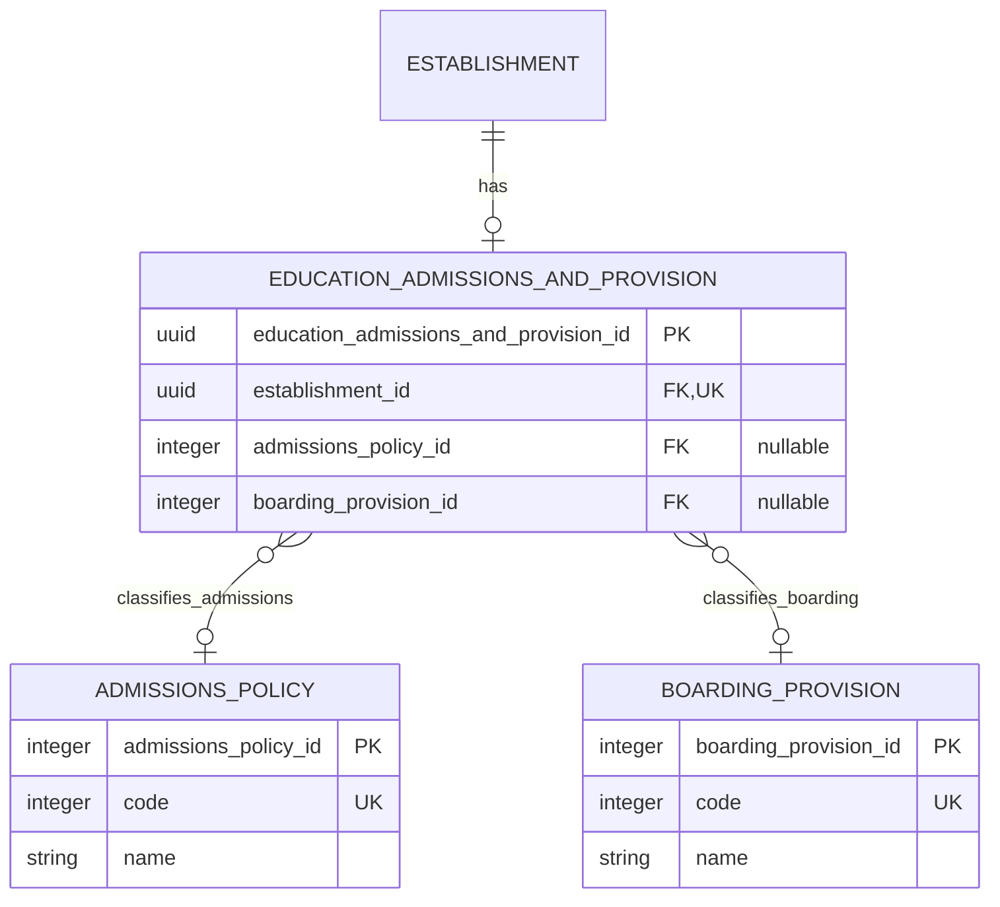

# Admissions policy and boarding provision

Two independent, optional classifications on `education_admissions_and_provision`. Each provision record selects at most one value from each list. Each lookup value can be reused by many establishments.

## Relationships

Use nullable foreign keys on the existing provision record. Separate association or wrapper tables are unnecessary for these single-value classifications. A missing admissions relationship does not prevent recording boarding or other provision facts.

## Admissions policy

Controlled admissions classification. Target name: `admissions_policy`. BAU: `dbo.AdmissionsPolicy`.

| admissions_policy_id | code | name |
| --- | --- | --- |
| 1 | 1 | Comprehensive (secondary) |
| 2 | 2 | Selective (grammar) |
| 3 | 3 | Modern (secondary) |
| 4 | 4 | Non-selective |

## Boarding provision

Controlled boarding or residential arrangement. Target name: `boarding_provision`. BAU: `dbo.Boarders`.

| boarding_provision_id | code | name |
| --- | --- | --- |
| 1 | 1 | No boarders |
| 2 | 2 | Children's home (Boarding school) |
| 3 | 3 | Boarding school |
| 4 | 4 | College / FE residential accomodation |

## Identity and absence rules

- Each list has its own internal identity sequence starting at 1. A separate unique integer `code` preserves the BAU business code, even where values currently coincide. Resolve relationships by `code`; store the internal ID as the foreign key.
- Names describe the values; foreign keys reference the stable integer keys.
- BAU `0` (`Not applicable`) becomes a null foreign key. Do not seed a Not applicable lookup row or invent a default relationship.
- BAU `9` (`Not recorded`) and a missing source value also become null. Preserve the original source value in migration evidence when the reason for absence matters; null alone does not distinguish these cases.
- `No boarders` is a substantive recorded answer and retains its relationship. It is distinct from no boarding information. `Non-selective` likewise remains a recorded policy.
- Exclude archive flag `1` and account for excluded source associations. The imported local dictionary has null archive flags for admissions codes `1` and `3`, so both are included. The older repository snapshot has different flags; migration uses the actual source dictionary. Code `5` (Not collected) is excluded as absence information.
- Reject unexpected source codes and broken references. Do not turn a mapping error into an absent relationship.
- Clearing a previously recorded classification sets that foreign key to null. Retain the provision record when it contains other facts.
- Applicability and requiredness are separate: a nullable relationship allows absence; establishment-type validation can require a value where the business rules demand one.

Values and labels above reflect the direct MSSQL migration on 12 November 2026. Source labels are retained exactly, including the boarding label's spelling. Both full eligible dictionaries are imported, independently of which values the selected establishments use. See [Source-owned reference data](../../schema/automation/source-reference-data.md).

