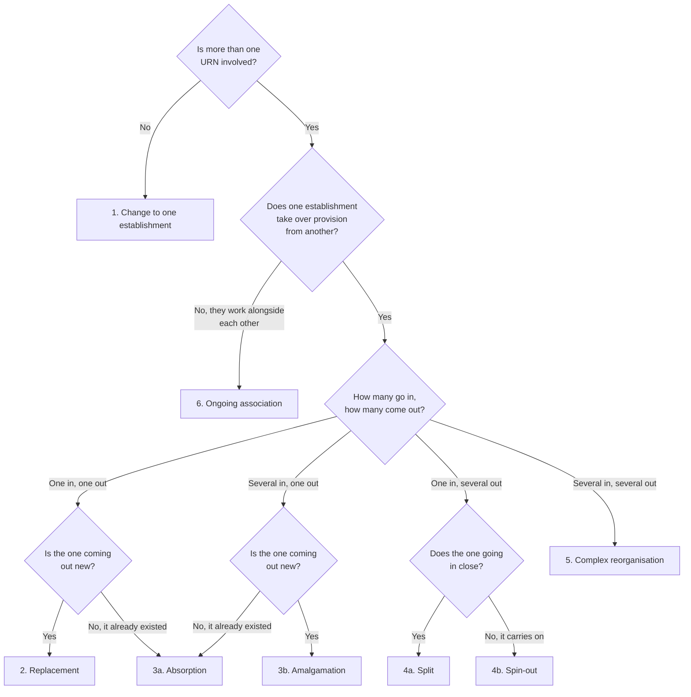

# How establishments change: a taxonomy

Draft for discussion, 27 November 2026. It draws on the four documents in the [succession folder](../) and their BAU evidence. It doesn't replace them. It is a way to explain them and agree terms with business specialists.

## In one paragraph

Schools and other establishments change in two very different ways. Some change **within themselves**. They keep their URN and get a new age range, more places or a sixth form. Others change **between establishments**. One closes and another takes over its provision, or several combine, or one is divided. Only the second kind creates succession between URNs. We can describe every case of the second kind by asking three questions: how many establishments go in, how many come out, and whether each one is new, continuing or closing. The answers give a small set of patterns that already exist in company law and official statistics. Everything else, such as academy conversion or a change of age range, is extra detail we attach to the pattern. It is not a separate pattern.

## Is there an existing taxonomy?

Yes. We don't need to invent one. Three established sources use almost the same set of patterns.

| Source | What it offers | How it matches our cases |
| --- | --- | --- |
| Eurostat business registers: [demographic events](https://ec.europa.eu/eurostat/documents/3859598/12453409/KS-GQ-21-001-EN-N.pdf) (see also the [merger glossary entry](https://ec.europa.eu/eurostat/statistics-explained/index.php/Glossary:Merger_of_enterprises)) | Birth, death, merger, take-over, break-up, split-off and wider restructuring, plus **continuity rules** for deciding when a unit keeps its identity. | Statistical registers have the same problem we do: is this the same unit carrying on, or a new one? The [Eurostat-OECD business demography manual](https://www.oecd.org/economics/eurostat-oecd-manual-on-business-demography-statistics_9789264041882-en) notes that in a take-over the unit that takes over keeps its identifier. That is exactly our absorption case. |
| DfE school organisation guidance: [opening, closing and making changes to schools](https://www.gov.uk/guidance/opening-closing-and-making-changes-to-schools) and [prescribed alterations](https://assets.publishing.service.gov.uk/media/68947395ad0cbc0e276430d8/making-significant-changes-prescribed-alterations-to-maintained-schools.pdf) | Separate legal processes for **opening**, **closing** and **making significant changes** (expansion, age range, sixth form and so on). | It confirms our main split. Opening and closing change which establishments exist. Prescribed alterations change one establishment and keep its identity. Many of BAU's archived link labels (contraction, add sixth form, remove nursery, change religious character) look like prescribed alterations. We haven't confirmed that against BAU history. |
| W3C [Organization Ontology](https://www.w3.org/TR/vocab-org/) | `org:ChangeEvent`, with `org:originalOrganization` (who went in) and `org:resultingOrganization` (who came out). Organisations point back to the event with `org:changedBy` and `org:resultedFrom`. | This is the RDF-idiomatic way to model "an event with participants" if we decide we need it. The succession pairs we already record can be read off such an event. |

The terms differ slightly. Eurostat says *take-over* where we say *absorption*, and *break-up* and *split-off* where we say *split* and *spin-out*. Company law calls them *merger by acquisition* and *merger by formation of a new company*. The patterns are the same. We suggest our own plain-English names, mapped to these terms, so that everyone can find the link.

## Two levels: the event and its effects

This is the idea that makes the rest easy to follow.

| Level | Question | Examples |
| --- | --- | --- |
| **Event** | What happened between establishments? | Replacement, absorption, amalgamation, split, spin-out |
| **Effect** | What happened to one establishment as a result? | Closed, opened, carried on, age range changed, capacity increased |

One event can have several effects on several establishments. A merger can close one school, raise the capacity of another and change its age range, all at once.

BAU often puts both levels in one value. "Merged - change in age range" is an event and an effect in one label. If we copy that approach we end up with a growing list such as "merged with expansion and change of age range". Keeping the two levels apart avoids that.

Effects also happen without any event. A school that changes its age range under the same URN has an effect but no partner establishment, so there is no succession.

## The taxonomy

### Three questions decide the pattern

1. **How many establishments go in, and how many come out?**
2. **Does each one going in close, or does it carry on?**
3. **Is each one coming out new, or did it already exist?**

### The families

We use two levels here:

- **The relationship type** is what we store. There are three: succession, provision transfer and ongoing association. We decide the type for each pair of establishments with one test: did the origin close?
- **The family** is the shape of the whole event. We use it to explain and classify what happened.

The table groups the families by the relationship type they **usually** create. It is not a strict hierarchy. One event can create more than one type. Sedbergh is a split, so it creates succession, but its two continuing schools also exchanged provision, which is provision transfer. Family numbers stay the same so that references elsewhere in this document still work.

| Family | Usually creates | Pattern | Plain-English test | Equivalent terms |
| --- | --- | --- | --- | --- |
| **2. Replacement** | Succession | One closes, one new opens | The old one is gone and a new one does the same job | Closure and opening as linked proposals |
| **3a. Absorption** | Succession | One or more close, an existing one carries on and takes their provision | The school that's left already existed | Take-over (Eurostat); merger by acquisition (company law) |
| **3b. Amalgamation** | Succession | Two or more close, one new opens | They all stopped, and a new school started | Merger (Eurostat); merger by formation of a new company |
| **4a. Split** | Succession | One closes, its provision goes to two or more others, new or existing | The old one is gone and several took its place | Break-up (Eurostat); division (company law) |
| **4b. Spin-out** | Provision transfer | One carries on, and a new one is created from part of it | The original is still open | Split-off (Eurostat) |
| **5. Complex reorganisation** | Mixed | Several in, several out | A local reorganisation that touches many schools | Restructuring (Eurostat) |
| **6. Ongoing association** | Ongoing association | Two or more carry on and work together | Nobody replaced anybody | Not a demographic event |
| **1. Change to one establishment** | None | One URN, before and after | Same school, something about it changed | Prescribed alteration (DfE) |

How many records each family creates:

- **Succession families** create one pair for each establishment that closed and each establishment that took over its provision.
- **Complex reorganisation** creates succession where the origin closed and provision transfer where it carried on, but only for pairs we have evidence for.
- **Change to one establishment** creates no relationship. It belongs in that establishment's own history.

We also need a **review state**, not a family, for source links that don't tell us enough to choose. BAU codes `0` Not applicable and most uses of `9` Other belong here.

Two things people often expect to be families are really variations:

- **Replacement after a gap.** The pattern is still replacement or absorption. The gap is a fact about dates.
- **Chains.** A becomes B and later B becomes C. That is two separate events. We record A → B and B → C, and work out the chain when we read it.

### Details we attach to a pattern

These describe an event or its effects. They are not extra families.

| Detail | Applies to | Values to agree |
| --- | --- | --- |
| **Cause or context** | The event | Academy conversion, fresh start, local reorganisation (for example infant and junior to primary), change of registration regime, intervention |
| **Outcome for each establishment** | Each establishment involved | Closed, newly opened, carried on |
| **Role** | Each establishment involved | Gave provision, received provision, replaced |
| **Change to provision** | Each establishment that carried on or opened | Age range, capacity, sixth form added or removed, nursery added or removed, religious character, site |
| **Dates** | The event and each establishment | When the event took effect, separate from each school's opening and closing dates and from when the system recorded the link |

Academy conversion is the clearest example. People often call it a type of succession. In this taxonomy it is the **cause** of a replacement. Teign School is a replacement whose cause is academy conversion.

## Examples from BAU

All of these come from the local test copy. They are candidate readings for business review, not confirmed history.

| Family | Example | Why it fits |
| --- | --- | --- |
| 2. Replacement | **113557 Teign School → 136494 Teign School** | Foundation school closed 28 February 2011. The academy opened 1 March 2011. Cause: academy conversion. |
| 3a. Absorption | **130546 Joseph Priestley College → 135771 Leeds City College** | Joseph Priestley closed in 2011. Leeds City had opened in 2009, so it already existed. BAU labels this "Result of Amalgamation", which shows that the label alone isn't enough. |
| 3a. Absorption, with effects | **102200 Weald Junior School → 102215 Weald Rise Primary School** | The junior school closed and the primary school carried on. BAU code `2Q` records two effects on the primary school: more capacity and a changed age range. |
| 3b. Amalgamation (candidate) | **Leeds College of Technology, Park Lane College and Leeds Thomas Danby → 135771 Leeds City College** | Three colleges linked to one college that opened in April 2009. We still need to check the closure dates of the three. |
| 4a. Split | **139979 Westlands School → 141384 Green Gates Academy and 141385 Westlands Academy** | Westlands closed on 31 August 2014. Both academies opened the next day. |
| 4a. Split into existing schools | **121739 Sedbergh Junior School → 112445 Casterton Sedbergh Preparatory and 112451 Sedbergh School** | The junior school closed. Two existing schools carried on, one with an age-range change and one with a capacity change. BAU holds six links for this one event. Only two are succession. |
| 4b. Spin-out | **137077 Rosedale College → 141561 Rosedale Primary School** | Rosedale College is still open. A new primary school was created from it. |
| 6. Ongoing association | **132838 LaSWAP Sixth Form ↔ 100050 Parliament Hill School** | A sixth-form partnership and a participating school. Neither replaces the other. |

## How BAU link types fit

BAU's `LinkType` list mixes all of the above. It holds direction, event pattern, effects and associations in one column. So we treat it as **evidence**, not as the target classification. This table shows what each active code tells us. Codes in the second column are hints we still need to check against each case.

| What the code tells us | BAU codes | Points towards |
| --- | --- | --- |
| Direction only | `1` Predecessor, `2` Successor | Any family from 2 to 5. Most links (over 24,000 rows) carry only this. |
| Event pattern hint | `1L` Predecessor - merged, `6` Successor - merged | 3a Absorption (BAU's merge screen uses these when an existing school survives) |
|  | `6.1` Predecessor - amalgamated, `6.2` Successor - amalgamated | 3b Amalgamation (BAU's merge screen uses these when it creates a new school) |
|  | `2K` Result of Amalgamation | 3a or 3b; needs checking |
|  | `1F` Predecessor - Split School, `2F` Successor - Split School | 4a Split or 4b Spin-out |
| Effect | `1I` Closure | Outcome: closed |
|  | `2A` Expansion, `2P` Merged - expansion of school capacity | Change to provision: capacity |
|  | `2O` Merged - change in age range | Change to provision: age range |
|  | `2Q` Merged - expansion in school capacity and changer in age range | Both of the above |
| Association | `4` Sixth Form Centre Link, `5` Sixth Form Centre School | 6 Ongoing association: sixth form |
|  | `CC` Children's Centre Link | 6 Ongoing association: children's centres |
| Nothing useful | `0` Not applicable, `9` Other | Review state |

The 21 archived codes follow the same split. Most are **effects** (contraction, change of age range, add or remove sixth form or nursery, change of religious character). A few are **causes** (For Academy, Fresh Start, Former Independent, New Provision). Some are **outcomes** for a registration regime (De-registered, Does not meet criteria for registration). None of them has rows in the local copy, so these readings come from the labels alone.

The full code-by-code evidence is in the [LinkType analysis](../bau-linktype-scenario-conceptual-analysis.md).

## Three types of relationship between establishments

BAU holds every link between establishments in one table, `EstablishmentLink`. That table mixes three different kinds of relationship. We separate them.

| | **Succession** | **Provision transfer** | **Ongoing association** |
| --- | --- | --- | --- |
| What it says | This establishment closed and that one took over its provision | Provision moved from this establishment to that one, and the origin carried on | These establishments work together |
| Comes from | A change event | A change event | An arrangement, not an event |
| Origin closed? | Yes, always | No | Not relevant |
| Time | One-off historical fact with an effective date. Never ends. | One-off historical fact with an effective date. Never ends. | A period with start and end dates. Can be current. |
| Shape | Directed: predecessor to successor | Directed: origin to recipient | Roles, such as centre and member school |
| Question it answers | Who came before this school? | Where did this school's provision come from? | Who does this school work with? |
| Families | Usually 2, 3a, 3b and 4a, and part of 5 | Usually 4b, and part of 5. Sometimes part of 4a, as at Sedbergh. | 6 |
| Examples | Teign; Westlands; Sedbergh Junior into each survivor | Rosedale College to Rosedale Primary; Sedbergh School and Casterton | LaSWAP and Parliament Hill; children's centre links |

Succession and provision transfer are close relatives. Both record provision moving because of a change. The only difference is whether the origin closed. Keeping them separate keeps the succession rule simple: a successor always means the predecessor closed.

One event can produce both. Sedbergh is the example. The junior school closed, giving two succession pairs. The two schools that carried on also exchanged provision, which is provision transfer. If we later model the event itself, for example with `org:ChangeEvent`, both types can be read off its participants.

Ongoing associations are a different kind of thing. Each kind needs its own named relationship, not a shared "linked establishment" table, or we rebuild BAU's problem. Some may belong in the groups model instead. GIAS already has group types for children's centres, and a sixth-form consortium could be a group with member schools.

## What this means for the model

- The current [succession creation rules](../establishment-succession-creation-rules.md) already match the succession type. They create one record for each closed predecessor and each successor it hands over to. This taxonomy doesn't change those rules.
- Family 1 belongs in establishment history, not in any relationship between establishments.
- Provision transfer is new. It fills the gap left by spin-out, where nothing closes but something real happened. It needs its own creation rules, written in the same way as the succession rules.
- Ongoing associations need modelling separately, starting with a check against the groups model.
- The taxonomy passes our conceptual boundary tests. A domain expert would recognise it. It is true without GIAS. It describes the world, not our records. BAU codes belong in the mapping, not in the concepts.
- Whether we model the **event** itself, for example with `org:ChangeEvent`, or only the succession pairs it produces is still open. The pairs are enough for "who came before this school?". An event is needed for "show me the whole reorganisation" or "one effective date for everything".

## Questions for business review

1. Do the six families and their names make sense to people who run school organisation?
2. Is absorption into an existing school really different from amalgamation into a new one? BAU's merge screen treats them differently. We think they should be different.
3. Do users need provision transfer, for spin-outs and transfers between schools that both carried on? Or is succession enough?
4. Is academy conversion a cause of replacement, or something users expect to see as its own type?
5. Do users need whole reorganisation events, or are succession pairs enough?
6. Can someone confirm what the archived codes were used for, ideally with old examples?

## Sources

| Source | Why it is relevant |
| --- | --- |
| [Eurostat business registers manual 2021](https://ec.europa.eu/eurostat/documents/3859598/12453409/KS-GQ-21-001-EN-N.pdf) | Its demographic-events chapter names the standard patterns of change between units: birth, death, merger, take-over, break-up, split-off and restructuring. These map closely onto our families. It also has continuity rules for deciding when a unit stays the same. Don't use those rules for schools. By Eurostat's tests, an academy conversion like Teign would look like the same unit carrying on, but DfE issues a new URN. We have read summaries of this chapter, not the full text. |
| [Eurostat glossary: merger of enterprises](https://ec.europa.eu/eurostat/statistics-explained/index.php/Glossary:Merger_of_enterprises) | A short, citable definition of merger. It helps explain why we keep amalgamation into a new school apart from absorption into an existing one. |
| [Eurostat-OECD business demography manual](https://www.oecd.org/economics/eurostat-oecd-manual-on-business-demography-statistics_9789264041882-en) | It notes that in a take-over the unit taking over keeps its identifier. That matches our absorption case, where the surviving school keeps its URN. It also keeps restructuring events apart from simple births and deaths, which supports keeping reorganisations apart from plain openings and closures. |
| [DfE: opening, closing and making changes to schools](https://www.gov.uk/guidance/opening-closing-and-making-changes-to-schools) | The main domain authority. It describes the real processes that create these events. Opening and closing a school change which establishments exist, while making changes alters one establishment. The rules changed on 1 September 2026, so check which version applies to a given case. |
| [DfE: making significant changes (prescribed alterations)](https://assets.publishing.service.gov.uk/media/68947395ad0cbc0e276430d8/making-significant-changes-prescribed-alterations-to-maintained-schools.pdf) | It lists the changes a maintained school can make without changing its identity: expansion, age range, adding or removing a sixth form, and others. This is the source for family 1, change to one establishment, and for the change-to-provision details. Many archived BAU link labels look like prescribed alterations. We haven't confirmed that against BAU history. |
| [W3C Organization Ontology](https://www.w3.org/TR/vocab-org/) | The standard RDF vocabulary for organisational change. `org:ChangeEvent` links the organisations that went in to the ones that came out. It is relevant to how we model events in our ontology, if we decide we need them. It isn't a source of meaning for school change. |
