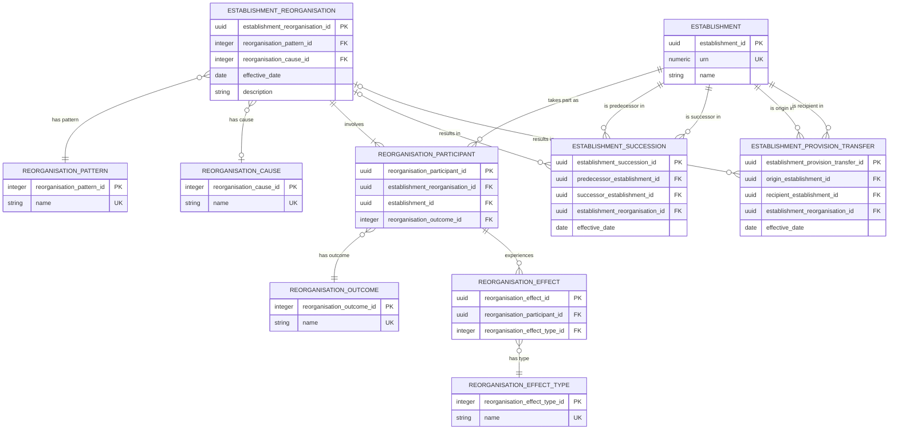

# Establishment reorganisation: logical model


Physical implementation: the [establishment schema](../../schema/establishment/establishment-schema.sql) now defines these tables, with keys and single-row checks only. Rules that span several rows, such as pattern matching, lifecycle agreement and cycle detection, will be checked in validation or in the application. Target-owned reference seeds and isolated schema tests are included; source-backed case migration is still to do. See the [migration test-case catalogue](../../../../docs/transformation/data/modelling/reorganisation/reorganisation-migration-test-cases.md).

We call this topic **establishment reorganisation**, the term DfE and councils already use for closures, mergers and splits. It describes something that happened in the world. It isn't an edit to an establishment record.

## What the model separates

| Concept | What it records | Entity |
| --- | --- | --- |
| **Reorganisation** | Something that happened, involving one or more establishments | `establishment_reorganisation` |
| **Reorganisation pattern** | The shape of the reorganisation: replacement, absorption, split and so on | `reorganisation_pattern`, referenced by the reorganisation |
| **Cause** | Why it happened, such as academy conversion | `reorganisation_cause`, referenced by the reorganisation |
| **Participant** | One establishment taking part in a reorganisation | `reorganisation_participant` |
| **Outcome** | Whether that participant closed, opened or carried on | `reorganisation_outcome`, referenced by the participant |
| **Effect** | A change to that participant's provision, such as a new age range | `reorganisation_effect` |
| **Succession** | Provision moved from an establishment that closed | `establishment_succession` |
| **Provision transfer** | Provision moved from an establishment that carried on | `establishment_provision_transfer` |

The reorganisation says what happened. Participants, outcomes and effects say what it did to each establishment. Succession and provision transfer say where provision went.

Ongoing associations, such as sixth-form partnerships, aren't reorganisations. They are outside this model. See [Ongoing associations](#ongoing-associations).

## ERD



## Establishment reorganisation

`establishment_reorganisation` records one business reorganisation involving one or more establishments. A merger of three schools is one reorganisation, not three.

Business-friendly pattern:

```text
What happened, when did it take effect, and why?
```

| Column | Required | Meaning and rule |
| --- | --- | --- |
| `establishment_reorganisation_id` | Yes | Generated opaque technical key. |
| `reorganisation_pattern_id` | Yes | The shape of the reorganisation. It must agree with the participants and pairs. See [Pattern rules](#pattern-rules). |
| `reorganisation_cause_id` | No | Why the reorganisation happened. Null means the cause isn't established. We never guess it from the pattern. |
| `effective_date` | No | Date the reorganisation took effect. Null means it isn't established. It isn't automatically any participant's opening or closing date, or a source link date. |
| `description` | No | Short readable summary for people reviewing the reorganisation, such as "Weald Junior absorbed into Weald Rise Primary". |

- A reorganisation has one or more participants.
- A reorganisation is a historical fact. It has no end date and no current flag. A correction to a wrong reorganisation needs an audit trail. It isn't the reorganisation expiring.
- We don't create a reorganisation just because several source links share a date. Matching dates are a reason to review, not evidence of one reorganisation.

### Reorganisation pattern

`reorganisation_pattern` is a closed list. Each value has an integer key and a unique name, like `academy_route`.

Business-friendly pattern:

```text
What shape did this reorganisation take: replacement, absorption, amalgamation, split or another pattern?
```

| Pattern | Meaning |
| --- | --- |
| Replacement | One establishment closes and a new one opens to replace it. |
| Absorption | One or more establishments close and an existing establishment carries on and takes their provision. |
| Amalgamation | Two or more establishments close and a new establishment opens in their place. |
| Split | One establishment closes and its provision goes to two or more others, new or existing. |
| Spin-out | One establishment carries on and one or more new establishments are created from part of it. |
| Transfer between continuing establishments | Provision moves between establishments that all carry on, and none is created. |
| Complex reorganisation | Two or more establishments give provision and two or more receive it. |

*Transfer between continuing establishments* isn't in the taxonomy yet. We found the gap while writing the rules. Without it, a nursery moving from one open school to another open school has no pattern. It needs business confirmation.

A change affecting only one establishment belongs in its dated attribute history. It does not create a reorganisation. Effects record changes that accompany a reorganisation between establishments.

### Pattern rules

The pattern is stored because it is the classification people search for and review. It must also agree with the reorganisation's participants and pairs. A mismatch means the pattern or the participants are wrong, and the reorganisation is held for review.

In these rules, a **giver** is a participant that is the predecessor or origin in at least one of the reorganisation's pairs. A **receiver** is a participant that is the successor or recipient in at least one pair. A participant can be both.

| Pattern | Givers | Receivers | Pairs |
| --- | --- | --- | --- |
| Replacement | Exactly one, closed | Exactly one, opened | One succession |
| Absorption | One or more, all closed | Exactly one, continued | Succession only |
| Amalgamation | Two or more, all closed | Exactly one, opened | Succession only |
| Split | Exactly one, closed | Two or more, opened or continued | Succession only |
| Spin-out | Exactly one, continued | One or more, all opened | Provision transfer only |
| Transfer between continuing establishments | One or more, all continued | One or more, all continued | Provision transfer only |
| Complex reorganisation | Two or more | Two or more | Any mix |

Every reorganisation involves at least two distinct establishments, and every participant appears in a succession or provision-transfer pair within that event.

A reorganisation with only one succession pair still needs its pattern. Teign is a replacement. Joseph Priestley into Leeds City College is an absorption.

### Reorganisation cause

`reorganisation_cause` records why the reorganisation happened, separately from its pattern and participant effects. It has an integer key and a unique name. Use the following working list of causes.

Business-friendly pattern:

```text
Why did this reorganisation happen?
```

| Cause | Note |
| --- | --- |
| Academy conversion | Evidenced for Teign. |
| Fresh start | From BAU's archived link type and opening and closing reasons. |
| Change of registration regime | For example a former independent school entering the state sector. |
| Change in status | From BAU's opening and closing reasons. Needs a clearer business definition. |

The lifecycle's opening and closing reasons stay where they are. They are facts about each establishment, such as "this school opened as an academy converter". The reorganisation's cause is a fact about the whole reorganisation. During migration, lifecycle reasons are useful evidence for the cause and pattern, but we don't copy them across automatically.

## Reorganisation participant

`reorganisation_participant` records one establishment's part in one reorganisation.

Business-friendly pattern:

```text
Which establishments took part in this reorganisation,
and did each one close, open or carry on?
```

| Column | Required | Meaning and rule |
| --- | --- | --- |
| `reorganisation_participant_id` | Yes | Generated opaque technical key. |
| `establishment_reorganisation_id` | Yes | The reorganisation. |
| `establishment_id` | Yes | The establishment taking part. |
| `reorganisation_outcome_id` | Yes | What happened to this establishment's identity in the reorganisation. |

- An establishment appears at most once in a reorganisation. The pair of reorganisation and establishment is unique.
- An establishment can take part in many reorganisations over time. A school can absorb another in 2009 and be split in 2014.
- We don't store a role such as "giver". The pairs already show who gave and who received, and one participant can do both.

### Reorganisation outcome

`reorganisation_outcome` is a closed list with an integer key and a unique name.

Business-friendly pattern:

```text
Did this establishment close, open or carry on as part of this reorganisation?
```

| Outcome | Meaning | Lifecycle check |
| --- | --- | --- |
| Closed | The establishment closed as part of this reorganisation. | Its lifecycle should show it as closed. |
| Opened | The establishment opened as part of this reorganisation. | Its lifecycle should show an opening date, where known. |
| Continued | The establishment existed before the reorganisation and carried on after it. | It wasn't closed by this reorganisation. |

The outcome is the effect every participant has, so we store it as one required value. Other effects are optional and can be many, so they have their own entity.

Lifecycle dates corroborate the outcome. They don't replace it. A successor that later closed still has outcome Opened or Continued in the earlier reorganisation.

## Reorganisation effect

`reorganisation_effect` records one change to a participant's provision caused by the reorganisation.

Business-friendly pattern:

```text
As a result of this reorganisation, what changed about this establishment?
```

| Column | Required | Meaning and rule |
| --- | --- | --- |
| `reorganisation_effect_id` | Yes | Generated opaque technical key. |
| `reorganisation_participant_id` | Yes | The participant affected. |
| `reorganisation_effect_type_id` | Yes | The kind of change. |

- A participant has zero or more effects. Weald Rise Primary has two: capacity increased and age range changed.
- A participant has each effect type at most once in a reorganisation.
- The effect records **that** something changed. The values before and after live in the establishment's dated attribute history, such as its statutory age range. We don't copy them here, or the two could disagree.
- A participant with outcome Closed has no effects. Closing is its outcome.

### Reorganisation effect type

`reorganisation_effect_type` is a list with an integer key and a unique name. These values are candidates. Several come only from archived BAU labels, so they need business confirmation.

Business-friendly pattern:

```text
What kind of change occurred: for example, did the age range change or capacity increase?
```

| Effect type | BAU evidence |
| --- | --- |
| Age range changed | `2O`, `2Q`; archived `1B`, `1C`, `2B`, `2C` |
| Capacity increased | `2A`, `2P`, `2Q`; archived `2C` |
| Capacity reduced | Archived `1A`, `1C` |
| Sixth form added | Archived `2D` |
| Sixth form removed | Archived `1D` |
| Nursery added | Archived `2E` |
| Nursery removed | Archived `1E` |
| Religious character changed | Archived `1H`, `2H` |

One effect type replaces each combined BAU label. `2Q` "Merged - expansion in school capacity and changer in age range" becomes an absorption reorganisation with two effects on the receiving school.

## Establishment succession

`establishment_succession` records that provision moved from an establishment that closed. The [succession creation rules](../../../../docs/transformation/data/modelling/reorganisation/establishment-succession-creation-rules.md) still apply in full.

Business-friendly pattern:

```text
Which establishment closed, and which establishment took over its provision?
```

| Column | Required | Meaning and rule |
| --- | --- | --- |
| `establishment_succession_id` | Yes | Generated opaque technical key. |
| `predecessor_establishment_id` | Yes | The establishment that closed. |
| `successor_establishment_id` | Yes | The establishment that took over its provision. |
| `establishment_reorganisation_id` | No | The reorganisation that produced this pair, where we know it. |
| `effective_date` | No | Only used when there is no reorganisation. See [Dates](#dates). |

## Establishment provision transfer

`establishment_provision_transfer` records that provision moved from an establishment that carried on.

Business-friendly pattern:

```text
Which establishment gave provision while carrying on, and which establishment received it?
```

| Column | Required | Meaning and rule |
| --- | --- | --- |
| `establishment_provision_transfer_id` | Yes | Generated opaque technical key. |
| `origin_establishment_id` | Yes | The establishment the provision came from. It didn't close as a result. |
| `recipient_establishment_id` | Yes | The establishment that received the provision, new or existing. |
| `establishment_reorganisation_id` | No | The reorganisation that produced this pair, where we know it. |
| `effective_date` | No | Only used when there is no reorganisation. See [Dates](#dates). |

Provision transfer needs its own creation rules, written like the succession rules. Until those are agreed, we hold candidate transfers for review rather than loading them.

## Rules for both kinds of pair

- Each pair links two different establishments.
- Each pair is stored once. Reverse source links are evidence for the same pair, not a second pair.
- Succession must not form a cycle. Following successors must never lead back to the start.
- A pair can exist without a reorganisation. Most migrated BAU links will start that way, because the source records pairs, not reorganisations. We group pairs into a reorganisation only when the evidence supports it.
- When a pair belongs to a reorganisation, both establishments must be participants in that reorganisation.
- A succession predecessor must have outcome Closed in its reorganisation. A provision-transfer origin must not.
- The same two establishments can't have both a succession and a provision transfer from the same reorganisation.
- We don't store a type on either pair. The pattern and cause of the reorganisation classify it. This replaces `establishment_succession_type` in the original proposal.

## Dates

Each date has one home, so values can't disagree.

| Date | Where it lives |
| --- | --- |
| When the reorganisation took effect | The reorganisation's `effective_date` |
| When a pair took effect, if there's no reorganisation | The pair's `effective_date`, which must be null when the pair belongs to a reorganisation |
| When each establishment opened or closed | `establishment_lifecycle` |
| Source link dates and system recording dates | Migration evidence only |

When we later group a pair into a reorganisation, its date moves to the reorganisation, if the reorganisation doesn't already have one.

## Ongoing associations

Sixth-form partnerships and children's centre links aren't reorganisations, so they don't belong in this model. Each needs its own named relationship, with start and end dates and participant roles. We should first check whether they fit the group model since GIAS already has group types for children's centres.

## Examples

**Teign: replacement caused by academy conversion**

| Entity | Values |
| --- | --- |
| Reorganisation | Pattern Replacement; cause Academy conversion; effective date to be agreed |
| Participants | 113557 Teign School, Closed; 136494 Teign School, Opened |
| Succession | 113557 → 136494 |

**Weald: absorption with two effects**

| Entity | Values |
| --- | --- |
| Reorganisation | Pattern Absorption; effective date 1 April 2015, to be confirmed |
| Participants | 102200 Weald Junior School, Closed; 102215 Weald Rise Primary School, Continued |
| Effects | Weald Rise: Capacity increased; Age range changed |
| Succession | 102200 → 102215 |

**Westlands: split into two new academies**

| Entity | Values |
| --- | --- |
| Reorganisation | Pattern Split |
| Participants | 139979 Westlands School, Closed; 141384 Green Gates Academy, Opened; 141385 Westlands Academy, Opened |
| Succession | 139979 → 141384; 139979 → 141385 |

**Rosedale: spin-out**

| Entity | Values |
| --- | --- |
| Reorganisation | Pattern Spin-out |
| Participants | 137077 Rosedale College, Continued; 141561 Rosedale Primary School, Opened |
| Provision transfer | 137077 → 141561 |

**Sedbergh: complex reorganisation**

| Entity | Values |
| --- | --- |
| Reorganisation | Pattern Complex reorganisation; effective date to be agreed |
| Participants | 121739 Sedbergh Junior School, Closed; 112445 Casterton Sedbergh Preparatory, Continued; 112451 Sedbergh School, Continued |
| Effects | Casterton: Age range changed. Sedbergh School: Capacity increased. |
| Succession | 121739 → 112445; 121739 → 112451 |
| Provision transfer | 112451 → 112445; 112445 → 112451, if review confirms the two schools exchanged provision |

If review finds the two continuing schools didn't exchange provision, there are no transfers, and the pattern becomes Split.

These six BAU links become one reorganisation, three participants, two effects and up to four pairs.


