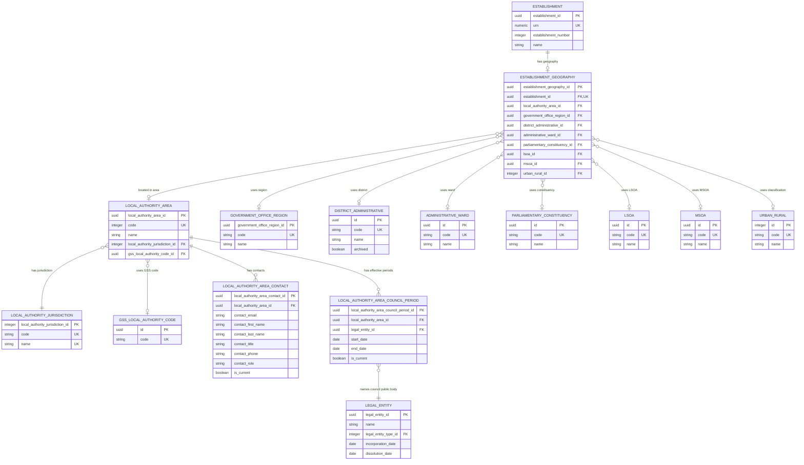

# Establishment geography

## Purpose

This model describes the local authority area, Government Office Region, administrative district, administrative ward, parliamentary constituency, LSOA, MSOA and urban/rural classification associated with an establishment. It also defines local-authority jurisdiction, statistical identifiers and contact details.

Geographic associations describe location and classification. Ownership and governance are separate relationships. Postal addresses and sites are described in [Location, contact and sites](location-contact-and-sites.md).

The DfE LA number identifies an area. The council responsible for that area is a separate legal entity of type Public body. `local_authority_area_council_period` records the effective periods connecting the two. The current migration maps all 206 captured BAU areas, including historical and Welsh areas; unknown effective dates remain null.

## Relationships

An establishment has zero or one geography record. Each record belongs to exactly one establishment and can reference one local authority area, one region, one district, one ward, one parliamentary constituency, one LSOA, one MSOA and one urban/rural classification. Each reference value can be associated with many establishments.

A local authority area has one jurisdiction, zero or one GSS code and any number of temporarily associated council contacts. An area can have successive council periods, while the same council can cover several area codes over time. Only one period per area can be marked current. Missing periods mean unresolved backfill, not that there was no council. Region, district, ward, parliamentary constituency, LSOA, MSOA and urban/rural classifications are recorded independently; this model does not define a hierarchy between them.

The establishment entity is shown for context; its full definition is in [Identity and classification](identity-and-classification.md).

## Tables and columns

Required columns must have a value. Optional relationships may be absent when a classification is not recorded or does not apply. Primary keys identify records; reference codes identify distinct values within their respective code lists.

### Establishment geography

`establishment_geography`

Groups the geographic classifications associated with an establishment.

| Column | Type | Required | Meaning and constraint |
| --- | --- | --- | --- |
| `establishment_geography_id` | UUID | Yes | Primary key. |
| `establishment_id` | UUID | Yes | Unique foreign key to establishment.establishment_id. |
| `local_authority_area_id` | UUID | No | Foreign key to local_authority_area.local_authority_area_id. |
| `government_office_region_id` | UUID | No | Foreign key to government_office_region.government_office_region_id. |
| `district_administrative_id` | UUID | No | Foreign key to district_administrative.id. |
| `administrative_ward_id` | UUID | No | Foreign key to administrative_ward.id. |
| `parliamentary_constituency_id` | UUID | No | Foreign key to parliamentary_constituency.id. |
| `lsoa_id` | UUID | No | Foreign key to lsoa.id. |
| `msoa_id` | UUID | No | Foreign key to msoa.id. |
| `urban_rural_id` | UUID | No | Foreign key to urban_rural.id. |

### Local authority area

`local_authority_area`

Identifies the DfE LA-code area associated with an establishment. The area scopes the establishment number in the LAESTAB. This geographical relationship applies to academies and independent schools as well as maintained schools; it does not state that the council maintains the establishment.

Maintenance is separately recorded in `establishment_responsibility`, with responsibility type 5 and a council legal-entity holder. Stage 3 derives it for the eight eligible English maintained-school types using the observed area, council periods and school operating dates. Welsh-coded schools retain geography without automatic maintenance. Migration evidence preserves the inputs and inferred facts; today's area cannot establish earlier membership of another area.

Stage 5 implements reviewed reorganisations as atomic operations. A retained-code succession ends the old council period and starts the accepted successor period for the same area. A split or merger supplies new areas and a complete reviewed establishment-to-area mapping. Active eligible English maintenance transfers on the evidenced vesting date; old responsibilities and observation evidence remain. Migration-only event lineage governs later ordinary source replay. A current lookup never replaces the historical period used by an older assertion.

| Column | Type | Required | Meaning and constraint |
| --- | --- | --- | --- |
| `local_authority_area_id` | UUID | Yes | Primary key. |
| `code` | Integer | Yes | Unique DfE local-authority code. |
| `name` | Text | Yes | Area label supplied by GIAS, including historical Pre LGR labels. |
| `local_authority_jurisdiction_id` | Integer | Yes | Foreign key to local_authority_jurisdiction.local_authority_jurisdiction_id. |
| `gss_local_authority_code_id` | UUID | No | Foreign key to gss_local_authority_code.id. |

### Council periods for an area

`local_authority_area_council_period`

Records which council exercised the relevant local-authority functions for a DfE LA-code area, and when. The council is a `legal_entity` with legal-entity type Public body (9). One council can appear in several areas; each period is a separate relationship. Kent's 922 and 886 records reuse one council, while Buckinghamshire's 825 area has periods for different councils.

| Column | Type | Required | Meaning and constraint |
| --- | --- | --- | --- |
| `local_authority_area_council_period_id` | UUID | Yes | Primary key for this period. |
| `local_authority_area_id` | UUID | Yes | Foreign key to the DfE LA-code area. |
| `legal_entity_id` | UUID | Yes | Foreign key to the council legal entity. Its legal-entity type must be Public body. |
| `start_date` | Date | No | Inclusive effective start of the council's functions for this area; unknown stays null. |
| `end_date` | Date | No | Exclusive effective end; unknown stays null. |
| `is_current` | Boolean | Yes | Explicit current assertion. At most one period per area is current; dates do not automatically update this flag. |

Formation of a shadow council is separate from its assumption of functions. The former belongs to the council's incorporation date when evidenced; the latter belongs to the area period. No formation or observation date is substituted for an unknown effective date. Fully dated periods for one area cannot overlap. Overlaps involving unknown dates remain a reported limitation.

During backfill an area can have zero recorded council periods. Full completion requires at least one period for every in-scope area, including abolished and Welsh authorities. The checked-in mapping records evidence and pending decisions. Stage 2b loads 188 council identities and 207 periods for all 206 areas, including 175 current area periods. A current area lookup is not evidence of a historical school's maintaining council.

Structural guards reject non-public-body holders, invalid legal-form changes and removal of the last area link from a council holding maintenance responsibilities. The final-state check allows an area link to be replaced atomically. Maintenance responsibilities themselves are implemented in a later stage.

### Local-authority jurisdiction

`local_authority_jurisdiction`

Classifies a local authority area's jurisdiction. The controlled values are English and Welsh.

| Column | Type | Required | Meaning and constraint |
| --- | --- | --- | --- |
| `local_authority_jurisdiction_id` | Integer | Yes | Primary key. |
| `name` | Text | Yes | Unique jurisdiction name. |

### GSS local-authority code

`gss_local_authority_code`

GSS means Government Statistical Service. A GSS local-authority code is an ONS geographic identifier used to link local authorities to statistical datasets. It is distinct from the numeric DfE local-authority code.

| Column | Type | Required | Meaning and constraint |
| --- | --- | --- | --- |
| `id` | UUID | Yes | Primary key. |
| `code` | Text | Yes | Unique GSS local-authority code; contains letters and digits. |

### Government Office Region

`government_office_region`

Identifies the region classification associated with an establishment.

| Column | Type | Required | Meaning and constraint |
| --- | --- | --- | --- |
| `government_office_region_id` | UUID | Yes | Primary key. |
| `code` | Text | Yes | Unique region code. |
| `name` | Text | Yes | Region name. |

### Administrative district

`district_administrative`

Identifies the administrative district associated with an establishment's location. District and local-authority classifications can describe the same area while remaining distinct concepts.

| Column | Type | Required | Meaning and constraint |
| --- | --- | --- | --- |
| `id` | UUID | Yes | Primary key. |
| `code` | Text | Yes | Unique district code. |
| `name` | Text | Yes | District name. |
| `archived` | Boolean | Yes | Whether the district reference value is archived. Existing relationships can reference archived districts. |

### Administrative ward

`administrative_ward`

Identifies the ward associated with an establishment's location.

| Column | Type | Required | Meaning and constraint |
| --- | --- | --- | --- |
| `id` | UUID | Yes | Primary key. |
| `code` | Text | Yes | Unique ward code. |
| `name` | Text | Yes | Ward name. |

### Parliamentary constituency

`parliamentary_constituency`

Identifies the parliamentary constituency associated with an establishment's location.

| Column | Type | Required | Meaning and constraint |
| --- | --- | --- | --- |
| `id` | UUID | Yes | Primary key. |
| `code` | Text | Yes | Unique constituency code. |
| `name` | Text | Yes | Constituency name. |

### LSOA

`lsoa`

Identifies the Lower Layer Super Output Area associated with an establishment's location. LSOAs are small-area statistical geographies designed for consistent reporting of statistics below local-authority level. They are built from groups of Output Areas and are modelled separately from MSOAs.

The Office for National Statistics (ONS) defines and publishes the codes, names and boundary products for LSOAs in England and Wales. A representative example is:

The ONS description of these statistical geographies is available in its [Census 2021 geographies guidance](https://www.ons.gov.uk/methodology/geography/ukgeographies/censusgeographies/census2021geographies).

| Code | Name | Interpretation |
| --- | --- | --- |
| `E01000001` | City of London 001A | An England and Wales LSOA code beginning with `E01`. |

| Column | Type | Required | Meaning and constraint |
| --- | --- | --- | --- |
| `id` | UUID | Yes | Primary key. |
| `code` | Text | Yes | Unique LSOA code. |
| `name` | Text | Yes | LSOA name. |

The code and name identify the statistical geography; they do not identify a school, local authority or electoral ward.

### MSOA

`msoa`

Identifies the Middle Layer Super Output Area associated with an establishment's location. MSOAs are statistical geographies made up of groups of LSOAs and usually fit within a local authority. They are modelled separately from LSOAs.

The ONS defines and publishes the codes, names and boundary products for MSOAs in England and Wales. A representative example is:

| Code | Name | Interpretation |
| --- | --- | --- |
| `E02000001` | City of London 001 | An England and Wales MSOA code beginning with `E02`. |

| Column | Type | Required | Meaning and constraint |
| --- | --- | --- | --- |
| `id` | UUID | Yes | Primary key. |
| `code` | Text | Yes | Unique MSOA code. |
| `name` | Text | Yes | MSOA name. |

An MSOA normally contains several LSOAs. The relationship between the two statistical geographies is maintained by ONS lookup and boundary products; this model records the Establishment's current LSOA and MSOA classifications without duplicating that hierarchy.

### Urban/rural classification

`urban_rural`

Identifies the urban or rural classification associated with an establishment's location. It is an independent controlled reference value and is not a substitute for an administrative or statistical area.

| Column | Type | Required | Meaning and constraint |
| --- | --- | --- | --- |
| `id` | UUID | Yes | Primary key. |
| `code` | Text | Yes | Unique urban/rural classification code. |
| `name` | Text | Yes | Human-readable classification name. |

### Contacts temporarily associated with the area

`local_authority_area_contact`

Describes council contacts currently stored against the area. Multiple contacts may be current at the same time. Their eventual association with the council belongs to the legal-entity contact slice; the area rename does not move them.

| Column | Type | Required | Meaning and constraint |
| --- | --- | --- | --- |
| `local_authority_area_contact_id` | UUID | Yes | Primary key. |
| `local_authority_area_id` | UUID | Yes | Foreign key to local_authority_area.local_authority_area_id. |
| `contact_email` | Text | No | Contact email address. |
| `contact_first_name` | Text | No | Contact person's given name. |
| `contact_last_name` | Text | No | Contact person's family name. |
| `contact_title` | Text | No | Contact person's title or job title. |
| `contact_phone` | Text | No | Contact telephone number. |
| `contact_role` | Text | No | Role or purpose of the contact. |
| `is_current` | Boolean | Yes | Whether the contact record is current. |

## Integrity rules

- Each establishment has at most one geography record.
- Every populated foreign key references an existing record.
- Reference codes are unique within their reference table. Names are labels and may change without changing a record's identity.
- Each local authority area has exactly one jurisdiction and at most one GSS code.
- Council periods reference public-body legal entities. An unchanged legal form is valid; changing a referenced council to a different or unknown form is rejected.
- One area has at most one current council period. Fully known periods cannot overlap. A council can be linked to several areas, with no uniqueness constraint on the council alone.
- The complete-backfill validation gate requires a council period for every area. Partial migration reports unresolved areas without manufacturing council records.
- The DfE local-authority code combines with the establishment number to form the DfE number (LAESTAB).
- Archived district values remain valid references for existing relationships.
- Parliamentary constituency codes are unique within the constituency reference.
- LSOA codes are unique within the LSOA reference.
- MSOA codes are unique within the MSOA reference.
- Urban/rural classification codes are unique within the urban_rural reference.
- A local-authority contact contains at least one of an email address, telephone number, given name, family name or title.

## Model boundary

The model records current geographic associations without effective dates or boundary-change history. Postcode lookup data is outside its scope.
