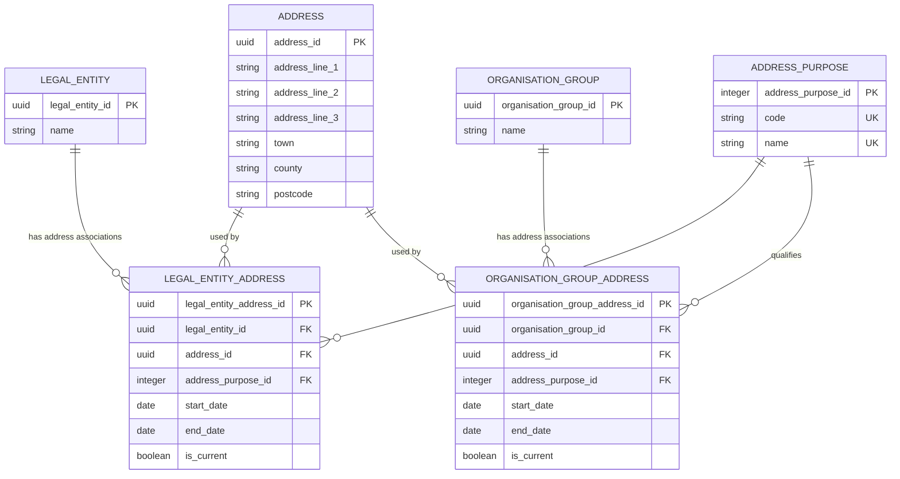

# Group addresses logical model

Implementation position: both association tables now have start/end dates and a current flag, with at-most-one-current and fully known period non-overlap constraints. T1 has two current administrative associations for its separate former SAT and current MAT, sharing one postal-address record with unknown business dates. T2 and T3 add continuing-trust observations. T4 and T5 retain blank organisation-group blocks, while T6 and T12 retain blank foundation-trust blocks. T7 adds one current administrative address for Dunstone Education Trust and retains its blank contact block plus two blank person-sponsor blocks. T8 records distinct former and current operator addresses. T10 and T11R each combine sponsor and MAT observations into one shared legal-entity administrative address. The shared loader resolves legal-entity and organisation-group owners and can preserve blank person-source blocks as migration evidence. The business model does not yet include person-address associations. Loaders preserve existing values and reject unreviewed conflicts; direct-write permissions and rewrite/delete protections are not yet defined. Reviewed address-correction auditing and coverage of other cases remain outstanding.

This document defines current and historical address use for legal entities and organisation groups in the Establishment Registry. It is the separate address branch of the [Establishment groups model](establishment-groups-logical-model.md), not an extension of school-site membership or academy-trust classification.

It answers four questions: who uses the address, which postal address is used, for what purpose, and when that use applies. The model separates the subject, preserved postal-address values, purpose and address-use period.

## Address ownership

An address belongs to the subject using it, not to its academy-trust classification or the source group UID. Reuse the existing `address` concept through purpose-labelled associations; do not add duplicate address components to legal entities, roles or groups.

| Subject | Address owner | Permitted purposes |
| --- | --- | --- |
| Academy trust, including SAT and MAT | `legal_entity` through `legal_entity_address` | Registered office, contact and administrative |
| Sponsor, foundation trust, umbrella trust or proprietor body | The resolved `legal_entity` through `legal_entity_address` | Registered office where applicable and evidenced, contact and administrative |
| Federation, children's-centre group or collaboration | `organisation_group` through `organisation_group_address` | Administrative and contact, not a legal registered office |

An academy trust is a legal entity holding a role, not a third address-owner kind. A SAT-to-MAT classification change does not move its addresses. If a company also acts as sponsor or proprietor, its corporate addresses remain attached to that same legal entity. A federation is an organisation group in this model: an address does not justify inventing a legal entity for it. A separately identified legal body associated with a federation would retain its own legal-entity addresses; these are not automatically the federation's addresses.

## Group address ERD

`legal_entity` and `organisation_group` are existing owner tables. Their definitions remain in the [Establishment groups logical model](establishment-groups-logical-model.md); the sections below describe only the address tables.

### Legal entity address

`legal_entity_address` records one continuous period during which one legal entity uses one postal address for one purpose. It answers "which address does this organisation use, what is it used for, and when?" The preserved address values are held separately in `address`.

A legal entity may have one current registered-office address, one current default contact address and one current administrative address recorded. Each purpose is optional. Several historical associations may exist for the same owner and purpose, but at most one has `is_current = true`. A move creates a new association rather than replacing the address on the previous period. Returning to an earlier address also creates a new association period.

| Attribute | Required | Rule |
| --- | --- | --- |
| `legal_entity_address_id` | Yes | Generated opaque identifier of this address-use association. It identifies neither the organisation nor the postal address itself. |
| `legal_entity_id` | Yes | The legal entity using the address. References the existing owner after identity resolution. |
| `address_id` | Yes | The shared postal-address record used for this purpose. Two purposes may reference the same address where both uses are evidenced. |
| `address_purpose_id` | Yes | Registered office, contact or administrative. Registered-office meaning requires supporting evidence or an explicit reviewed migration decision. |
| `start_date` | No | First day this address applies to the owner for this purpose. Null means unknown; it is not the date the record was imported. |
| `end_date` | No | First day this address no longer applies for this purpose. Null means unknown or not yet established, not proof that a non-current association still applies. |
| `is_current` | Yes | Explicit assertion that this is the owner's currently recorded address for this purpose. At most one is current per owner/purpose; the flag is not calculated from incomplete dates. |

For example, Northbridge can use one office for both registered-office and contact purposes. This creates two associations pointing to one postal-address record, not two copies of its address text. An absent contact association means no default contact address is recorded; it does not justify copying the registered office automatically.

### Organisation group address

`organisation_group_address` records one continuous period during which an organisation group uses one postal address for an administrative or contact purpose. It answers "where was this group's administrative address, or where should correspondence be sent, during this period?"

An organisation group may have one current administrative address and one current default contact address recorded. Each purpose is optional. Several historical periods may exist for the same owner and purpose, but at most one has `is_current = true`. Registered-office purpose is not permitted here because the group is not modelled as a legal entity.

| Attribute | Required | Rule |
| --- | --- | --- |
| `organisation_group_address_id` | Yes | Generated opaque identifier of this group's address-use association. |
| `organisation_group_id` | Yes | The federation, children's-centre group or collaboration using the address. References the existing group, not one of its members. |
| `address_id` | Yes | The shared postal-address record. Recording a group address does not require creating a school site. |
| `address_purpose_id` | Yes | Administrative or contact only. A source label does not turn the group's address into a legal registered office. |
| `start_date` | No | First day the group uses this address for this purpose; null means unknown. Membership or group opening dates do not supply this date automatically. |
| `end_date` | No | First day the group no longer uses this address for this purpose; null means unknown or not yet established. |
| `is_current` | Yes | Explicit current recorded-address assertion. At most one is current for the group and purpose, independently of the completeness of its dates. |

For example, Westbrook Federation's primary address can be recorded for administrative purposes. A separately evidenced correspondence address creates a second association with contact purpose; no contact association is invented when that evidence is absent.

### Address purpose

`address_purpose` defines why a subject uses an address. It answers "what business meaning does this address have for this owner?" Purpose belongs to the association, not to the postal-address record, because the same address may support different uses.

| Attribute | Required | Rule |
| --- | --- | --- |
| `address_purpose_id` | Yes | Stable identifier of the controlled address purpose, referenced by either association table. |
| `code` | Yes | Unique machine-readable value: `registered`, `contact` or `administrative`. It is not a BAU group-type code. |
| `name` | Yes | Unique business-friendly label displayed to users: Registered office, Contact or Administrative. |

| Code | Name | Meaning |
| --- | --- | --- |
| `registered` | Registered office | The legal entity's registered-office address, where that meaning is evidenced or explicitly accepted by a reviewed migration decision. Not a federation's registry entry address. |
| `contact` | Contact | The owner's recorded default correspondence address. It need not be the registered office or a teaching site. |
| `administrative` | Administrative | The recorded primary administrative address where registered-office meaning is not established. This preserves a BAU group address without asserting legal registration. |

For example, Registered office and Contact can both qualify associations to the same address. The labels still describe two independently recorded uses; they are not interchangeable.

### Address

`address` holds reusable postal-address components. It answers "what is the postal address?", without saying who uses it, why it is used or whether it is a school site. Its shared definition remains in [Location, contact and sites](location-contact-and-sites.md#address).

The owner, purpose and business dates are held in the association tables. An address can be referenced by several associations where that sharing is evidenced; identical address text alone does not prove shared legal identity.

Once used by an address-history association, the postal components are preserved. A different address or corrected spelling uses a new address record, or reuses an existing record with the required unchanged values. Do not overwrite the old postal text: doing so would make every historical period pointing to that record appear to have used the new address. This preservation rule also prevents unintended changes to other owners or school sites sharing the record. This is a logical preservation rule followed by the migration loaders, not a permissions restriction in the WIP physical schema. Enforcement for direct writes remains undecided.

| Attribute | Required | Rule |
| --- | --- | --- |
| `address_id` | Yes | Generated opaque identifier of the postal-address record. It is neither an organisation identifier nor a property UPRN. |
| `address_line_1` | No | First postal-address line, such as the building number/name and street, where supplied. Maps from the appropriate source Street field. |
| `address_line_2` | No | Second postal-address line or locality, where supplied. Maps from the appropriate source Locality field. |
| `address_line_3` | No | Additional postal-address line, where supplied. Maps from the appropriate source Address3 field. |
| `town` | No | Postal town or city, where supplied. Maps from the appropriate source Town field. |
| `county` | No | County name, where supplied. Resolve a source county code to its label; do not store the code as if it were an address name. |
| `postcode` | No | Postal code, where supplied. A postcode alone does not establish address purpose or registered-office status. |

Individual components may be unknown, but a wholly blank source block does not create a group address association. UPRN, country and site-name extensions are not added to this table by this design.

For example, one postal-address record can serve Northbridge's registered-office and default contact associations. If only the contact address moves, end its old contact period and create a new contact association to another address record. Keep both the historical contact row and the unchanged registered-office row pointing to the original postal-address record.

## Address association rules

Each association describes a business period for one owner, purpose and address. Preserve ended periods; do not delete them or replace their address when the owner moves. A missing purpose is not inferred from another purpose.

### Recording an address change

When a real change takes effect:

1. Set the previous association's `is_current` to false and its `end_date` to the known effective change date.
2. Create or reuse a postal-address record containing the new values without mutating the previous record.
3. Create a new association for the same owner and purpose, with that date as `start_date` and `is_current = true` when the change is current.
4. Preserve the old association and address so historical queries can still show the earlier address.

Perform the end-and-start operation atomically. An address change does not create a new legal entity, organisation group, role or trust classification. Each purpose has its own timeline: changing a contact address does not automatically change the administrative or registered-office address.

### Business dates, current status and observations

Periods follow the existing half-open convention: `start_date` is inclusive and `end_date` is exclusive. Where both are known, end must be later than start. The old and new periods may meet on the same date without overlapping.

Unknown boundaries remain null. If a new source observation shows a different current address but does not establish when it changed, retire the old current assertion with an unknown end and create the new current association with an unknown start. Do not substitute the observation date. Retain observation dates and mapping evidence separately. Null boundaries cannot establish complete historical coverage or prove that two periods do not overlap.

`is_current` supports current-address queries without guessing from incomplete dates. It must be changed explicitly; passing a future start or end date does not automatically change the flag. Known future changes remain non-current until an authorised operation activates them and retires the previous current assertion.

### Relocation versus correction

A relocation changes which address actually applies and creates a new business period. Correcting a typo or an erroneous assertion is different: the owner may not have moved at all. Create a separate postal-address record with the corrected values, preserve the original record, and apply a reviewed correction to the relevant association without inventing a relocation date. Preserve the association's before/after state, actor, reason and recording time in a correction audit. Business dates change only if the review establishes that they were wrong.

An audit describes what was recorded and corrected, not when an address actually applied. Dated associations provide explicit business history; the audit supplements that history rather than replacing it. This is not a full bitemporal model for querying every previous belief about the data. The physical correction/audit path for addresses is still outstanding.

The contact association is the subject's default correspondence address. Role-specific or named-person contact addresses are not included. Where separate sponsor/trust source records resolve to one legal entity but supply different addresses for the same purpose, preserve the assertions in migration evidence and require a decision. Do not let import order choose a winner, overwrite one assertion, or allocate another legal entity just to store the difference. Confirm whether the difference is historical, a correction or a genuinely role-specific contact before extending this model.

## Shared address and source handling

`address` remains the reusable postal-address definition in [Location, contact and sites](location-contact-and-sites.md). Its current components are address lines 1-3, town, county and postcode; the using relationship holds `address_id`. Do not create an association for a wholly blank source block. Missing components remain unknown, and absence of an association does not prove that the subject has no address.

Resolve the source group to a legal entity or organisation group before attaching its address. Map Street to address line 1, Locality to line 2, Address3 to line 3, Town to town and Postcode to postcode, resolving any county code through reference data rather than copying a code into a county label. Apply the same component mapping to the separate `GroupContact*` block. Do not use the member school's address, the lead-centre designation or source observation dates to invent a group contact or registered office.

`GroupPostUPRN`, `GroupContactUPRN`, site names and country codes remain source evidence until their location/country representation is agreed. UPRN is not added to postal-address text or inferred from it; the existing model places property identity on `site`. Receiving a group address alone does not establish a teaching site, occupation or premises ownership. Person addresses and telephone/email contacts remain outside this extension. A current source snapshot does not establish earlier address-use periods.

## Worked examples

These examples are hypothetical and illustrate the relationships, not approved source migrations.

### Academy trust with one address used for two purposes

Suppose a reviewed decision establishes that Northbridge Learning Limited uses the same office as its registered office and default contact address. Northbridge is legal entity `L1`; `A1` is its postal-address record.

| Association | Owner | Purpose | Address |
| --- | --- | --- | --- |
| Legal-entity address 1 | Legal entity L1 | Registered office | A1 |
| Legal-entity address 2 | Legal entity L1 | Contact | A1 |

There is one postal-address record and two purpose-labelled associations, each with independent business dates and current status. Northbridge's academy-trust role and sponsor role both resolve to L1, so they do not need duplicate corporate addresses. A later SAT-to-MAT classification change leaves both address-use periods untouched. If correspondence moves, end the old contact association and create another period for the new address; the registered-office association remains on A1.

### T1's MAT moves while the SAT retains its recorded address

This is a hypothetical future extension to T1, not a source assertion or an executed migration. T1's former SAT and current MAT are different legal entities whose recorded primary addresses currently share postal record A1. Suppose an evidenced MAT administrative-address change takes effect on 1 November 2026:

| Owner | Purpose | Address | Start date | End date | `is_current` after the change |
| --- | --- | --- | --- | --- | --- |
| Former SAT | Administrative | A1 | Unknown | Unknown | True |
| Current MAT | Administrative | A1 | Unknown | 2026-11-01 | False |
| Current MAT | Administrative | A2 | 2026-11-01 | Unknown | True |

The SAT's current recorded-address assertion remains unchanged; it does not assert that its academy-trust role or responsibility is current. The MAT has an ended address-use association and a new current one. A1's values remain intact for both the SAT and the MAT's historical period. No SAT/MAT identities are merged and no earlier start date is inferred.

### Federation with an administrative address

Westbrook Federation is organisation group `G1`. Its primary address is recorded as address `A2`, without evidence of a legal registered office. Create one `organisation_group_address` association from G1 to A2 with administrative purpose. Do not create a legal entity solely to store that address. If no default contact address is supplied, leave that purpose absent rather than copying A2 or a member school's address.

### Conflicting source records for one legal entity

A sponsor record and academy-trust record may resolve to the same company while recording different contact addresses. This is not permission to create two companies or silently prefer the trust record. Resolve whether one value is historical, erroneous or role-specific, and record the accepted default address and decision. Retain rejected or unresolved assertions in migration evidence. Role-specific address modelling is a separate extension if needed.

## Cardinality and integrity rules

1. Each association has exactly one owner appropriate to its association table, one address and one purpose. No address owner is a party role, classification or responsibility.
2. An owner has zero or one current address for each permitted purpose and may have several historical association periods. Legal entities can use registered-office, contact and administrative purposes; organisation groups can use administrative and contact purposes.
3. A postal address can be used by several associations where those uses are evidenced. The shared address record does not identify or merge its users.
4. Blank source blocks create no association. Missing purposes or components mean not recorded or unknown, not confirmed absence.
5. A missing contact address is not inferred from a primary address, school address or lead designation.
6. Preserve postal values used by history. A real address change ends one association period and creates another; it does not overwrite address text or discard the earlier association.
7. Registered-office purpose requires supporting purpose evidence or an explicitly reviewed migration decision. An accepted assumption remains distinguishable from independent verification in migration evidence.
8. Conflicting assertions for one resolved owner/purpose require a decision; import order is not a conflict-resolution rule.
9. Known periods for the same owner and purpose must not overlap. A fully dated period has an end strictly later than its start. The same owner may return to an earlier address through a new period.
10. Unknown dates require review before claiming historical coverage or non-overlap. Migration observations, role dates and membership dates do not invent address-use boundaries.
11. At most one association per owner/purpose has `is_current = true`; this explicit assertion is independent of incomplete dates and does not automatically advance with the clock.
12. Corrections preserve original address values and before/after association evidence through an audited path. They do not fabricate a move or effective date when the business address did not change.
13. Reobserving or reimporting an unchanged address for the same owner and purpose reuses its existing association period. A new snapshot alone is not a new period or an address-change event.

## Physical implementation follow-through

T2 also exercises this model: identical primary addresses from its SAT and MAT source records resolve to one Hive Education Trust association, with separate evidence for each observation and unknown business dates. A classification change does not itself create another address period. Its blank sponsor and contact blocks remain evidence only.

The physical tables and T1 migration now support multiple periods, unknown boundaries, one current association and non-overlapping fully known periods. Loaders preserve postal values and existing periods. Direct-write permissions, rewrite/delete protection and correction mechanisms are deferred. Remaining implementation work includes:

- Decide the reviewed address-correction and enforcement approach separately from the WIP business schema; no correction function, audit table or permission roles are currently defined.
- Extend reviewed source mappings to other cases and to actual address changes. T1 currently rejects changed source addresses pending review; it does not infer effective dates.

T1 fixtures retain both current associations with unknown business dates. Constraint tests exercise synthetic dated changes and adjacent historical periods within a rolled-back transaction. No synthetic move is stored as T1 source history, and no extra trigger has been added.

