# Establishment identity and classification

This document defines the establishment identity, lifecycle and controlled classification data.

`establishment_geography.local_authority_area_id` identifies the DfE LA-code area that scopes the establishment number in LAESTAB. It is a geographical reference, not a link asserting maintenance by a council.

## Identity and classification ERD

```mermaid
erDiagram
    ESTABLISHMENT }o--|| ESTABLISHMENT_TYPE : "has type"
    ESTABLISHMENT_TYPE }o--|| ESTABLISHMENT_TYPE_CATEGORY : "belongs to"
    ESTABLISHMENT_TYPE }o--o| ACADEMY_ROUTE : "has route"
    ESTABLISHMENT }o--o| EDUCATION_PHASE : "has phase"
    ESTABLISHMENT }o--o| FURTHER_EDUCATION_TYPE : "has further-education type"
    ESTABLISHMENT }o--o| SECTION_41_APPROVAL_STATUS : "has Section 41 status"
    ESTABLISHMENT }o--o| RELIGIOUS_CHARACTER : "has religious character"
    ESTABLISHMENT }o--o| RELIGIOUS_ETHOS : "has religious ethos"
    ESTABLISHMENT }o--o| DIOCESE : "has diocese"
    ESTABLISHMENT ||--o| ESTABLISHMENT_LIFECYCLE : "has lifecycle"
    ESTABLISHMENT ||--o| ESTABLISHMENT_GEOGRAPHY : "has geography"
    ESTABLISHMENT_GEOGRAPHY }o--o| GOVERNMENT_OFFICE_REGION : "uses region"
    ESTABLISHMENT_LIFECYCLE }o--|| ESTABLISHMENT_STATUS : "has status"
    ESTABLISHMENT_LIFECYCLE }o--o| REASON_ESTABLISHMENT_OPENED : "has opening reason"
    ESTABLISHMENT_LIFECYCLE }o--o| REASON_ESTABLISHMENT_CLOSED : "has closing reason"

    ESTABLISHMENT {
        uuid establishment_id PK
        numeric urn UK
        integer establishment_number
        numeric ukprn
        string name
        string ofsted_link
        integer establishment_type_id FK
        integer education_phase_id FK
        integer further_education_type_id FK
        integer section_41_approval_status_id FK
        integer religious_character_id FK
        integer religious_ethos_id FK
        integer diocese_id FK
    }

    FURTHER_EDUCATION_TYPE {
        integer further_education_type_id PK
        string code UK
        string name
    }

    SECTION_41_APPROVAL_STATUS {
        integer section_41_approval_status_id PK
        string code UK
        string name
    }

    RELIGIOUS_CHARACTER {
        integer religious_character_id PK
        string code UK
        string name
    }

    RELIGIOUS_ETHOS {
        integer religious_ethos_id PK
        string code UK
        string name
    }

    DIOCESE {
        integer diocese_id PK
        string code UK
        string name
    }

    ESTABLISHMENT_GEOGRAPHY {
        uuid establishment_geography_id PK
        uuid establishment_id FK, UK
        uuid local_authority_area_id FK
        uuid government_office_region_id FK
    }

    GOVERNMENT_OFFICE_REGION {
        uuid government_office_region_id PK
        string code UK
        string name
    }

    ESTABLISHMENT_LIFECYCLE {
        uuid establishment_lifecycle_id PK
        uuid establishment_id FK, UK
        integer establishment_status_id FK
        date open_date
        date close_date
        integer reason_establishment_opened_id FK
        integer reason_establishment_closed_id FK
        date last_changed_date
    }

    ESTABLISHMENT_STATUS {
        integer establishment_status_id PK
        integer code UK
        string name
    }

    REASON_ESTABLISHMENT_OPENED {
        integer reason_establishment_opened_id PK
        string code
        string name UK
    }

    REASON_ESTABLISHMENT_CLOSED {
        integer reason_establishment_closed_id PK
        string code
        string name UK
    }

    ESTABLISHMENT_TYPE {
        integer establishment_type_id PK
        string code UK
        string name
        integer establishment_type_category_id FK
        integer academy_route_id FK
    }

    ESTABLISHMENT_TYPE_CATEGORY {
        integer establishment_type_category_id PK
        integer code
        string name UK
    }

    ACADEMY_ROUTE {
        integer academy_route_id PK
        string name UK
    }

    EDUCATION_PHASE {
        integer education_phase_id PK
        integer code
        string name
    }
```



## Establishment

`establishment` is the central business table for a current establishment record. It holds the canonical identity, name and headline classification context; operational provision, measures and locations are represented by owned substructures.

Business-friendly pattern:

```text
For this establishment record,
what is its identity, name and headline classification?
```

- `urn` is the canonical public and reconciliation identifier.
- The DfE number is composed from the local-authority code in `establishment_geography` and the establishment number.
- UKPRN is an optional externally-issued provider identifier.
- This table deliberately does not absorb measures, governance, groups or site details.

| Column | Required | Meaning and rule |
| --- | --- | --- |
| `establishment_id` | Yes | Generated opaque technical key for internal relationships; not a public identifier. |
| `urn` | Yes | Immutable, globally unique canonical business identifier used for public routes, search and migration reconciliation. |
| `establishment_number` | Conditional | Local-authority-scoped establishment number, between 1 and 9999 where present. |
| `ukprn` | Conditional | Current UK Provider Reference Number supplied by UKRLP where applicable. |
| `name` | Yes | Current published establishment name; historic and alternative names are deferred. |
| `ofsted_link` | No | Optional text URL for navigating to Ofsted information using the establishment URN. |
| `establishment_type_id` | Yes | Reference to the detailed administrative establishment type. Category and academy route are obtained through that type. |
| `further_education_type_id` | Conditional | Optional reference to a further-education sub-classification, distinct from the headline establishment type. |
| `section_41_approval_status_id` | Conditional | Optional reference to the recorded Section 41 approval classification. |

### Identifier rules

| Identifier | Cardinality | Constraint | Note |
| --- | --- | --- | --- |
| URN | Exactly one | Globally unique and immutable | The canonical public establishment identifier for this slice. |
| DfE number / LAESTAB | Derived | Uniqueness requires local-authority context | Derived from the referenced local authority's `code` and `establishment_number`, commonly rendered as `LA/ESTAB` with the establishment number zero-padded to four digits. |
| UKPRN | Zero or one | Eight-digit value; global uniqueness is not yet a target rule | Optional because it does not apply to every establishment. It is externally owned by UKRLP. |

The model must enforce the stated uniqueness constraints for the direct identifier attributes. The uniqueness scope for each identifier type must be defined by its owning authority.

## Establishment lifecycle

`establishment_lifecycle` records the current status of an establishment and the key dates and reasons that explain its opening or closure. It is the logical representation of the ontology's `EstablishmentLifecycle` concept.

Business-friendly pattern:

```text
Is the establishment open, when did its current lifecycle begin or end,
and what reason explains that change?
```

- An establishment has zero or one lifecycle record in this slice.
- `establishment_status_id` is a controlled value, not free text.
- Open and close dates, and their reasons, are conditional source facts. They must not be inferred when the source does not provide them.
- When both dates are present, `close_date` must not precede `open_date`.
- `last_changed_date` describes source currency; it is not the date of a lifecycle event.

| Column | Required | Meaning and rule |
| --- | --- | --- |
| `establishment_lifecycle_id` | Yes | Generated opaque technical key for the lifecycle record. |
| `establishment_id` | Yes | One-to-one owner relationship to `establishment`; unique in this table. |
| `establishment_status_id` | Yes | integer ID reference to the establishment-status code list. |
| `open_date` | Conditional | Date the establishment opened, where supplied by the source. |
| `close_date` | Conditional | Date the establishment closed, where supplied by the source. |
| `reason_establishment_opened_id` | Conditional | integer ID reference to the opening-reason code list, where supplied by the source. |
| `reason_establishment_closed_id` | Conditional | integer ID reference to the closure-reason code list, where supplied by the source. |
| `last_changed_date` | Conditional | Source-system date on which the lifecycle data last changed. |

### BAU source mapping

The first migration maps lifecycle facts from `dbo.Establishment` and its controlled reference tables. The target model keeps these facts together as one owned lifecycle boundary rather than adding status and dates to the core identity table.

| Logical concept | BAU source | Notes |
| --- | --- | --- |
| Establishment status | `dbo.Establishment.status_code` -> `dbo.EstablishmentStatus.code` | Preserve the controlled code and its label. |
| Open date | `dbo.Establishment.OpenDate` | Nullable source date. |
| Close date | `dbo.Establishment.CloseDate` | Nullable source date. |
| Reason opened | `dbo.Establishment.reasonEstablishmentOpened_code` -> `dbo.ReasonEstablishmentOpened.code` | Nullable source reason. |
| Reason closed | `dbo.Establishment.reasonEstablishmentClosed_code` -> `dbo.ReasonEstablishmentClosed.code` | Nullable source reason. |
| Last changed date | `dbo.Establishment.lastChangedDate` | Source currency marker. |

### Lifecycle reference data

`establishment_status`, `reason_establishment_opened` and `reason_establishment_closed` are controlled reference-data entities. Names provide the human-readable labels. The lifecycle record points to these values rather than storing labels or source codes as unbounded text.

| Entity | Key attributes | Meaning |
| --- | --- | --- |
| `establishment_status` | `establishment_status_id` (integer ID), integer `code`, `name` | Current lifecycle status, such as open or closed. |
| `reason_establishment_opened` | `reason_establishment_opened_id` (integer ID), text `code`, `name` | Controlled reason explaining an opening event. |
| `reason_establishment_closed` | `reason_establishment_closed_id` (integer ID), text `code`, `name` | Controlled reason explaining a closure event. |

## Establishment status

`establishment_status` contains a integer identity primary key, a required unique integer `code` copied unchanged from BAU, and a required unique `name`. Lifecycle records reference its integer ID.

| Code | Name |
| --- | --- |
| `1` | Open |
| `2` | Closed |
| `3` | Open, but proposed to close |
| `4` | Proposed to open |

## Reason establishment opened

`reason_establishment_opened` contains a integer identity primary key, a required unique text `code` copied unchanged from BAU, and a required unique `name`. Preserve leading zeroes. Lifecycle records use an optional integer ID reference; omit it when no meaningful source reason is recorded.

| Code | Name |
| --- | --- |
| `01` | Result of Amalgamation |
| `02` | Result of Closure |
| `03` | Change Religious Character |
| `04` | Fresh Start |
| `05` | New Nursery School |
| `06` | New Provision |
| `07` | Former Independent |
| `08` | Split school |
| `09` | Change in status |
| `10` | Academy Converter |
| `11` | Academy Free School |
| `12` | Free Special School |
| `14` | Meets accreditation standards |

## Reason establishment closed

`reason_establishment_closed` contains a integer identity primary key, a required unique text `code` copied unchanged from BAU, and a required unique `name`. Preserve leading zeroes. Lifecycle records use an optional integer ID reference; omit it when no meaningful source reason is recorded.

| Code | Name |
| --- | --- |
| `01` | Result of Amalgamation/Merger |
| `02` | Closure |
| `03` | Change Religious Character |
| `04` | Fresh Start |
| `05` | Close Nursery School |
| `06` | For Academy |
| `07` | De-registered |
| `08` | Does not meet criteria for registration |
| `09` | Change in status |
| `10` | Academy Converter |
| `11` | Academy Free School |
| `12` | Transferred to new sponsor |
| `14` | Created in Error - application rejected |

## Establishment type

`establishment_type` is controlled reference data describing the detailed administrative kind of establishment, retaining the published DfE type code and label. For academies this distinguishes converter and sponsor-led types.

Business-friendly pattern:

```text
Which detailed establishment type does the administrative team record?
```

- It is reference data, not free text on `establishment`.
- The establishment has one current type in this slice.
- Each type belongs to exactly one category and has an academy route only where applicable.
- Category and route are obtained through the type; neither is stored on `establishment`.
- The published DfE code identifies the type independently of its label and internal key. Internal IDs may be reassigned when rebuilding this WIP model.

| Column | Required | Meaning and rule |
| --- | --- | --- |
| `establishment_type_id` | Yes | Sequence-generated integer reference-data identifier, independent of the published code. |
| `code` | Yes | Unique published DfE establishment type code, stored as text. This is business reference data, not migration lineage. |
| `name` | Yes | Human-readable detailed establishment-type label. |
| `establishment_type_category_id` | Yes | Required integer ID reference to the BAU-aligned type category. |
| `academy_route_id` | Conditional | Reference to the route specified in the academy mapping below; null for every other type. |

### Establishment type category

`establishment_type_category` contains the eleven category names from BAU `EstablishmentTypeGroup`. These groupings follow existing business policy, including special academies under Academies and special free schools, UTCs and studio schools under Free Schools.

| Column | Required | Meaning and rule |
| --- | --- | --- |
| `establishment_type_category_id` | Yes | Sequence-generated integer reference-data identifier. |
| `code` | Yes | Unique integer BAU EstablishmentTypeGroup code; the API returns it as a string. |
| `name` | Yes | Unique human-readable category label, retaining the BAU group name. |

The category has these three columns. Its code is the published BAU group code, distinct from the target integer ID and BAU's internal row ID.

| Category |
| --- |
| Colleges |
| Academies |
| Free Schools |
| Children's Centres |
| Online provider |
| Universities |
| Independent schools |
| Local authority maintained schools |
| Special schools |
| Welsh schools |
| Other types |

Every detailed type has one required category. Migration resolves `Establishment.type_code` to the target type integer ID and verifies the reference mapping against BAU `EstablishmentType.group_code`. The target category integer ID is reached through the type. Its unique integer `code` is the unchanged BAU EstablishmentTypeGroup code and is reconciled against `EstablishmentType.group_code`.

### Academy route

`academy_route` is a closed reference list describing how an academy was established. The detailed type determines the route. It does not identify the current sponsor or academy trust; those are recorded through establishment responsibilities. Opening reasons remain separate lifecycle facts.

| Column | Required | Meaning and rule |
| --- | --- | --- |
| `academy_route_id` | Yes | Sequence-generated integer reference-data identifier. |
| `name` | Yes | Unique human-readable route label. |

| Route |
| --- |
| Converter |
| Sponsor led |

### Detailed academy type mapping

These are the nine academy types recorded by establishments. The eight converter and sponsor-led types must have the category and route shown. All nine types belong to Academies; Academy secure 16 to 19 has a null route. Null is absence of an applicable route, not a reference row named None.

| DfE code | Detailed type | Conceptual type | Route |
| --- | --- | --- |
| 34 | Academy converter | Mainstream academy | Converter |
| 28 | Academy sponsor led | Mainstream academy | Sponsor led |
| 44 | Academy special converter | Academy special school | Converter |
| 33 | Academy special sponsor led | Academy special school | Sponsor led |
| 42 | Academy alternative provision converter | Academy alternative provision | Converter |
| 43 | Academy alternative provision sponsor led | Academy alternative provision | Sponsor led |
| 45 | Academy 16-19 converter | Academy 16 to 19 | Converter |
| 46 | Academy 16 to 19 sponsor led | Academy 16 to 19 | Sponsor led |
| 57 | Academy secure 16 to 19 | Academy secure 16 to 19 | Null |

The model implements [Option 3](../../../../docs/transformation/data/modelling/establishment-types/academy-establishment-types-and-route-options.md), amended by the [agreed changes](../../../../docs/transformation/data/modelling/establishment-types/establishment-type-requested-changes.md). The table's conceptual type is a projection determined by the detailed type code, not a category attribute. The ontology, vocabulary and SHACL retain their five conceptual academy types and separate route concept. Each detailed type supplies the route for `esto:hasAcademyRoute` where applicable.

## Education phase

`education_phase` classifies the broad phase of education provided by the establishment.

Business-friendly pattern:

```text
Which education phase does this establishment provide?
```

- An establishment has at most one current phase in this slice.
- Multiple phases require further evidence before extending the model.

| Column | Required | Meaning and rule |
| --- | --- | --- |
| `education_phase_id` | Yes | Sequence-generated integer reference-data identifier. |
| `code` | Yes | Unique integer BAU EducationPhase code, distinct from the target UUID. |
| `name` | Yes | Human-readable phase label. |

## Further-education type and Section 41 approval

These are two independent, optional classifications directly referenced by an establishment. Neither replaces its establishment type or education phase.

`further_education_type` supplies a seeded integer identifier, a unique source `code` and a readable `name`. BAU `Establishment.furtherEducationType_code` maps to this classification. Code `00` (Not applicable), `99` (Unknown) and missing source values all map to a null reference.

`section_41_approval_status` has the same reference-data structure. BAU `Establishment.section41Approved_code` maps to Approved (`1`), Not approved (`2`) or Not applicable (`3`). Approved and Not approved are retained; Not applicable and missing source values map to null.

The reference lists are imported from the complete local BAU `FurtherEducationType` and `Section41Approved` dictionaries. Names come from the source, not archived setup scripts or fixed seed labels. Archived and absence values are excluded. Establishment codes are resolved against the imported dictionaries; missing source references fail instead of being treated as absent relationships. See [Source-owned reference data](../../schema/automation/source-reference-data.md).

These fields hold current classifications for E15. No additional history or unnamed additional classifications are introduced by this slice.

## Faith and diocese (E16)

Establishment has three optional references: `religious_character_id`, `religious_ethos_id` and `diocese_id`. Each reference table holds an integer identifier, the original source code and a readable name.

Religious character describes the establishment's designated religious character. Religious ethos is recorded separately; migration does not infer one from the other. Diocese records the named diocese, where applicable. For example, a Church of England establishment may reference the Diocese of Ely. Another establishment may explicitly record None for religious character and have a null diocese reference.

The migration reads BAU `religiousCharacter_code`, `religiousEthos_code` and `diocese_code`. Unknown, Not applicable and missing source values map to null. None remains a meaningful religious-character or ethos value. The full eligible source dictionaries are imported, including values unused by the selected establishments. Source codes resolve through those dictionaries, and missing references stop the load for review.

## Ofsted link (E17)

E17 covers one optional text field on Establishment: `ofsted_link`. The migration derives an Ofsted URN search link from the source URN, for example `https://reports.ofsted.gov.uk/search?q=136102`. This follows BAU's pattern of constructing an external link from a base address and URN. The search URL avoids requiring a provider-category code or an Ofsted lookup table in the registry.

The link is navigation to an external service; it does not establish that a report is available. Missing or blank links load as null. The controlled T10 school projection retains null under its existing limited source scope.
