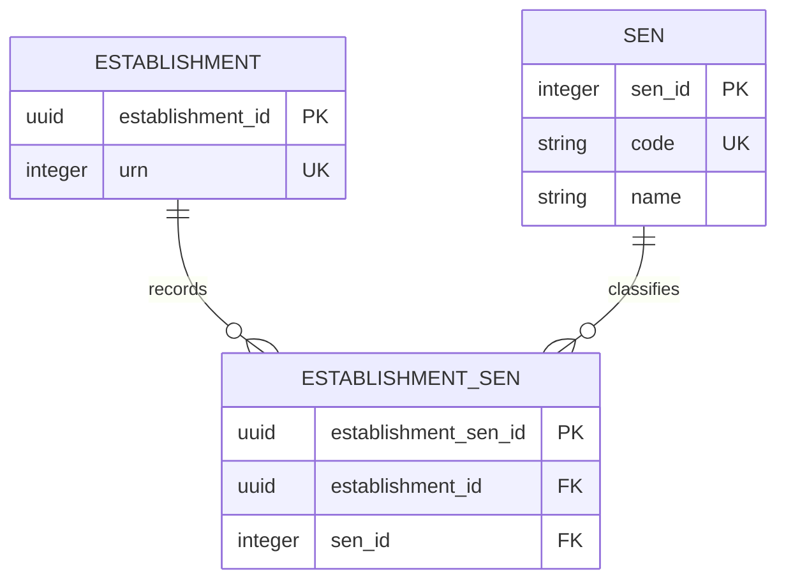

# Special educational needs (SEN)

This slice records the SEN classifications associated with an establishment. It is separate from specialist facilities, their capacities and pupil counts.

## Logical model

SEN code `00` (Not Applicable) is excluded from the lookup and all establishment associations. Absence creates no SEN relationship.

## SEN

`sen` is bounded reference data with an integer key. `code` preserves the BAU text code, including leading zeroes; `name` preserves the source label. Only current source values are included in this cut. The target has no archive column. Source rows with `archived = 0` or null are current; rows with `archived = 1` are excluded.

| sen_id | code | name |
| --- | --- | --- |
| 1 | `01` | VI - Visual Impairment |
| 2 | `02` | HI - Hearing Impairment |
| 3 | `03` | SLCN - Speech, language and Communication |
| 4 | `04` | ASD - Autistic Spectrum Disorder |
| 5 | `05` | SEMH - Social, Emotional and Mental Health |
| 6 | `06` | MSI - Multi-Sensory Impairment |
| 7 | `07` | PD - Physical Disability |
| 8 | `08` | MLD - Moderate Learning Difficulty |
| 9 | `09` | SLD - Severe Learning Difficulty |
| 10 | `10` | PMLD - Profound and Multiple Learning Difficulty |
| 11 | `11` | SpLD - Specific Learning Difficulty |
| 12 | `12` | OTH - Other Difficulty/Disability |

The internal IDs are allocated by an independent identity sequence starting at 1. Initial imports use source-code order; dictionary replay preserves existing IDs. Resolve BAU `senCode` through `sen.code`; do not treat the BAU identity column as the business code.

## Establishment SEN

Each `establishment_sen` row records one SEN classification for one establishment.

| Column | Rule |
| --- | --- |
| `establishment_sen_id` | UUID primary key, retained when the same association is replayed. |
| `establishment_id` | Required foreign key to the establishment. |
| `sen_id` | Required foreign key to SEN reference data. |

