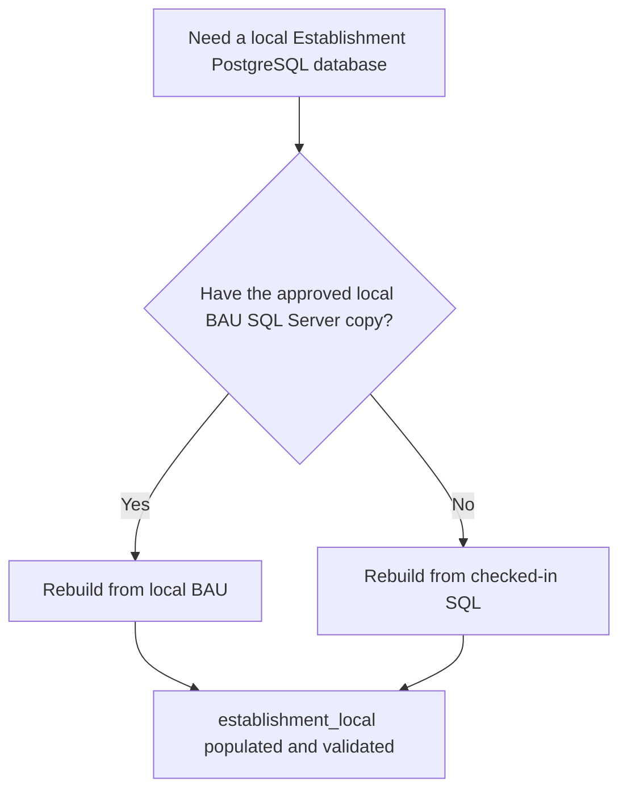

# Local Schema Automation

This directory contains the PostgreSQL physical schemas, SQL seeds and local automation used to build the Education Provider Registry model.

This is a work-in-progress business schema. Application/database roles, grants,
write restrictions and correction-audit machinery are not defined here. Those
require separate decisions. Local modelling runs use the existing administrator
connection; they do not establish a production permissions design.

## One Establishment creation file

[establishment-schema.sql](establishment/establishment-schema.sql) creates the
whole Establishment schema, including address history, lead periods, indexes,
constraints and both triggers. It is plain PostgreSQL SQL with no file includes.
Run it in an existing database where the `establishment` schema does not exist:

```powershell
psql.exe -X -w -h localhost -U postgres -d establishment_local -v ON_ERROR_STOP=1 -f ".\models\schema\establishment\establishment-schema.sql"
```

It creates structure only, not reference seeds, test data or the separate migration
evidence schema. It does not drop an existing schema. The explicit rebuild commands
perform the destructive reset separately and then invoke this creation file.

Group postal-address associations are implemented in
[establishment-schema.sql](establishment/establishment-schema.sql), with
registered-office, contact and administrative purpose reference data. Organisation
groups cannot use registered-office purpose. T1's two primary SAT/MAT blocks are
migrated as administrative addresses; blank contact/sponsor blocks remain evidence.
Both default rebuilds and SQL fixture exports preserve this slice without adding
triggers. Scoped address runners require the current schemas to be created first.

Both address association tables retain explicit `start_date`, `end_date` and
`is_current` history. T1's current dates remain unknown. Fully known periods
cannot overlap; each owner/purpose has at most one current association. Migration
loaders preserve existing periods and reject unreviewed source conflicts.
Protection against direct rewriting/deleting history and the correction workflow
remain undecided; the schema does not enforce them through permissions.

T2 also retains one current administrative association for Hive Education Trust,
with separate evidence from its identical SAT and MAT primary address blocks.
Its business dates are unknown; no sponsor/contact or registered-office address
is inferred. Both default rebuilds include this slice.

## What is here

T10 additionally loads a Companies House registered-office observation for
Outwood, company 06995649. Run `automation/migrate-t10-registered-office.ps1`
after the existing T10 parties and administrative addresses are loaded. The
default BAU rebuild runs it as T10's supplementary migration; SQL replay
restores the saved address and provenance. The address-use dates stay null.
See [the source observation](seed/fixtures/t10-registered-office.json) and
[validation SQL](migration/validate-scripts/validate-t10-registered-office.sql).

Source-based group-address imports require BAU `dbo.County`. The transform
joins county codes to names, retaining raw codes as migration evidence.
Unknown/Not recorded (`099`), Not applicable (`000`) and missing counties
remain null. Missing substantive lookup codes stop migration for review.
All currently selected BAU group-address blocks carry `099`, so adding the lookup
does not invent county names for them. The checked-in SQL rebuild uses its
saved data and needs no SQL Server lookup.

Reviewed assumptions, source scope and expected values for T1-T8, T10-T15R and T17
are kept in [fixtures](seed/fixtures/README.md), separately from reusable loading
SQL. Five case-specific loaders have been replaced by three shared loaders for
addresses, reviewed shared-party proprietorship and historical federation
membership. Blank organisation-group, legal-entity and person-source address blocks are retained as evidence without inventing associations. T7, T8, T10, T11R, T13, T14R and T15R add reviewed administrative legal-entity addresses. Case-specific validators and existing runner commands remain.

| Directory | Purpose |
| --- | --- |
| `establishment/` | Complete Establishment creation SQL, source transforms, fixture loaders and standalone case documentation. |
| `governance/` | Governance PostgreSQL schema and migration SQL. |
| `migration/` | Migration-evidence schema and identity-resolution records; `validate-scripts/` contains all validation SQL. |
| `seed/` | Checked-in reference data, sample Establishment data and the BAU selection manifest. |
| `automation/` | PowerShell commands for rebuilding local databases, extracting BAU data and validating the result. |

## Establishment rebuild paths

### Optional reference values

Unknown, Not applicable and missing source values map to null references.
They are excluded from the business reference lists, whose name constraints
reject these placeholders. This applies to education phase, gender, admissions,
nursery and sixth-form provision, FE type, Section 41 approval, faith, diocese
and geography. Boarding and specialist provision already map absence codes to
null. None, No boarders, No nursery classes and Not approved remain real values.
Source codes are interpreted per field; 99 is not a universal null code.

The transform keeps diagnostic source columns where provided. A recognised
absence code may have a null target ID; an unsupported nonblank code still
fails validation. Null alone does not preserve why a value is absent; consult
the original source or migration evidence for that distinction.

### Additional establishment classifications (E15)

Both fields exist and the migration supports substantive FE types and Section
41 statuses. The fixture now has **0** FE-type values: its previous 40 values
were all Unknown or Not applicable. E15 is complete for the model-building
scope clarified on 19 October 2026; a genuine FE-type sample is separate
migration-coverage work (MIG-014). Section 41 has **4**
values: 2 Approved and 2 Not approved. The controlled T10 school retains nulls.

Use [validate-additional-classifications.sql](migration/validate-scripts/validate-additional-classifications.sql)
for target counts and values.

### Faith and diocese (E16)

The model, transform, CSV contract, loader and checked-in fixtures carry all
three fields. After applying the null rule, religious character has **15**
values, religious ethos **11**, and diocese **6**. E16 remains complete under
the agreed criterion. The controlled T10 school retains nulls.

Use [validate-faith-and-diocese.sql](migration/validate-scripts/validate-faith-and-diocese.sql)
for target counts and labels, and
[validate-null-reference-policy.sql](migration/validate-scripts/validate-null-reference-policy.sql)
to check that no placeholder reference rows or links remain.

### Dated group-member lead designation

The physical model stores each spell as lead in `establishment.organisation_group_member_lead_period`, separately from membership joined and left dates. A member returning as lead has a new period. Start dates are inclusive and end dates exclusive. PostgreSQL enforces one current lead per group, non-overlap of fully known periods, and known membership boundaries. Current lead designation is derived from lead periods using `is_current = true`; membership has no stored lead flag. No current row means no current lead recorded, not confirmed non-lead. Explicit source STANDARD/LEAD assertions remain in migration evidence.

BAU current lead flags become current assertions with unknown start/end dates. Snapshot observations remain in migration evidence and are not substituted for business dates. Incomplete periods require review before making historical claims. Current status is explicit, not automatically recalculated as dates pass.

The single [Establishment creation file](establishment/establishment-schema.sql) includes the lead-period table and its two consistency triggers. Both BAU loading and checked-in fixture replay include the table. Separate DDL fragments and legacy additive local upgrades have been retired; rebuild the WIP local target using the supported commands when its structure changes. The DDL requires PostgreSQL `btree_gist` for group-wide exclusion constraints.

Regression checks in [validate-group-member-lead-periods.sql](migration/validate-scripts/validate-group-member-lead-periods.sql) cover handovers, return as lead, independent membership dates, unknown boundaries and rejection of conflicts. Synthetic histories are rolled back.

The Establishment schema retains two consistency triggers. These reject invalid
writes; none maintains a duplicate lead summary:

- `check_group_member_lead_period`: Restricts lead periods to children's-centre groups and checks known membership boundaries and current eligibility.
- `check_membership_lead_boundaries`: Rejects membership date changes that invalidate lead periods or end membership while a current lead assertion remains.

Identifier rewrite/delete policy, parent group-type changes and permissions are
deferred. No additional trigger or permission role is introduced to enforce them
in this WIP schema. Existing keys, uniqueness and foreign keys remain in place;
the migrations still reject unreviewed identity/source conflicts.

Unique indexes and exclusion constraints separately enforce one current lead per
group and non-overlap of fully known lead periods. Foreign keys enforce ownership
and references.

### Choosing a rebuild path

Choose the path that matches the data available on your machine:



| Path | Use when | Command | Detailed runbook |
| --- | --- | --- | --- |
| BAU-source rebuild | You have a local BAU SQL Server copy and read-only credentials. | `rebuild-establishment-from-local-bau.ps1` | [Rebuild Establishment From Local BAU](automation/rebuild-establishment-from-local-bau.md) |
| Checked-in-fixture rebuild | You do not have the BAU SQL Server copy. | `rebuild-establishment-from-checked-in-sql.ps1` | [Rebuild Establishment From Checked-in SQL](automation/rebuild-establishment-from-checked-in-sql.md) |

## Establishment data flow and execution engines

By default, the BAU-source rebuild reads MSSQL BAU, loads PostgreSQL, runs the tests, then exports the validated PostgreSQL data as static SQL INSERT files. Custom selections and skipped-test runs do not automatically refresh the checked-in fixture. INSERT exports come from PostgreSQL, not directly from the MSSQL query results.

PowerShell coordinates the steps. MSSQL executes the source T-SQL; PostgreSQL executes the target SQL. `psql` and `pg_dump` are PostgreSQL client programs launched by PowerShell, not separate database engines.

### Rebuild from local BAU

Entry point: [rebuild-establishment-from-local-bau.ps1](automation/rebuild-establishment-from-local-bau.ps1).

```text
[PowerShell]
Read -Urn, -SelectionFile, or the default fixture manifest
Configure connections and create a temporary working directory
    |
    v
[MSSQL + PowerShell: URN-only selections]
Discover and validate supported groups before rebuilding the target
Keep organisation memberships within the supplied URNs
(Explicit group-selection manifests bypass discovery)
    |
    v
[PostgreSQL, through psql launched by PowerShell]
Recreate the local establishment and migration schemas
Load reference seeds and record the migration run
    |
    v
+-----------------------------------------------------------------+
| Repeat for geography, selected URNs and selected relationships: |
|                                                                 |
| [MSSQL]                                                         |
| Run T-SQL in establishment/transforms/                          |
| Extract and map the BAU data                                    |
|     |                                                           |
|     v                                                           |
| [PowerShell]                                                    |
| Write temporary pipe-delimited CSV files                        |
|     |                                                           |
|     v                                                           |
| [PostgreSQL client: psql -> PostgreSQL]                         |
| Run \copy to load CSV into temporary PostgreSQL tables          |
|     |                                                           |
|     v                                                           |
| [PostgreSQL]                                                    |
| Run INSERT ... SELECT, updates and load-time checks             |
| Populate Establishment tables and migration evidence            |
| Apply reviewed mappings where configured                        |
+-----------------------------------------------------------------+
    |
    v
[PostgreSQL + PowerShell]
Print the summary; run SQL tests and approval/count comparisons
With -SkipTests: omit the test suite, not load checks or constraints
    |
    v
[PostgreSQL client: pg_dump, launched by PowerShell]
Export the populated PostgreSQL data as static SQL INSERT statements
Default tested fixture: export and refresh seed/
Custom/untested run: export only with an explicit -ExportDirectory
    |
    v
[PowerShell]
Save exports to seed/ or the requested review directory
With -IncludeGovernance: rebuild/load governance_local (PostgreSQL)
Clean up working files unless -KeepFixture is supplied
```

The exported files are:

- `seed/seed-reference-data.sql` — reference data.
- `seed/seed-establishment-fixture.sql` — selected Establishment records and relationships.
- `seed/seed-migration-evidence.sql` — migration evidence for those records.

These are snapshots of the populated PostgreSQL target, retained so the local test database can be rebuilt without MSSQL.

### Rebuild from checked-in SQL

Entry point: [rebuild-establishment-from-checked-in-sql.ps1](automation/rebuild-establishment-from-checked-in-sql.ps1).

| Step | Execution engine / client | What runs and what it produces |
| --- | --- | --- |
| 1. Start the rebuild | PowerShell | Reads the selection manifest and coordinates the target rebuild. No MSSQL connection is needed. |
| 2. Recreate and load | PostgreSQL, through `psql` launched by PowerShell | Recreates the local schemas, loads reference seeds, then executes the checked-in Establishment INSERT statements and migration-evidence SQL. |
| 3. Run tests | PostgreSQL and PowerShell | Executes target SQL checks and compares approval snapshots and row counts. This path does not extract BAU data or regenerate the SQL exports. |

Both paths rebuild disposable local schemas. They are modelling and repeatable test workflows, not the incremental daily production ETL.

Both default paths restore all 23 active test scenarios across 42 distinct
establishments, including approved controlled fixtures and migration evidence.
`seed/all-test-cases.json` defines the complete catalogue. The BAU rebuild runs
the base selection and additional case runners before exporting the full SQL
seeds; the checked-in SQL rebuild restores those seeds without source access.
Both validate the complete catalogue. Explicit custom BAU selections remain
limited to their requested scope and do not automatically refresh the seeds.


## From zero to a populated local PostgreSQL database

1. Install PostgreSQL locally and create an empty database named `establishment_local`.

   ```powershell
   createdb.exe -h 127.0.0.1 -p 5432 -U postgres establishment_local
   ```

2. Configure the local PostgreSQL password in `%APPDATA%\postgresql\pgpass.conf`:

   ```text
   127.0.0.1:5432:establishment_local:postgres:<local-password>
   ```

3. From the `education-provider-registry-docs` repository root, choose one rebuild path.

   With checked-in SQL only **(Recommended)**:

   ```powershell
   powershell.exe -NoProfile -ExecutionPolicy Bypass -File ".\models\schema\automation\rebuild-establishment-from-checked-in-sql.ps1"
   ```

   With the approved local BAU copy:

   ```powershell
   $bauSqlServer = 'localhost' # Your local SQL Server name or named instance.
   powershell.exe -NoProfile -ExecutionPolicy Bypass -File ".\models\schema\automation\rebuild-establishment-from-local-bau.ps1" -SqlServer $bauSqlServer
   ```

   `-SqlServer` accepts `localhost`, the developer's own machine name, or a local named instance such as `localhost\SQLEXPRESS`. Remote/shared servers remain blocked. `-SourceDatabase` defaults to `gias_bau_test_local`; another local BAU copy must use a database name ending `_local`, containing only letters, digits and underscores.

   The BAU command prompts for the local SQL Server `reader` password. Use `-UseWindowsAuthentication` when the local SQL Server is configured for Windows authentication, or `-KeepFixture` to retain extracted CSVs for troubleshooting. `-IncludeGovernance` additionally rebuilds and loads the Governance schema. Use `-ExportDirectory` to write refreshed fixtures to a review directory instead of changing `seed/`.


4. The chosen command recreates the disposable `establishment` and `migration` schemas, loads reference and Establishment data, then validates the completed schema unless the BAU rebuild is explicitly run with `-SkipTests`.

The scripts are intentionally restricted to the local `establishment_local` database. They do not target shared environments.

The scripts are thin entry points to the `EprLocalAutomation` PowerShell module. Any single step, such as one test or one establishment reload, can be run on its own by importing the module. See the [automation README](automation/README.md).

## Using a different BAU dataset and your own URNs

The checked-in tests and approval snapshots describe this repository's curated cases. They are not a generic acceptance suite for arbitrary BAU data. Changing the URNs alone does not change those expected relationships, identities or counts.

1. Query your local MSSQL copy to choose establishments that exist there:

   ```sql
   SELECT TOP (50) URN, EstablishmentName, OpenDate, CloseDate
   FROM dbo.Establishment
   ORDER BY URN;
   ```

2. Run the existing rebuild script with just your URNs and the case-specific tests disabled. Use unique integer URNs between `1` and `999999`:

   ```powershell
   $bauSqlServer = 'localhost' # Change for your local instance.
   $bauDatabase = 'gias_bau_test_local' # Or your own BAU copy named *_local.
   powershell.exe -NoProfile -ExecutionPolicy Bypass -File ".\models\schema\automation\rebuild-establishment-from-local-bau.ps1" -SqlServer $bauSqlServer -SourceDatabase $bauDatabase -Urn "109443,20338" -SkipTests
   ```

   Add `-UseWindowsAuthentication` if appropriate, or `-SqlUser` for a different read-only SQL login. This rebuilds the same disposable `establishment_local` database: existing local target data is replaced. It does not overwrite the checked-in seeds or approval snapshots.

   `-SkipTests` skips the whole Establishment test suite, including SQL fixture tests, approval snapshots and row-count comparisons. It does not bypass selection validation, source extraction checks, SQL load checks or database constraints. The migration-run notes explicitly record that tests were skipped; a completed import is not a tested/approved fixture.

3. Inspect the loaded target data. If you need SQL exports, add `-ExportDirectory "$env:TEMP\epr-my-fixture-export"` to the same command. Keep custom or untested exports separate from `seed/`. Add your own reviewed expectations before treating that dataset as validated.

Replace the example URNs with values in your source. The source must have the BAU table/column structure expected by the transforms, including geographic reference tables.

The automation discovers current academy-trust, foundation-trust and sponsor responsibilities, plus federation and children's-centre group memberships. It imports memberships **only for the supplied URNs**, never every other establishment in those groups. A group's local membership may therefore be incomplete; migration evidence records that scope. A children's-centre group's lead member is not imported unless its URN is supplied, and no replacement lead is invented.

Current links are the default. Add `-IncludeArchivedLinks` to discover archived trust/foundation/sponsor links as well. Historical federation and children's-centre memberships are not included. Unsupported group types, duplicate links, missing groups and identity conflicts require review rather than being silently accepted.

If you prefer a file, save this as `my-fixture-selection.json`, substituting your URNs, and replace `-Urn "109443,20338"` with `-SelectionFile ".\my-fixture-selection.json"`:

```json
{
  "organisationType": "establishment-fixture-set",
  "urns": [109443, 20338]
}
```

URN-only files, including older files with empty group arrays, use discovery. The checked-in manifest retains explicit relationships for the repeatable reviewed fixture; discovery does not change that default path.

Discovery finds **group links**, not independent-school proprietor identities. Reviewed proprietor overlays still need their supporting evidence. Existing reviewed person/company and SAT/MAT identity rules remain in place; discovery does not guess new identity mappings or bypass load checks.

## Establishment approval tests

The repository's selected URNs and group fixtures are defined in `seed/fixture-selection.json`. Each selected URN requires an approval snapshot; case-specific SQL tests and the row-count approval also describe that curated dataset. The scope test rejects establishments outside the selection. Use `-SelectionFile` and `-SkipTests` for a different dataset, as described above.

The Establishment snapshots compare business data and stable reference keys; generated surrogate UUIDs are intentionally excluded because they are expected to change when the local schema is rebuilt.

The rebuild scripts run these tests automatically unless the BAU rebuild uses `-SkipTests`. The examples below refer to the checked-in cases. To run them directly from the repository root:

```powershell
.\models\schema\tests\assert-establishment-approval.ps1 -Urn 136102
.\models\schema\tests\assert-establishment-approval.ps1 -Urn 134314
.\models\schema\tests\assert-establishment-approval.ps1 -Urn 135905
.\models\schema\tests\assert-establishment-row-counts.ps1
```

The T1 approval snapshot is updated only when a data or model change is deliberate and has been reviewed. Use the `-UpdateApproval` switch on the approval script:

```powershell
.\models\schema\tests\assert-establishment-approval.ps1 -UpdateApproval
.\models\schema\tests\assert-establishment-approval.ps1 -Urn 136102 -UpdateApproval
.\models\schema\tests\assert-establishment-approval.ps1 -Urn 134314 -UpdateApproval
.\models\schema\tests\assert-establishment-approval.ps1 -Urn 135905 -UpdateApproval
```

The commands update the approval file for the specified URN. Only update a snapshot after a deliberate, reviewed data or model change; then rerun the normal rebuild and review the snapshot diff before committing it.

## Establishment cases

Each extract selected by the clean test-case matrix must have a corresponding case file under `establishment/cases/`. The case is establishment-centric: it records the T reference, URN, establishment name, establishment type and the group links that make the establishment useful for the scenario. Add the case file as part of reviewing an extract, before committing the refreshed seed.

Use the T reference and URN in the filename, for example:

`establishment/cases/t1-urn-136102-co-operative-academy-stoke-on-trent.md`

For example, T16 is recorded in `establishment/cases/t16-urn-135905-manchester-creative-and-media-academy.md`.

If one T covers more than one establishment, document each URN in its own section or companion case file and keep the shared T reference explicit.

### Ofsted link (E17)

Establishment has one optional `ofsted_link` text field. The BAU transform builds
`https://reports.ofsted.gov.uk/search?q=<URN>` from the source URN; the CSV
contract and loader carry the link through to the target. This is a derived
navigation link, rather than a stored source URL or confirmation that a report
exists. Ofsted's [URN search](https://reports.ofsted.gov.uk/search?q=136102)
was checked for the example establishment on 16 October 2026.

The selected fixture has 41 links; the limited T10 school projection retains
null. Missing and blank input links load as null. Run
[validate-ofsted-link.sql](migration/validate-scripts/validate-ofsted-link.sql)
for counts, a comparison to the migration rule and a listing by URN.

### Specialist provision (E09)

E09 covers specialist provision type, the capacity and pupil count for each of
resourced provision and SEN units, and the special-classes boolean. The five
existing specialist fields now have a real source sample: Netley Primary School
& Centre for Autism (100018), with both provision types and 24 places/24 pupils
for each. The new has_special_classes field sits on education admissions and
provision: source 1 means true, 2 means false, and 0/9/missing mean null.
It has 21 populated values; false counts as populated.

Netley is in the base selection and the E09 coverage case. The default catalogue
now has 23 active cases across 42 establishments. The saved seed and source
rebuild paths both include its specialist records. Replayed changes remove
obsolete current measure blocks, known zeros are retained, and absent measures
do not become invented zero counts. Run
[validate-specialist-provision.sql](migration/validate-scripts/validate-specialist-provision.sql)
for target counts and the individual source-derived values.
