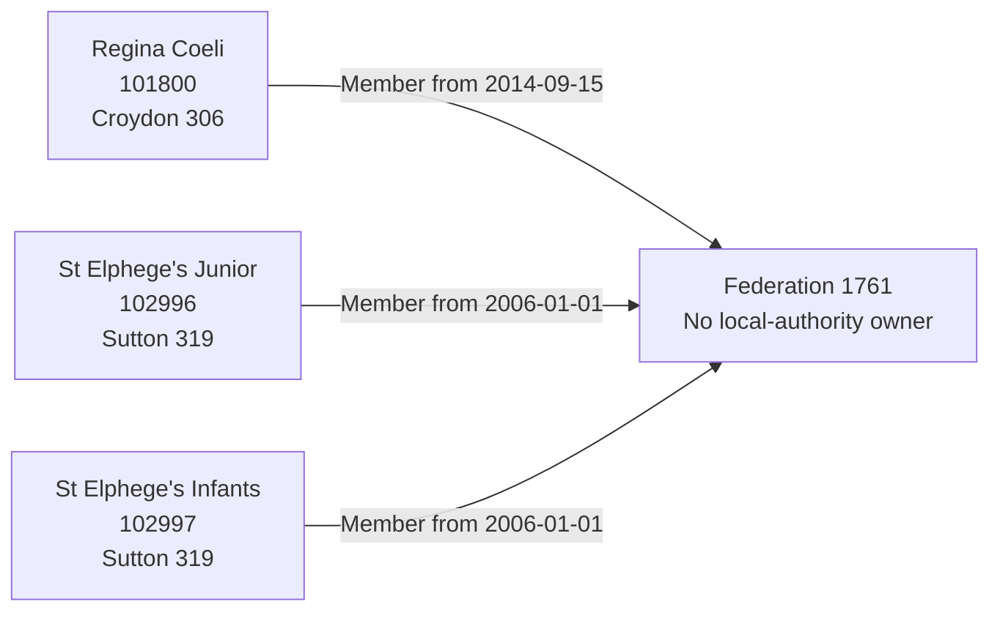

# T18: The Federation of St Elphege's RC School

T18 tests one federation across two local authorities. Each school retains its own local authority and independently evidenced joining date. The federation has no local-authority owner and is not represented as a legal entity or an operating responsibility.

## Establishments

T18 is one federation scenario with three establishment records, T18a to T18c.

| Field | T18a | T18b | T18c |
| --- | --- | --- | --- |
| URN | 101800 | 102996 | 102997 |
| Name | Regina Coeli Catholic Primary School | St Elphege's RC Junior School | St Elphege's RC Infants' School |
| Establishment number | 3408 | 3503 | 3504 |
| School UKPRN | 10071655 | 10079489 | 10078365 |
| Local authority | Croydon (306) | Sutton (319) | Sutton (319) |
| Establishment type | Voluntary aided school (02) | Voluntary aided school (02) | Voluntary aided school (02) |
| Education phase | Primary (2) | Primary (2) | Primary (2) |
| Source status | Open (1) | Open (1) | Open (1) |
| School opening / closure | Both null | Both null | Both null |

School opening dates remain unknown. Do not replace them with federation formation or membership joining dates. School UKPRNs belong to the schools, not the federation.

## Source federation and links

| Federation field | Source value |
| --- | --- |
| Name | The Federation of St Elphege's RC School |
| Group UID | 1761 |
| Type | Federation (01) |
| Group ID / company number / organisation UKPRN | All null |
| Open date | 2006-01-01 |
| Closed date | Null |
| Group local-authority code | 999 |

| GroupLink | Member URN | Effective date | Archived | Link type |
| --- | --- | --- | --- | --- |
| 2517 | 101800 | 2014-09-15 | 0 | HARD |
| 1811 | 102996 | 2006-01-01 | 0 | HARD |
| 1812 | 102997 | 2006-01-01 | 0 | HARD |

These are the federation's complete three source links and each school's only source group link. No `GroupRelationsLink` involving UID 1761 was returned. All three links are imported, not a selected-only membership slice.

The two Sutton schools joined when the federation formed. Regina Coeli's later joining date must remain 2014-09-15, not be backdated to 2006. No source link supplies a leaving date. Active flags are retained as source assertions; unknown ends do not prove indefinite membership.

## Target interpretation

| Target table | Expected representation |
| --- | --- |
| `establishment`, lifecycle and geography | Three separate schools with their own UKPRNs, unknown opening/closure dates, and authorities 306, 319 and 319. |
| `organisation_group` | One Federation, formed 2006-01-01, closure unknown and `local_authority_id` null. |
| `organisation_group_member` | Three members with their respective link effective dates as `joined_date`; `left_date` null and no lead periods. |
| `group_identifier` | One current GIAS Group UID 1761 attached to the organisation group. No Group ID is invented. |
| Migration evidence | Separate accepted source-link evidence for 2517, 1811 and 1812, retaining active flags, HARD link type, joining-date basis and complete imported scope. |
| Legal entities, party roles, organisation identifiers, responsibilities and lead periods | No records created merely to represent the federation. |

Code 999 does not select a target authority. Neither the most frequent member authority (Sutton) nor the earliest or latest joining member determines federation ownership. Cross-authority membership must not be rejected or coerced to a single authority. Known starts use the target's inclusive-start convention; unknown ends stay null.

## Relationship graph



## Target query

```sql
SELECT e.urn, e.name, la.code AS school_authority_code,
       la.name AS school_authority, g.name AS federation,
       g.local_authority_id AS federation_authority,
       m.joined_date, m.left_date
FROM establishment.organisation_group g
JOIN establishment.group_identifier i USING (organisation_group_id)
JOIN establishment.group_identifier_type t USING (group_identifier_type_id)
JOIN establishment.group_identifier_issuer issuer USING (group_identifier_issuer_id)
JOIN establishment.organisation_group_member m USING (organisation_group_id)
JOIN establishment.establishment e USING (establishment_id)
JOIN establishment.establishment_geography geo USING (establishment_id)
JOIN establishment.local_authority la ON la.local_authority_id=geo.local_authority_id
WHERE t.name='Group UID' AND issuer.name='GIAS' AND i.value='1761'
ORDER BY e.urn;
```

Expect three rows, two distinct school authorities, null federation authority and the three source joining dates above.

## Expected checks and evidence limits

- All three open, maintained schools belong to one open federation; the minimum two-member requirement is satisfied.
- School authority and UKPRN values are retained without copying them to the group or another school.
- Regina Coeli's later joining date is not replaced by group formation.
- Unknown school opening and membership leaving dates remain unknown; federation lead designation is not applicable.
- No legal entity, operating responsibility or registered federation identifiers are inferred from membership.
- Repeat import retains school, federation, membership and identifier identities without duplication.
- Changed source membership, authority, identity or lifecycle assertions require review before import. This source-backed test demonstrates model behaviour, not independent verification of every source field or legal governance arrangement.
