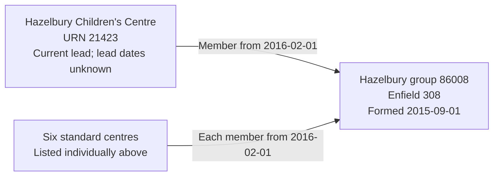

# T19R: Hazelbury children's-centre group

T19R tests the complete Hazelbury group of seven children's centres, with one explicit current lead. Group formation, establishment opening, membership joining and lead designation are distinct lifecycle facts. In particular, membership starts after group formation; neither date establishes when the lead designation started.

## Children's-centre group

| Field | Source value |
| --- | --- |
| Group UID | 86008 |
| Group name | Hazelbury |
| Type | Children's Centres Group (08) |
| Group local authority | Enfield (308) |
| Open date | 2015-09-01 |
| Closed date | Null |
| Group ID, company number and organisation UKPRN | All null |
| Members | Seven active, open children's centres |
| Lead | Hazelbury Children's Centre, URN 21423 |

The group's authority is recorded directly on the source group, not inferred from its members. Each centre also retains its own authority, Enfield 308.

## Establishments and source links

Each centre has source type 47, status Open (1), education phase Not applicable (0), null closure, null UKPRN and null establishment number. Preserve the five-digit URNs and absent school-style identifiers.

| Ref | URN | Establishment | Opening date | GroupLink | Membership effective date | `ccLinkType` |
| --- | --- | --- | --- | --- | --- | --- |
| T19Ra | 20048 | Carterhatch Bell Lane Children's Centre | 2008-03-31 | 23702 | 2016-02-01 | STANDARD |
| T19Rb | 20575 | Carterhatch Autumn Close Children's Centre | 2007-09-16 | 23703 | 2016-02-01 | STANDARD |
| T19Rc | 21240 | Bowes and Garfield Children's Centre | 2006-09-27 | 23698 | 2016-02-01 | STANDARD |
| T19Rd | 21423 | Hazelbury Children's Centre | 2006-09-27 | 23697 | 2016-02-01 | LEAD |
| T19Re | 21425 | Hazelwood Children's Centre | 2009-09-30 | 23699 | 2016-02-01 | STANDARD |
| T19Rf | 21547 | Honilands Children's Centre | 2008-01-23 | 23700 | 2016-02-01 | STANDARD |
| T19Rg | 22423 | Prince of Wales Childrens Centre | 2008-01-23 | 23701 | 2016-02-01 | STANDARD |

These are the complete seven group links, all `archived = 0`. Each centre has only this source group link. No `GroupRelationsLink` involving UID 86008 was returned. Import all seven members, not just the lead centre.

Each membership's joining date is its own effective date, 2016-02-01, not the group formation date 2015-09-01 or the centre's earlier opening. Leaving dates remain unknown. Active source flags assert observed current membership, not indefinite membership.

`LEAD` creates a current lead-period assertion; `STANDARD` creates none and can retire a previously current assertion without inventing an end date. Both source codes remain in migration evidence. No current lead row means no current lead recorded, not necessarily confirmed non-lead. Missing or unrecognised codes require review, not default false. The source identifies the current lead but supplies no lead-designation start/end dates or handover history. Create one current lead period with both business boundaries null; do not use membership, formation or snapshot dates as its start.

## Relationship graph



The grouped standard-centre box represents six separate memberships. The target contains seven members in total.

## Target interpretation

| Target table | Expected records |
| --- | --- |
| `establishment`, lifecycle and geography | Seven centres, preserving source URNs, names, individual opening dates and Enfield authority; absent UKPRNs/numbers remain null. |
| `organisation_group` | One children's-centre group named Hazelbury, formed 2015-09-01, closure unknown and authority Enfield 308. |
| `organisation_group_member` | Seven memberships joined 2016-02-01, leaving dates unknown; Current lead designation is held only in the separate period table; the six STANDARD assertions remain in evidence. |
| `organisation_group_member_lead_period` | One current assertion belonging to Hazelbury's membership, with unknown start/end dates. |
| `group_identifier` | One current GIAS Group UID 86008 on the organisation group; no Group ID invented. |
| Migration evidence | Seven separate accepted member-evidence records retaining source links, active flags, explicit lead codes, effective-date basis and complete imported scope. |
| Legal entities, party roles, organisation identifiers and responsibilities | No records created merely to represent the group, authority association or lead designation. |

## Target query

```sql
SELECT e.urn, e.name, la.code AS group_authority_code,
       g.open_date AS group_formed, life.open_date AS centre_opened,
       m.joined_date, m.left_date,
       p.start_date AS lead_start, p.end_date AS lead_end,
       p.is_current AS current_lead_assertion
FROM establishment.organisation_group g
JOIN establishment.group_identifier i USING (organisation_group_id)
JOIN establishment.group_identifier_type t USING (group_identifier_type_id)
JOIN establishment.group_identifier_issuer issuer USING (group_identifier_issuer_id)
JOIN establishment.local_authority la ON la.local_authority_id=g.local_authority_id
JOIN establishment.organisation_group_member m USING (organisation_group_id)
JOIN establishment.establishment e USING (establishment_id)
JOIN establishment.establishment_lifecycle life USING (establishment_id)
LEFT JOIN establishment.organisation_group_member_lead_period p
  ON p.organisation_group_member_id=m.organisation_group_member_id
WHERE t.name='Group UID' AND issuer.name='GIAS' AND i.value='86008'
ORDER BY e.urn;
```

Expect seven rows, all formed 2015-09-01 and joined 2016-02-01, with the individual centre openings above. Only 21423 has a current lead assertion; its lead dates are null.

## Expected checks and evidence limits

- Complete seven-member scope, one lead and six explicit standard codes are retained without duplicate identities on reimport.
- Group formation is not substituted for membership joining; establishment openings remain separate.
- Current lead designation does not invent dated lead history. Unknown boundaries are not treated as infinite periods.
- Group UID belongs to an organisation group, not a legal entity or party role.
- No registered identifiers or operating responsibilities are inferred from membership or lead designation.
- Source changes to membership, authority, dates, identity or lead codes require review before import. This bounded source assessment does not independently verify every establishment field or governance arrangement.
