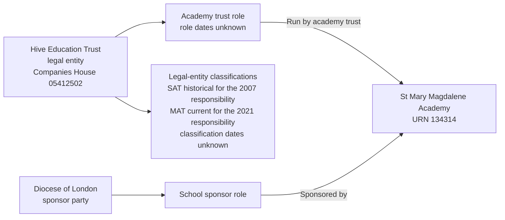

# T2: URN 134314, St Mary Magdalene Academy

T2 tests that Hive Education Trust remains one legal entity as it changes from SAT to MAT for St Mary Magdalene Academy, while the Diocese of London holds a separate sponsorship responsibility.

## Establishment

| Field | Value |
| --- | --- |
| URN | 134314 |
| Establishment number | 6905 |
| Name | St Mary Magdalene Academy |
| Establishment type | Academy sponsor led |
| Education phase | All-through |
| Local authority | Islington |

## Group records

| Source group | Source type | Source status | Effective date | Target role | Target responsibility | Group ID | Companies House number |
| ---: | --- | --- | --- | --- | --- | --- | --- |
| 4737 | Single-academy trust | Archived | 1 September 2007 | Academy trust | Run by academy trust | TR02103 | 05412502 |
| 23869 | Multi-academy trust | Active | 4 October 2021 | Academy trust | Run by academy trust | TR02103 | 05412502 |
| 2914 | School sponsor | Active | 1 September 2007 | School sponsor | Sponsored by | SP00172 | Not supplied |

T2 demonstrates two things. First, Hive Education Trust changed from a single-academy trust to a multi-academy trust. The archived SAT group `4737` and active MAT group `23869` represent successive classifications of the same trust and must not be treated as two legal entities. Second, the party providing sponsorship is different from the party running the academy. The external sponsor is the Diocese of London, which can sponsor establishments that are run by another trust. These are separate parties, roles and responsibilities for the same establishment.

The current local BAU source link for the sponsor starts on 1 September 2007. The active academy-trust link starts on 4 October 2021. The sponsor record does not include a Companies House number, so identity resolution must not merge it with Hive Education Trust merely because both records are linked to this establishment.

The source does not provide dates for the legal entities' party roles or trust classifications, so those start and end dates are `NULL`. The group-link dates belong to the establishment responsibilities. They show that Hive Education Trust was a SAT when the responsibility beginning 1 September 2007 applied, and a MAT when the responsibility beginning 4 October 2021 applied. They do not establish when either classification itself started or ended.

The active MAT group makes the MAT responsibility and the MAT classification current. The archived SAT group makes the SAT responsibility and SAT classification historical. This current-state assertion is explicit; it is not derived from the dates.

The local source observation on 12 October 2026 supplies identical primary addresses for archived SAT UID `4737` and active MAT UID `23869`: Liverpool Road, Islington, London, N7 8PG. These are two observations of the same Hive Education Trust legal entity, not evidence of a move or two address periods. One current administrative-purpose `legal_entity_address` association references one postal-address record. Both observations retain separate source evidence linked to that association.

The address is recorded as administrative, not a verified registered office. Both business dates remain null; neither the observation date nor the SAT/MAT responsibility dates establishes an address start or end. All three contact blocks and sponsor UID `2914`'s primary block are blank, so no contact or sponsor address is invented. All six source blocks, including four blank blocks, retain evidence. County/country codes are retained as raw evidence; the unavailable county label remains null.

Unchanged imports retain the association and postal IDs without creating new periods. Conflicting SAT/MAT address observations or a changed existing address require a reviewed migration decision, rather than silent replacement or an invented move date. Academy-trust classification changes do not themselves change address ownership.

## Relationship graph



## Expected target representation

The migration should create:

- one establishment row for URN `134314`;
- one legal entity and academy-trust role for Hive Education Trust;
- SAT and MAT classifications for Hive Education Trust, both with `NULL` start and end dates. The SAT classification has `is_current = false`; the MAT classification has `is_current = true`;
- one legal entity and school-sponsor role for the Diocese of London;
- two `Run by academy trust` responsibilities: SAT from 1 September 2007 with an unknown end date and `is_current = false`, and MAT from 4 October 2021 with an unknown end date and `is_current = true`;
- one `Sponsored by` responsibility beginning 1 September 2007, with no academy-trust type and `is_current = true`.

The two responsibilities must remain distinguishable even though they refer to the same establishment. The sponsor's missing Companies House number should be retained as missing rather than invented or copied from the academy trust.

## Target query

Run against `establishment_local` to display the establishment, responsibilities, parties, roles, classifications, identifiers and address periods together. Address rows are independent of classifications and responsibilities, so Hive's one current administrative association appears once, with null business dates. The Diocese of London has no address association.

```sql
WITH target AS (
    SELECT *
    FROM establishment.establishment
    WHERE urn = 134314
),
responsibilities AS (
    SELECT er.*, rt.name AS responsibility_type
    FROM establishment.establishment_responsibility AS er
    JOIN target AS e USING (establishment_id)
    JOIN establishment.establishment_responsibility_type AS rt
      USING (responsibility_type_id)
),
parties AS (
    SELECT DISTINCT le.*
    FROM establishment.legal_entity AS le
    JOIN responsibilities AS er USING (legal_entity_id)
),
roles AS (
    SELECT r.*, rpt.name AS role_type
    FROM establishment.establishment_party_role AS r
    JOIN parties AS le USING (legal_entity_id)
    JOIN establishment.establishment_party_role_type AS rpt
      USING (establishment_party_role_type_id)
),
classifications AS (
    SELECT atc.*, att.name AS academy_trust_type
    FROM establishment.academy_trust_classification AS atc
    JOIN parties AS le USING (legal_entity_id)
    JOIN establishment.academy_trust_type AS att
      USING (academy_trust_type_id)
),
identifiers AS (
    SELECT gi.*, git.name AS identifier_type, issuer.name AS issuer
    FROM establishment.group_identifier AS gi
    JOIN roles AS r USING (establishment_party_role_id)
    JOIN establishment.group_identifier_type AS git
      USING (group_identifier_type_id)
    JOIN establishment.group_identifier_issuer AS issuer
      USING (group_identifier_issuer_id)
),
addresses AS (
    SELECT link.*, purpose.code AS address_purpose,
           a.address_line_1, a.address_line_2, a.address_line_3,
           a.town, a.county, a.postcode
    FROM establishment.legal_entity_address AS link
    JOIN parties AS le USING (legal_entity_id)
    JOIN establishment.address_purpose AS purpose USING (address_purpose_id)
    JOIN establishment.address AS a USING (address_id)
)
SELECT 'establishment' AS record_type, to_jsonb(e) AS data
FROM target AS e
UNION ALL
SELECT 'responsibility', to_jsonb(er)
FROM responsibilities AS er
UNION ALL
SELECT 'legal_entity', to_jsonb(le)
FROM parties AS le
UNION ALL
SELECT 'party_role', to_jsonb(r)
FROM roles AS r
UNION ALL
SELECT 'academy_trust_classification', to_jsonb(c)
FROM classifications AS c
UNION ALL
SELECT 'group_identifier', to_jsonb(i)
FROM identifiers AS i
UNION ALL
SELECT 'legal_entity_address', to_jsonb(a)
FROM addresses AS a
ORDER BY record_type;
```
