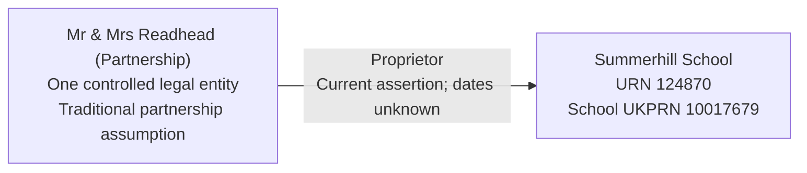

# T21: URN 124870, Summerhill School

T21 tests a partnership proprietor represented as one legal entity of type Traditional partnership, holding a Proprietor responsibility. It does not create two person endpoints, a company, a proprietor party role or ownership assertions.

## Establishment

| Field | Source value |
| --- | --- |
| URN | 124870 |
| Name | Summerhill School |
| Establishment type | Other independent school (11) |
| Source status | Open (1) |
| Local authority | Suffolk (935) |
| Establishment number | 6016 |
| Establishment UKPRN | 10017679 |
| Education phase | Not applicable (0) |
| Opening | 1921-03-13 |
| Closure | Null |

Retain the school UKPRN on the establishment, not on its proprietor. School opening is not a proprietor responsibility start or partnership formation date.

## Proprietor evidence and accepted assumption

The GIAS establishment extract dated 16 June 2026 supplies exact `PropsName = Mr & Mrs Readhead (Partnership)` for this school. The same extract identifies an open Other independent school. Local BAU also records an open Other independent school, with `proprietorType_code = 02`, Proprietor Body. Its proprietor identity is obfuscated and there is one additional `EstablishmentProprietors` row. Neither obfuscated name is used to resolve the target party; the extra row is not imported as a second proprietor.

For this controlled test, explicitly assume that the extract's proprietor is one Traditional partnership legal entity. The legal-form interpretation is accepted for the fixture, not independently verified registered identity or a universal rule for names containing “Mr & Mrs”. A matching name alone must not authorise merging with another party. Actual migration requires an accepted identity and legal-form review.

Local BAU separately names The A S Neill Summerhill Trust with charity number 1089804. This does not identify the partnership as that charity. Do not merge them, copy the charity number or assign the proprietor a charity status merely because the charity is recorded against the same school.

No source group links were returned for Summerhill. No GIAS group UID or Group ID is invented for the proprietor. No company number or organisation UKPRN is supplied for the partnership; incorporation, dissolution and charity-register status remain unknown.

## Dates and target interpretation

Create one current Proprietor responsibility with null start and end dates. The extract observation date 2026-06-16 belongs in evidence, not a business start date. The school's 1921 opening does not establish when this proprietor took responsibility. “Current” is the accepted fixture assertion, not proof of its full history.

| Target table | Expected records |
| --- | --- |
| `establishment`, lifecycle and geography | One Summerhill, retaining school identifiers, Suffolk authority, source opening and unknown closure. |
| `legal_entity` | One Mr & Mrs Readhead (Partnership), legal type Traditional partnership; charity status and company dates null. |
| `establishment_responsibility` | One current Proprietor responsibility to that legal entity, dates unknown and person/academy-trust endpoints absent. |
| Registered organisation identifiers, party roles, academy-trust classifications, organisation groups and memberships | No records created merely to represent this proprietor. |
| Migration evidence | Separate public-extract identity assumption and local obfuscated classification context beneath the same migration run, without using either observation as a responsibility date. |

The fixed fixture UUID is a controlled target allocation, not a source identifier. Reimport reuses it and the existing responsibility; conflicting identity or legal form requires review rather than silent reassignment.

## Relationship graph



## Target query

```sql
SELECT e.urn, e.name AS school, le.name AS proprietor,
       lt.name AS legal_form, rt.name AS responsibility,
       r.start_date, r.end_date, r.is_current,
       le.incorporation_date, le.dissolution_date
FROM establishment.establishment e
JOIN establishment.establishment_responsibility r USING (establishment_id)
JOIN establishment.establishment_responsibility_type rt USING (responsibility_type_id)
JOIN establishment.legal_entity le USING (legal_entity_id)
LEFT JOIN establishment.legal_entity_type lt USING (legal_entity_type_id)
WHERE e.urn=124870;
```

Expect one Traditional partnership proprietor row, current with unknown responsibility and company dates.

## Expected checks and evidence limits

- One partnership party and one proprietor responsibility are retained without splitting the proprietor into people or allocating a company.
- School identifiers remain on the school; missing registered proprietor identifiers stay absent.
- No separate proprietor party role, group identifier or group membership is introduced.
- Extract identity and local obfuscated context have distinct provenance. The legal-form assumption is explicit and reviewable.
- The separate charity assertion is not attached to the partnership.
- School opening and extract observation do not become responsibility dates.
- Atomic rollback validation and repeat import preserve business identities without changing unrelated establishments.
- These checks validate the bounded fixture, not every source field, current registered identity or ownership of the school's assets, land or business.
